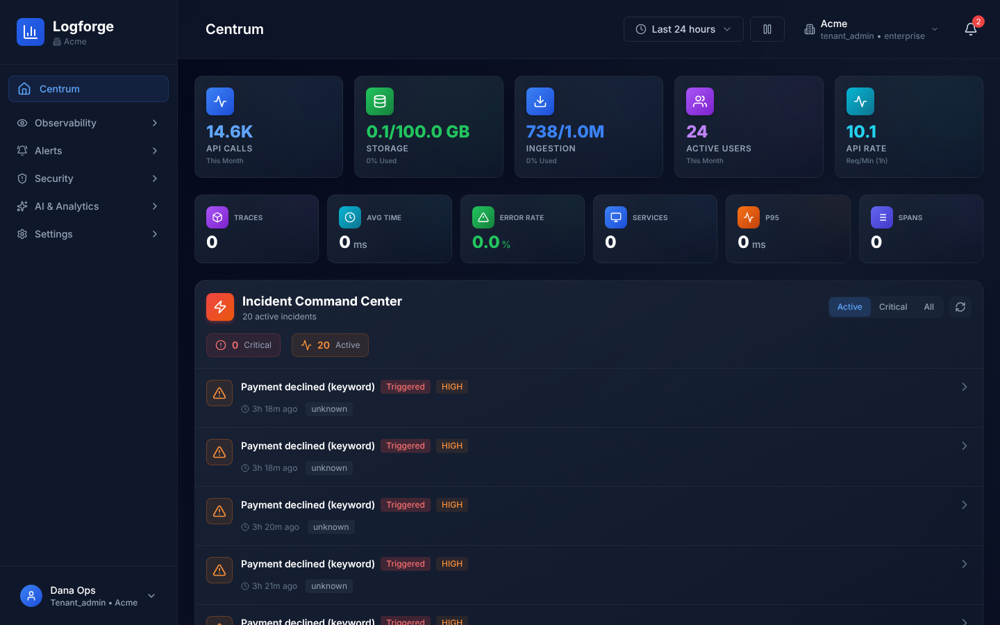
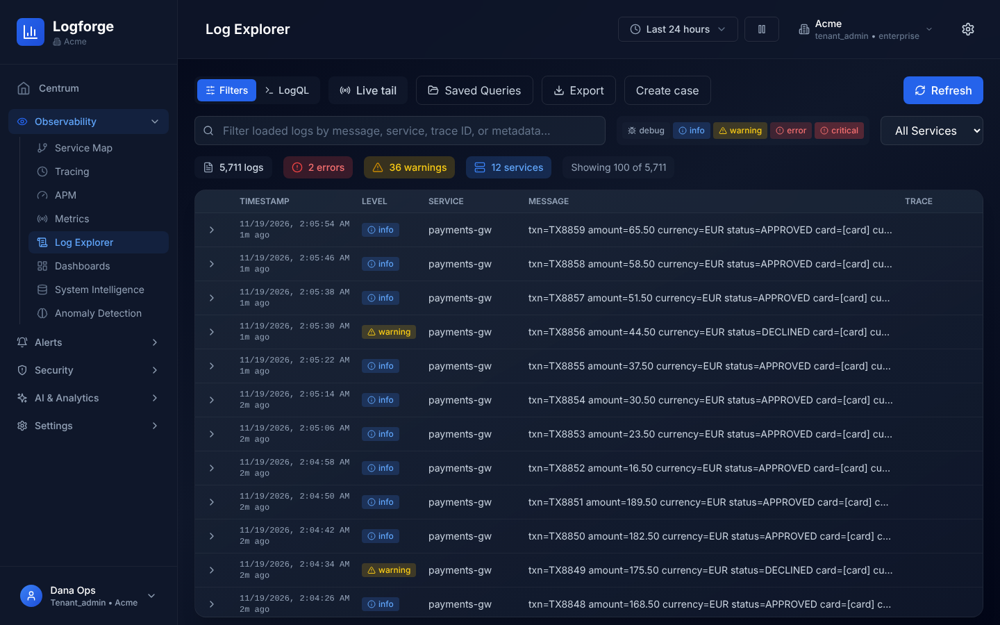
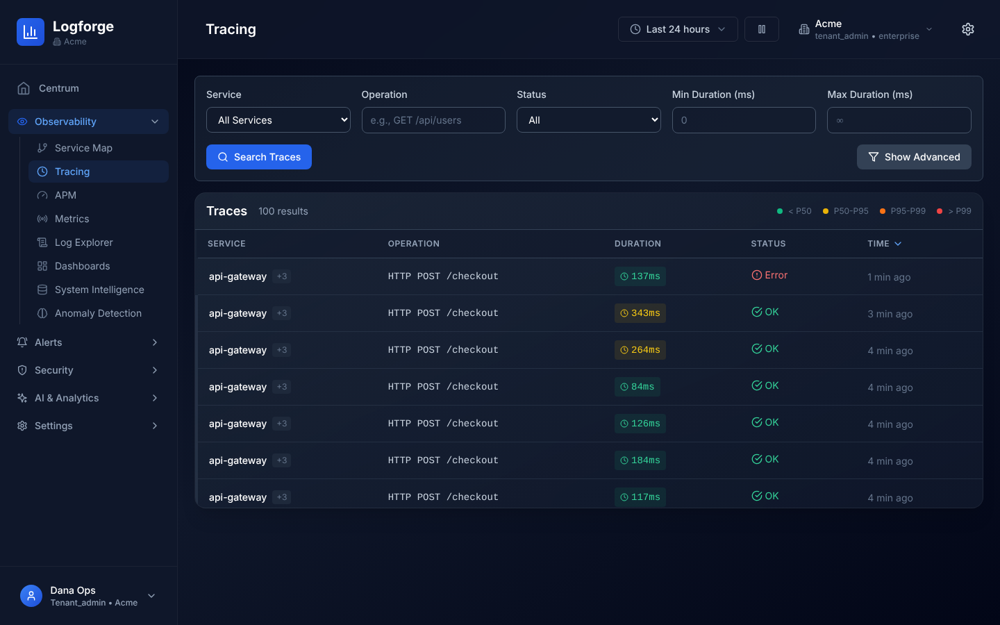
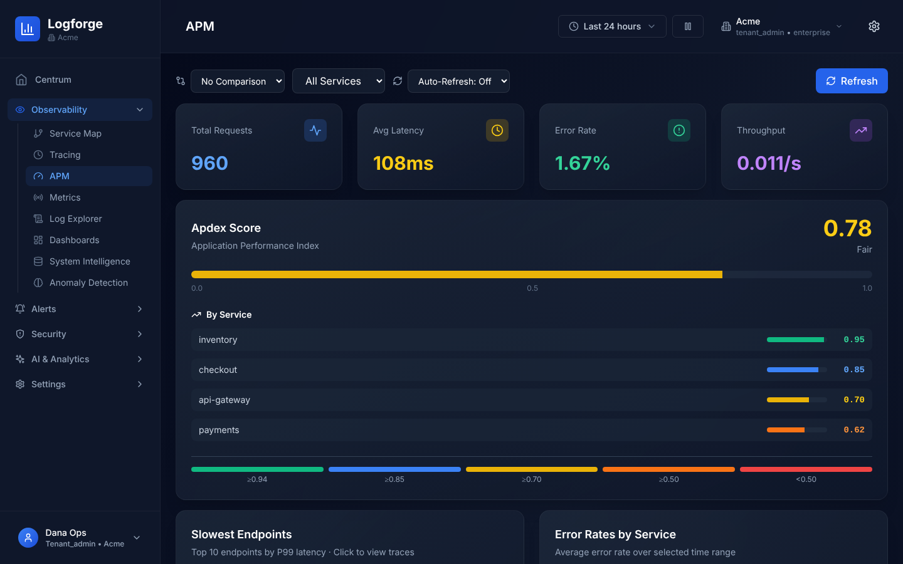
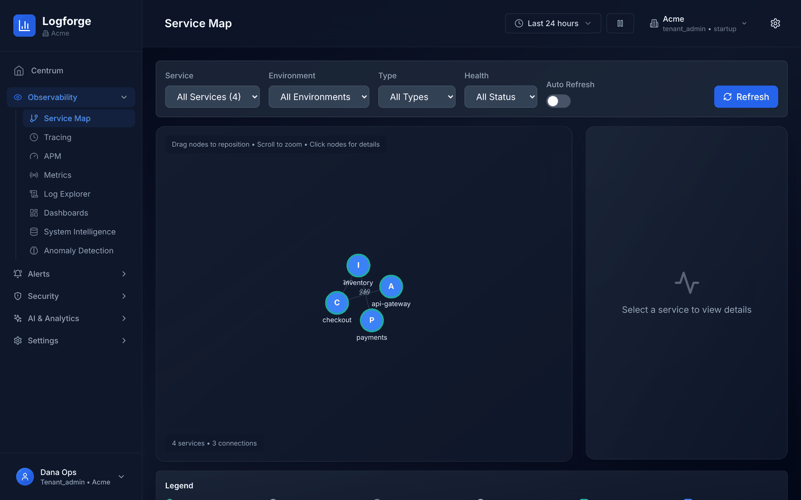
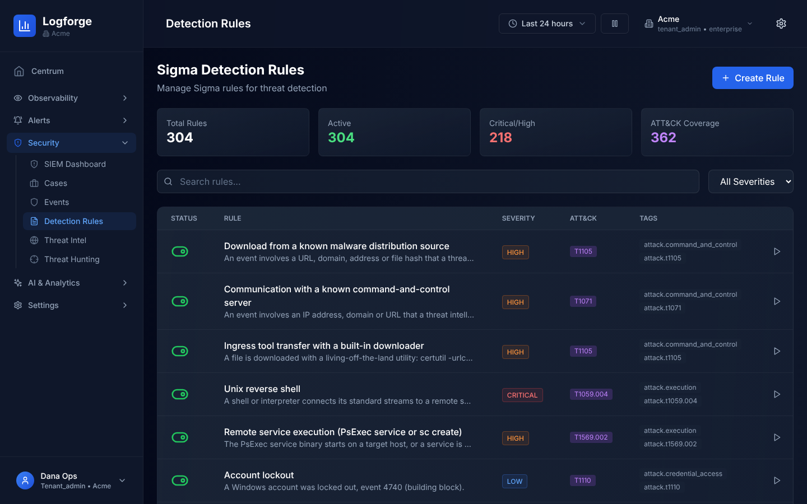
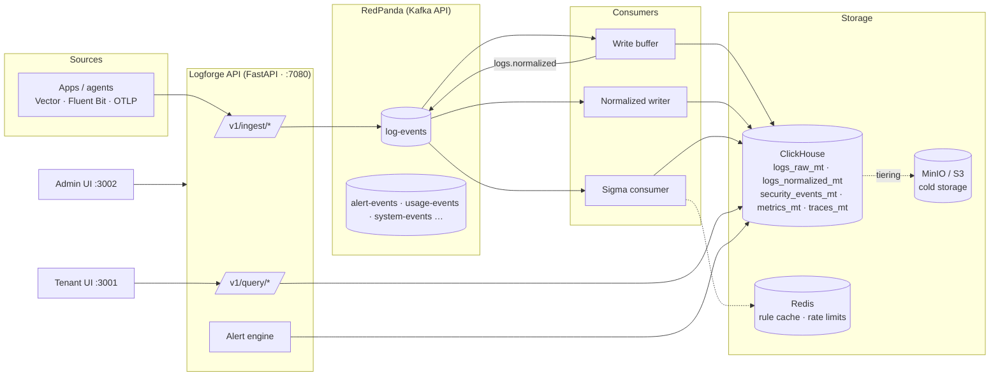

# Logforge

[](./LICENSE)
[](https://github.com/miteshpant/logforge/actions/workflows/ci.yml)
[](./docs/api/openapi.yaml)

**Logforge is an open-source, multi-tenant observability and SIEM platform.**
It ingests logs, metrics and traces, stores them in ClickHouse, lets you query
them with a pipe-style query language, raises alerts, and runs Sigma detection
rules (with MITRE ATT&CK tags) over incoming logs to produce security events.

> **Project status: early / alpha.** The ingestion, storage, query, alerting and
> detection paths are real and tested. Some UI screens and "AI" features are
> still demos. See [Feature status](#feature-status) for an honest breakdown,
> and [docs/ROADMAP.md](./docs/ROADMAP.md) for where help is needed.

## Screenshots

<sub>Captured from a fresh `./deploy.sh` during the [QA run](./docs/QA_REPORT.md), with a tenant seeded with an hour of synthetic logs, traces and metrics.</sub>

| | |
| --- | --- |
| **Centrum** (tenant overview)<br> | **Log Explorer**<br> |
| **Tracing**<br> | **APM** (latency, error rate, Apdex)<br> |
| **Service Map** (built from trace spans)<br> | **Sigma Detection Rules** (243 vendored SigmaHQ rules)<br> |

## Contents

- [Screenshots](#screenshots)
- [Feature status](#feature-status)
- [Architecture](#architecture)
- [Quick start](#quick-start)
- [Authentication](#authentication)
- [API reference](#api-reference)
- [Shipping logs](#shipping-logs)
- [Repository layout](#repository-layout)
- [Configuration](#configuration)
- [Development and testing](#development-and-testing)
- [Contributing](#contributing)
- [License](#license)

---

## Feature status

| Area | Status | Where |
| --- | --- | --- |
| Log ingestion: JSON, batch, OTLP, syslog, nginx, CEF, plain text | ✅ Implemented | `apps/api/routers/ingestion.py`, `parsers.py` |
| Back-pressure (bounded worker pool, `429` + `Retry-After`) | ✅ Implemented | `apps/api/ingest_pipeline.py` |
| Metrics and trace ingestion, APM, service map | ✅ Implemented | `apps/api/routers/observability_api.py` |
| Query: JSON DSL, aggregations, time series | ✅ Implemented | `apps/api/query_engine.py` |
| **LogforgeQL**, a pipe language (`timeout \| where service = "api" \| limit 50`) | ✅ Implemented | `apps/api/logql.py` |
| Alerting: threshold, pattern, anomaly and saved-search rules | ✅ Implemented | `apps/api/alert_engine.py` |
| Notifications: webhook, Slack, email, PagerDuty, Teams, Discord | ✅ Implemented (off by default) | `apps/api/services/notification_service.py` |
| Sigma detection engine, with 243 vendored SigmaHQ rules | ✅ Implemented | `apps/api/sigma_engine.py`, `apps/api/content/rules/` |
| Anomaly detection and forecasting (z-score / EWMA) | ✅ Implemented | `apps/api/services/anomaly_detector.py`, `predictive_analytics_service.py` |
| Multi-tenancy, roles, API keys, quotas, subscription tiers | ✅ Implemented | `tenant_api.py`, `authn_authz_middleware.py`, `config/pricing.yml` |
| Server-sent event streams (metrics, alerts, security, …) | ✅ Implemented | `apps/api/routers/streaming_api.py` |
| Live log tail (`/v1/stream/logs`) | ❌ Missing (the UI already calls it) | [ROADMAP](./docs/ROADMAP.md) |
| MITRE ATT&CK coverage endpoint | 🟡 Service exists, no route | [ROADMAP](./docs/ROADMAP.md) |
| Threat-intel enrichment | 🟡 IOC CRUD only, no feed clients | `apps/api/threat_intel.py` |
| Root-cause analysis | 🟡 Partly placeholder | `apps/api/services/rca_engine.py` |
| "AI" natural-language query and recommendations | 🧪 Keyword templates and canned output, no LLM | `apps/api/services/ai_service.py` |
| Billing | 🟡 Usage metering and invoices computed, no payment provider | `apps/api/routers/usage_api.py` |
| Tenant web UI (Next.js) | 🟡 Most screens are wired to the API; a few still show demo data | `apps/ui/` |
| Platform admin UI (Next.js) | 🟡 Tenants, users, usage and audit work; billing, features and support pages are placeholders | `apps/admin-ui/` |

---

## Architecture



**How a log travels through the system:**

1. A client sends `POST /v1/ingest/logs` (or `/batch`, `/otlp`, `/syslog`, …). The request is authenticated, parsed, validated and handed to a bounded worker pool.
2. The worker publishes the batch to the `log-events` topic and waits for delivery confirmation.
3. The log handler maps fields (`apps/api/config/field_mapping.yml`) and writes batches to `logs_raw_mt`. Writes it can't make go to a disk dead-letter queue.
4. A `logs.normalized` event fans out:
   - The **normalized writer** fills `logs_normalized_mt`.
   - The **Sigma consumer** evaluates the detection rules and writes matches to `security_events_mt`.
5. Queries, dashboards and alert rules read from ClickHouse. Every table is partitioned by tenant (`customer_id`).

For a full assessment (architecture, security posture, code quality and priorities), read [docs/CODE_ANALYSIS.md](./docs/CODE_ANALYSIS.md). A deeper architecture map is in [docs/ARCHITECTURE_MINDMAP.md](./docs/ARCHITECTURE_MINDMAP.md).

---

## Quick start

### Prerequisites

- Docker with Docker Compose v2
- About 4 GB of free RAM
- `curl` and `jq` for the examples below

### 1. Start the stack

```bash
git clone https://github.com/miteshpant/logforge.git
cd logforge
./deploy.sh
```

The first run compiles MinIO from its official source (`infra/docker/minio/`), which takes a couple of minutes. The upstream image is no longer published on Docker Hub.

| Service | URL / port | Notes |
| --- | --- | --- |
| API | http://localhost:7080 | Interactive docs at http://localhost:7080/docs |
| Tenant UI | http://localhost:3001 | |
| Admin UI | http://localhost:3002 | Platform administration; sign in as a platform admin |
| ClickHouse | http://localhost:8124 (HTTP), `9001` (native) | user `logforge` / `logforge123` |
| MinIO | http://localhost:9004 (console), `9003` (S3 API) | `minio` / `minio123` |
| RedPanda | `19092` (Kafka), `18081` (schema registry), `18082` (HTTP proxy) | |
| Redis | `6379` | |

> ⚠️ These default credentials are for local development only. See [SECURITY.md](./SECURITY.md) before you expose Logforge anywhere.

### 2. Create the first platform admin

```bash
# Get a one-time setup token. It is valid for 24 h, held in memory, and lost if the API restarts.
SETUP_TOKEN=$(curl -s -X POST http://localhost:7080/v1/auth/setup/init | jq -r .setup_token)

curl -s -X POST http://localhost:7080/v1/auth/setup \
  -H 'Content-Type: application/json' \
  -d "{\"setup_token\":\"$SETUP_TOKEN\",\"name\":\"Admin\",\"email\":\"admin@example.com\",\"password\":\"Change-Me-Now-123!\"}"
```

Passwords need at least 12 characters, with upper and lower case, a digit and a symbol.

### 3. Log in, create a tenant and send your first log

```bash
TOKEN=$(curl -s -X POST http://localhost:7080/v1/auth/login \
  -H 'Content-Type: application/json' \
  -d '{"email":"admin@example.com","password":"Change-Me-Now-123!"}' | jq -r .access_token)

# Platform admins act on the special "platform" scope
TENANT_ID=$(curl -s -X POST http://localhost:7080/v1/tenants \
  -H "Authorization: Bearer $TOKEN" -H 'X-Customer-ID: platform' \
  -H 'Content-Type: application/json' \
  -d '{"name":"Acme","type":"startup","primary_contact_name":"Ops","primary_contact_email":"ops@example.com"}' \
  | jq -r .tenant_id)

# Ingest a log into that tenant
curl -s -X POST http://localhost:7080/v1/ingest/logs \
  -H "Authorization: Bearer $TOKEN" -H "X-Customer-ID: $TENANT_ID" \
  -H 'Content-Type: application/json' \
  -d '{"service":"checkout","level":"error","msg":"payment declined","attrs":{"order_id":"42"}}'

# Query it back with LogforgeQL. A leading bare word is a full-text search on
# the message, so start with `where` to filter on fields only.
curl -s -X POST http://localhost:7080/v1/query/logql \
  -H "Authorization: Bearer $TOKEN" -H "X-Customer-ID: $TENANT_ID" \
  -H 'Content-Type: application/json' \
  -d '{"query":"where service = \"checkout\" and level = \"error\" | limit 10","since":"1h"}' | jq
```

### 4. Create a tenant user and open the UI

The tenant UI is for tenant users. A platform admin can't log into it, because there is no tenant called `platform`.

```bash
USER_ID=$(curl -s -X POST http://localhost:7080/v1/users \
  -H "Authorization: Bearer $TOKEN" -H 'X-Customer-ID: platform' \
  -H 'Content-Type: application/json' \
  -d '{"name":"Dana Ops","email":"dana@acme.example","password":"Acme-Demo-Pass-123!"}' | jq -r .id)

curl -s -X POST http://localhost:7080/v1/users/$USER_ID/roles \
  -H "Authorization: Bearer $TOKEN" -H 'X-Customer-ID: platform' \
  -H 'Content-Type: application/json' \
  -d "{\"tenant_id\":\"$TENANT_ID\",\"role\":\"tenant_admin\"}"

# New users start as "pending" and can't log in (403) until activated
curl -s -X PUT http://localhost:7080/v1/users/$USER_ID \
  -H "Authorization: Bearer $TOKEN" -H 'X-Customer-ID: platform' \
  -H 'Content-Type: application/json' -d '{"status":"active"}'
```

Open http://localhost:3001 and sign in as `dana@acme.example`.

New tenants start on the `startup` plan, which doesn't include batch ingestion (`/v1/ingest/logs/batch` returns `403 feature_not_subscribed`). A platform admin can change a tenant's plan with `PUT /v1/admin/tenants/{tenant_id}/subscription`.

**Useful commands:** `make logs`, `make down`, `make clean` (this also deletes volumes), `make health`.

---

## Authentication

Every request outside a small public set (`/health`, `/docs`, `/openapi.json`, `/v1/auth/login`, `/v1/auth/setup*`, …) needs `Authorization: Bearer <token>`.

| Token type | How to get it | Tenant selection |
| --- | --- | --- |
| **JWT** (contains `.`) | `POST /v1/auth/login` (refresh with `POST /v1/auth/refresh`) | **Required** `X-Customer-ID: <tenant_id>` header (`platform` for platform-wide admin calls). Server-sent event streams accept `?token=…&customer_id=…`. |
| **API key** (`lf_…`) | `POST /v1/enterprise/auth/api-keys` | Taken from the key, so no header is needed. Use this for log shippers. |

**Roles:**

- **Platform:** `super_admin`, `admin`, `support_admin`, `billing_admin`.
- **Tenant:** `tenant_admin`, `security_analyst`, `devops_engineer`, `compliance_officer`, `viewer`.

Each endpoint is mapped to a permission such as `logs:write:tenant` in `apps/api/authn_authz_middleware.py`.

---

## API reference

The API has **294 paths (339 operations)**. The OpenAPI 3.1 spec is generated from the code and committed in two equivalent forms:

- **[`docs/api/openapi.yaml`](./docs/api/openapi.yaml)** and **[`docs/api/openapi.json`](./docs/api/openapi.json)**. Import either into Postman, Insomnia or Swagger Editor, or generate a client with `openapi-generator`. GitHub displays these files as source rather than as rendered API docs.
- **Hosted reference:** once GitHub Pages is enabled, the [Publish API docs](./.github/workflows/pages.yml) workflow serves a Redoc rendering at `https://miteshpant.github.io/Logforge/` (with both spec files alongside it).
- **On a running stack:** Swagger UI at http://localhost:7080/docs and ReDoc at http://localhost:7080/redoc.

If you change an endpoint, regenerate both files. CI fails when either is stale:

```bash
pip install -r apps/api/requirements.txt
python scripts/export_openapi.py
```

---

## Shipping logs

Ready-made Vector and Fluent Bit configurations are in [`packages/shipper-recipes/`](./packages/shipper-recipes/). Point them at `/v1/ingest/logs/batch` and authenticate with an `lf_` API key. Batch ingestion needs a plan that includes the `ingestion.batch` feature; the default `startup` plan doesn't.

---

## Repository layout

```
apps/
  api/                FastAPI backend (Python 3.12)
    routers/          HTTP endpoints, one file per area
    services/ dao/    Business logic and ClickHouse access
    events/           Kafka publishers, consumers, handlers
    config/           Field mappings, topics (events.yml), pricing, quotas, MITRE catalogue
    content/rules/    Vendored SigmaHQ detection rules (DRL 1.1)
  ui/                 Tenant web UI (Next.js 14)
  admin-ui/           Platform admin UI (Next.js 14)
packages/
  rules/              Hand-written Sigma rules and content pack (currently used by tests only)
  shipper-recipes/    Vector and Fluent Bit configs
infra/docker/         compose.yml, ClickHouse schema (init_simple.sql) and migrations
config/               Storage deployment profiles (S3, GCS, MinIO, GovCloud)
docs/                 API spec, architecture map, roadmap, enhancement log
scripts/              Developer tooling (OpenAPI export)
tests/                pytest suites (tests/routes_tests needs live infrastructure)
```

The `*.py` scripts at the repository root (`simulate_tenant_logs.py`, `data_generator.py`, `test_*_flow.py`, …) are manual load and integration scripts that run against a live stack. pytest does not collect them. Configure them with the `LOGFORGE_*` variables listed in [CONTRIBUTING.md](./CONTRIBUTING.md).

---

## Configuration

These are the main environment variables for the API. In development none of them is required.

| Variable | Purpose |
| --- | --- |
| `ENVIRONMENT` | `development` (default). In `production`, `staging` and similar, startup **fails** if any of the next three are left at their weak defaults. |
| `JWT_SECRET` | Key used to sign JWTs. |
| `CLICKHOUSE_HOST` / `CLICKHOUSE_PORT` / `CLICKHOUSE_PASSWORD` | ClickHouse connection. Outside Docker use `localhost` / `8124`. |
| `MINIO_ACCESS_KEY` / `MINIO_SECRET_KEY` | Object storage credentials. |
| `LOGFORGE_SECRET_KEY` | Encrypts stored notification-channel credentials. |
| `LOGFORGE_NOTIFICATIONS_ENABLED` | Turns on automatic alert delivery (off by default). |
| `LOGFORGE_MAX_QUERY_WINDOW_DAYS` | Widest query time range allowed (default 31). |
| `THREAT_INTEL_ENABLED` | Turns on IOC enrichment (off by default). |
| `QUOTA_RESET_*` | Quota reset schedule; see [`.env.quota.example`](./.env.quota.example). |

---

## Development and testing

```bash
# API: unit tests that need no infrastructure (the same set CI runs). Run from the repo root.
python -m venv .venv && . .venv/bin/activate
pip install -r apps/api/requirements.txt
pytest tests/ --ignore=tests/routes_tests

# API: route tests (need the Docker stack running)
pytest tests/routes_tests

# API with hot reload against the Docker infrastructure
cd apps/api && CLICKHOUSE_HOST=localhost CLICKHOUSE_PORT=8124 uvicorn main:app --reload --port 7080

# Tenant UI (deploy.sh serves a production build on :3001; for hot reload in
# Docker add the dev override:
#   docker compose -f infra/docker/compose.yml -f infra/docker/compose.dev.yml up -d)
cd apps/ui && npm install && npm run dev        # http://localhost:3000
cd apps/ui && npx playwright test               # E2E; needs a running API
# Against the compose stack, after `python scripts/bootstrap_demo.py`:
#   PLAYWRIGHT_BASE_URL=http://localhost:3001 npx playwright test --project=chromium tests/0[5-8]-*.spec.ts

# Admin UI
cd apps/admin-ui && npm install && npm run dev  # http://localhost:3002
```

CI ([`.github/workflows/ci.yml`](./.github/workflows/ci.yml)) runs on every pull request:

- API tests and the OpenAPI freshness check
- Route tests and Playwright end-to-end tests against the full Docker stack
- Ruff lint
- pip-audit, bandit and gitleaks
- Production builds of both UIs

---

## Contributing

Contributions are welcome! Here is the short version:

1. **Fork** the repo (or create a branch if you have write access). Branch off `main`.
2. Make your change, add tests, and regenerate the OpenAPI spec if you touched the API.
3. **Open a pull request against `main`.** `main` is protected: every change needs a passing CI run and an approving review from a maintainer, and nobody pushes to it directly.

Read [CONTRIBUTING.md](./CONTRIBUTING.md) for details, and see [docs/ROADMAP.md](./docs/ROADMAP.md) for concrete, scoped tasks, including good first issues. Please follow the [Code of Conduct](./CODE_OF_CONDUCT.md). Report security issues privately as described in [SECURITY.md](./SECURITY.md).

---

## License

Logforge is licensed under the [Apache License 2.0](./LICENSE).

The vendored SigmaHQ rules in `apps/api/content/rules/` remain under the [Detection Rule License 1.1](./apps/api/content/rules/LICENSE).
