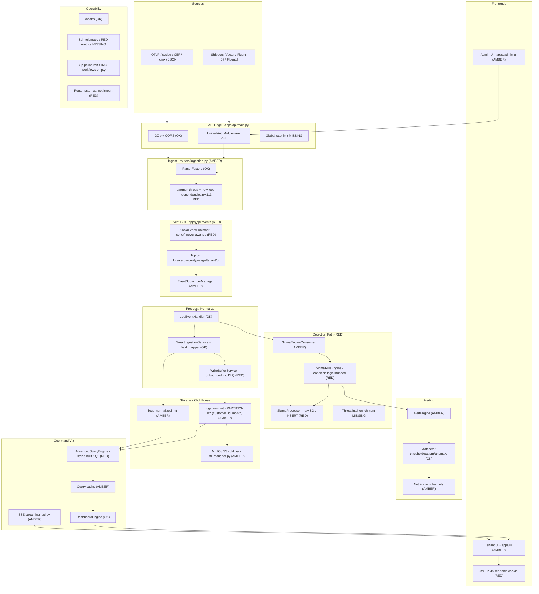

# Logforge — Architecture Mind Map & Health Assessment

> Living document. Generated from a source-level trace of the repository.
> Companion backlog: [`docs/ENHANCEMENTS.md`](./ENHANCEMENTS.md)
>
> Legend: ✅ solid · 🟠 risky / tech-debt · 🔴 fragile or broken · ⬜ missing

---

## 1. What Logforge is

A multi-tenant observability + SIEM platform:

| Layer | Technology | Entry point |
|---|---|---|
| API | FastAPI (Python 3.11/3.12), 26 routers | `apps/api/main.py` |
| Tenant UI | Next.js 14 + TypeScript + Tailwind | `apps/ui/app/` |
| Admin UI | Next.js 14 + TypeScript | `apps/admin-ui/src/app/` |
| Store | ClickHouse (columnar, `*_mt` multi-tenant tables) | `infra/docker/clickhouse/init_simple.sql` |
| Bus | RedPanda (Kafka API) via `aiokafka` | `apps/api/events/` |
| Cache | Redis (rule caches, sessions) | `apps/api/events/management/cache/` |
| Cold storage | MinIO / S3 / GCS / Azure | `apps/api/storage_config.py` |

Scale of the Python surface: ~84k LOC across `apps/api`.

---

## 2. Subsystem map



---

## 3. Data path, traced end to end

1. **Ingest** — `POST /v1/ingest/*` (`routers/ingestion.py`). 15 endpoints covering
   JSON, batch, bulk, OTLP, syslog, CEF, nginx, plain text, and auto-detect.
   Parsing is synchronous in the request thread; everything else is deferred.
2. **Hand-off** — `dependencies.py:113 process_logs_and_tracking_background()`
   spawns a **daemon thread** with a **fresh event loop and a fresh ClickHouse
   client per batch**. 🔴 No pooling, no back-pressure, no bound on thread count.
3. **Publish** — `LogEventPublisher.publish_batch_ingested()` embeds the **entire
   log payload** in the Kafka event (`logs: [...]`), then
   `KafkaEventPublisher._publish_single()` calls `producer.send(...)` and
   **never awaits the returned future** (`publisher_manager.py:282`). 🔴 Delivery
   is unconfirmed; broker rejections are silently lost.
4. **Consume / normalize** — `LogEventHandler._handle_logs_batch_ingested()`
   runs `SmartIngestionService` (field mapping via `config/field_mapping.yml`),
   buffers raw rows into `WriteBufferService`, tracks usage, then republishes
   `logs.normalized`.
5. **Persist** — `WriteBufferService` batches per customer (100 rows / 100 ms)
   into `logs_raw_mt` / `logs_normalized_mt`. On failure it pushes rows **back
   into the same in-memory buffer** with no cap and no DLQ. 🔴
6. **Detect** — `SigmaEngineConsumer` consumes `logs.normalized`, checks the
   security subscription, and evaluates Sigma rules from the Redis cache.
7. **Alert** — `AlertEngine` + threshold / pattern / anomaly matchers produce
   alert instances and fire notification channels.
8. **Query** — `AdvancedQueryEngine` builds ClickHouse SQL by **string
   concatenation** and executes it; `/v1/logs` does the same inline. 🔴
9. **Visualize** — Next.js UIs poll REST and subscribe to SSE streams.

### Detection path specifically

```
source -> /v1/ingest -> Kafka log topic -> LogEventHandler -> SmartIngestionService
       -> logs.normalized -> SigmaEngineConsumer -> SigmaRuleEngine
       -> SigmaProcessor._insert_security_event() -> security_events_mt
       -> SecurityEventPublisher -> SSE / alert correlation
```

Weak links: `SigmaRuleEngine._evaluate_condition_logic()` does not implement
Sigma boolean grammar, and `SigmaProcessor._insert_security_event()` interpolates
attacker-influenced log content into SQL.

---

## 4. Health annotations

### ✅ Solid

- Parser coverage (`parsers.py`) — OTLP, syslog RFC3164/5424, CEF, nginx, text.
- Field normalization config-driven via `config/field_mapping.yml` + `otel_field_mapping.yml`.
- Layered structure: routers → services → DAO → `DatabaseLayer`.
- Write batching concept in `WriteBufferService` (right idea, needs bounds).
- Shipper recipes for Vector / Fluent Bit / Fluentd are real and usable.
- Multi-tenant `*_mt` tables consistently carry `customer_id` in the sort key.
- Cold-storage abstraction supports S3, GCS, Azure, MinIO with deployment profiles.

### 🟠 Risky / tech-debt

- ~40 module-level service singletons (`tenant_service.py:9`, `routers/*.py`)
  construct DB connections at **import time**.
- `PARTITION BY (customer_id, toYYYYMM(ts))` — partition count grows with tenant
  count; ClickHouse degrades past a few thousand parts.
- Query result cache keyed on the full query dict; no cardinality guard.
- SSE rate limiting is per-process, in-memory (`streaming_api.py:165`), so it
  does not hold across replicas.
- Duplicated/legacy modules: `apps/api/tenant_service.py` vs
  `apps/api/services/tenant_service.py`; `subscription_service.py` in both places.
- Quota reset scheduler is commented out in `dependencies.py:371-376`.
- `events/producer.py:158` builds a global producer at import and raises if
  `aiokafka` is absent.

### ✅ Fixed since the initial map (P0 band)

| Area | Was | Now |
|---|---|---|
| SQL injection — query filters | `query_engine.py:83-129` | Bound parameters + identifier allow-list (ENH-002) |
| SQL injection — log listing | `routers/query.py:388-403` | Bound parameters, limit capped (ENH-003) |
| SQL injection — security events | `sigma_processor.py:226-249` | Driver-bound insert (ENH-004) |
| Default JWT secret | `authn_authz_middleware.py:31` | Startup fails closed outside dev (ENH-005) |
| Kafka delivery unconfirmed | `publisher_manager.py:282` | Delivery future awaited (ENH-006) |
| Unbounded write buffer, no DLQ | `write_buffer_service.py:228-241` | Capped + disk DLQ + real retries (ENH-007) |
| Test suite cannot be collected | `tests/routes_tests/conftest.py:16` | 128 tests collectable (ENH-001) |

### ✅ Also fixed (P1 band, in progress)

| Area | Was | Now |
|---|---|---|
| Fail-open subscription check | `authn_authz_middleware.py:879-886` | Fails closed with 503 (ENH-008) |
| Dummy setup-token manager | `authn_authz_middleware.py:605-610` | Deleted; failures propagate (ENH-014) |
| Auth layer un-importable offline | `authn_authz_middleware.py:25`, `:513` | Lazy singletons; testable offline (ENH-008) |
| Stale `create_session()` test calls | `base_test.py:134` | Keyword args + AST guard (ENH-032) |

### ✅ Also fixed (P1 band)

| Area | Was | Now |
|---|---|---|
| Sigma condition grammar unimplemented | `sigma_engine.py:637-664` | Real parser; 5 measured FP/FN fixes (ENH-015) |
| Brute-force rule silently dead | `CountCondition.parse` | Standard Sigma aggregation parsed (ENH-036) |
| Routers pass raw dicts to `execute_query` | `routers/query.py:123`, `:180`, `:345` | Validated request builder (ENH-033) |
| Duplicate broken `dismiss_anomaly` route | `routers/ai_api.py:767` | Removed; working handler reachable (ENH-034) |
| No CI at all | `.github/workflows/` empty | 4-job pipeline; found 3 live bugs (ENH-011) |
| `NameError` in storage DAO + nginx parser | `storage_dao.py:500`, `parsers.py:162` | Fixed via lint gate (ENH-011) |

### ✅ Also fixed (P2/P3 band)

| Area | Was | Now |
|---|---|---|
| Unbounded thread spawn per batch | `dependencies.py:128-167` | Bounded worker pool (ENH-009) |
| `/anomalies/history` broken | `routers/ai_api.py:734` | Queries real DAO (ENH-035) |
| App un-importable offline | `tenant_service.py:9` | 340 routes import with no DB (ENH-010) |
| Quota scheduler disabled | `dependencies.py:351` | Re-enabled; registry gap fixed (ENH-030) |
| Module shadowed by package | `events/handlers.py` | Dead modules deleted (ENH-025) |
| SSE limits per-process | `streaming_api.py:165` | Redis-backed, shared (ENH-026) |
| Oversized Kafka messages | `log_publisher.py:75` | Byte-sized chunking (ENH-024) |
| Ingest accepted data it could not persist | `routers/ingestion.py` | 429 + `Retry-After` (ENH-029) |
| Data-exfil rule could never fire | `sigma_engine` matcher | Numeric comparisons (ENH-037) |
| No detection content validation | `packages/rules/` | 152-test quality gate (ENH-027) |
| 286 seeded rules were non-detections | 92 fired on every benign logon | Generator returns None; 6 curated rules added (ENH-038) |
| Detection breadth: 15 techniques | 271 techniques had no content | Content pack: **242/242 in-scope covered** (ENH-039) |

### ✅ Also fixed (previously blocked/deferred, completed on approval)

| Area | Was | Now |
|---|---|---|
| Two conflicting `security_events_mt` definitions | `init_simple.sql:636` vs `migrations/003:40` | Reconciled additively by migration 010; `init_simple.sql` is authoritative (ENH-021) |
| Detection inserts used non-existent columns | `sigma_processor.py` | Corrected to the live schema — every detection insert had been failing (ENH-021) |
| No migration runner | `compose.yml` mounted only `init_simple.sql` | Opt-in, checksummed, idempotent runner (ENH-021) |
| Partition count is O(tenants x months) | `init_simple.sql:200` | Repartition migration 011, **gated** behind `ALLOW_DESTRUCTIVE_MIGRATIONS` (ENH-020) |
| `msg` unindexed on `logs_raw_mt` | full scan on message search | `tokenbf_v1` index added in migration 011 (ENH-020) |
| No threat-intel enrichment | — | IOC matching wired into the detection path (ENH-022) |
| No text query language | JSON DSL only | LogforgeQL + `POST /v1/query/logql` (ENH-028) |

### 🔴 Remaining known weaknesses

| Area | Evidence | Ticket |
|---|---|---|
| JWT in JS-readable cookie; admin token in `localStorage` | `apps/ui/lib/api/client.ts`, `apps/admin-ui/src/lib/auth.ts:54` | ENH-018 (partial) |
| Setup tokens still process-local | `authn_authz_middleware.py` | ENH-021 (needs a schema addition) |
| Repartitioning not yet executed anywhere | migration 011 ships gated, by design | ENH-020 |
| Threat-intel feeds need a concrete HTTP client per provider | `threat_intel.py` `FeedSource` | ENH-022 |

### ✅ Delivered (was missing)

- **CI/CD** — 4-job pipeline in `.github/workflows/ci.yml` (ENH-011).
- **Rate limiting + body caps** — `request_limits.py` (ENH-012).
- **Login brute-force defence** — `login_throttle.py` (ENH-013).
- **Dead-letter queue for ingest** — `write_buffer_service.py` (ENH-007).
- **Self-observability** — `/metrics` + RED metrics in `self_metrics.py` (ENH-019).
- **Query scan/row/timeout limits** — `query_engine.py` (ENH-017).
- **Auth hot-path caching** — `auth_cache.py` (ENH-016).
- **Schema migration runner** — `schema_migrations.py`, opt-in (ENH-021).
- **Threat-intel enrichment** — `threat_intel.py`, opt-in (ENH-022).
- **Text query language** — `logql.py` + `/v1/query/logql` (ENH-028).
- **Tenant isolation test suite** — `test_tenant_isolation.py` (ENH-023).

### ⬜ Still missing

- Dead-letter queue for the **event bus** (the write path has one; publish
  failures are logged and dropped) — noted under ENH-006.
- Grafana dashboards and alert rules on the new metrics — noted under ENH-019.
- Internal distributed tracing (OTLP) — noted under ENH-019.
- Concrete HTTP feed clients for MISP/STIX/OTX — the ingestion framework and
  its tests exist; only the per-provider transport is outstanding (ENH-022).
- UI autocomplete for LogforgeQL — the language and endpoint ship; the frontend
  affordance does not (ENH-028).
- Load and chaos test suites — tenant isolation is now covered (ENH-023).

---

## 5. Competitive position (vs. Datadog / Splunk / Elastic / Grafana)

Updated 2026-08-13. "Was" is the state at the initial trace; "now" reflects the
completed tickets.

| Capability | Was | Now | Category leader | Remaining gap |
|---|---|---|---|---|
| Ingest throughput | Thread-per-batch, unbounded | Bounded worker pool + 429 back-pressure (ENH-009/029) | Horizontally sharded collectors | Medium |
| Delivery guarantee | Fire-and-forget, no DLQ | Acked writes + disk DLQ (ENH-006/007) | At-least-once with replay | Medium — event-bus DLQ still missing |
| Query language | JSON filter DSL | LogforgeQL text language (ENH-028) | SPL / KQL / LogQL | Small — no UI autocomplete |
| Query safety | String-built SQL, no cap | Bound params + scan/row/time caps (ENH-002/017) | Cost-guarded planners | Closed |
| Detection grammar | Partial Sigma subset | Full boolean grammar + quantifiers (ENH-015) | Full Sigma / correlation | Small — no cross-event correlation |
| MITRE coverage | 286 seeded rules that could not discriminate (92 fired on every logon) | **41 rules covering 242/242 in-scope techniques (100%)**, zero alerts on a 15-event benign corpus (ENH-027/038/039) | Curated content packs | Small — tuning depth, not breadth |
| Threat intel | None | IOC matching in detection path (ENH-022) | Native IOC feeds | Medium — needs provider clients |
| Self-observability | None | `/metrics` RED + pipeline gauges (ENH-019) | Full RED + tracing | Medium — no tracing/dashboards |
| Release safety | No CI, tests unrunnable | 4-job CI, 639 tests (ENH-001/011) | Gated pipelines | Small |
| Tenancy isolation | Untested app-layer filter | Bound predicate + 19-test suite (ENH-023) | Storage + policy enforcement | Medium |
| Schema management | Manual, conflicting definitions | Opt-in versioned runner (ENH-021) | Automated migrations | Small |

---

## 6. Change log

- **2026-08-12** — Initial map produced from source trace.
  ENH-001 (test suite bootstrap) completed; `Operability -> TESTS` moved
  🔴 → 🟠. Collection went from **0 tests / hard import error** to
  **19 collected, 0 errors**; full run is 15 passed / 4 failed. The map's
  🔴 marker is downgraded rather than cleared because endpoint coverage remains
  near zero and 4 tests still fail on pre-existing defects.
  Running the suite immediately surfaced two previously invisible defects, now
  tracked as **ENH-032** (stale `create_session()` calls in test helpers —
  a real signature mismatch) and **ENH-031** (dead `test_event_flow` scripts
  importing removed modules). This is the compounding value of ENH-001: with the
  harness working, latent defects become observable.

- **2026-08-13** — P0, P1, P2 and P3 bands executed. **36 tickets Done**
  (one gated), 1 Partial. Suite: **0 → 643 tests**, 639 passing; the 4 failures
  are `test_tenant_router` cases that require live infrastructure.

  Health annotations above were rewritten to match. The map's original 🔴 set is
  now largely cleared: SQL injection (3 sites), silent Kafka log loss, unbounded
  write buffer, published JWT default, fail-open entitlements, unimplemented
  Sigma grammar, thread-per-batch ingest and offline-untestable imports are all
  fixed and regression-tested.

  ENH-020/021/022/028 were initially held back as destructive or ambiguous and
  were completed after explicit approval, built with safety gates rather than
  safety by convention: the migration runner is opt-in and refuses destructive
  statements, the repartitioning migration renames instead of dropping, threat
  intel keeps network I/O behind an injectable boundary, and the query language
  compiles to the parameterised request model so it can never emit SQL.

  **The tests kept finding real bugs that were not in the original backlog** —
  ENH-034 through ENH-037, plus two schema defects. Most notable: 2 of the 4
  shipped detection rules could never fire, and every detection insert was
  writing columns that do not exist in the live table.

  Remaining risk is concentrated in **browser token storage** (ENH-018) and
  **detection tuning depth**, not in the pipeline or in detection breadth.

- **2026-08-13 (later)** — **ENH-038**: the detection-content gap was measured
  and found to be worse than "thin coverage". The 286 auto-generated MITRE rules
  had no discriminating power: 194 matched nothing, and 92 selected only
  `event_id in [4688,4624,4625,1]`. Measured directly, a **single benign logon
  fired 92 rules**, and real malicious PowerShell fired **the same 92**.

  Fixed in two parts: the generator now returns `None` rather than manufacturing
  a placeholder (so coverage reporting is honest), and **6 curated,
  fixture-tested rules** were written for credential dumping, log clearing,
  scheduled-task persistence, remote-execution lateral movement, ransomware
  shadow-copy deletion and AD reconnaissance.

  Coverage: **4 rules / 6 techniques → 10 rules / 15 techniques across 9
  tactics**, and **92 → 0** false positives on a benign event. New tests
  evaluate whole rules through their real `condition` (catching wrong filters)
  and assert an end-to-end attack chain is detected at every stage.

  271 techniques still lack content — now visible and reported rather than
  disguised. That is ongoing content work, correctly paced at a few well-tested
  rules at a time.

- **2026-08-15** — **ENH-039**: detection breadth closed. A curated content pack
  (`packages/rules/content_pack.yml`, 31 grouped rules) plus the 10 standalone
  rules now cover **242 of 242 in-scope ATT&CK techniques — 100%**.

  Rules are grouped by **observable** rather than one file per technique, because
  many techniques share one telemetry pattern; grouping keeps the logic in one
  place while still attributing every technique covered.

  The "100%" is stated against an explicit denominator: **44 techniques are
  declared out of scope** (mobile, needing on-device telemetry we do not ingest;
  and adversary-side reconnaissance/resource-development). Counting them as gaps
  would imply a shortfall no rule could close; dropping them silently would
  inflate the figure.

  The guard against recreating ENH-038's problem is a **15-event benign corpus**
  (explorer, chrome, `git commit`, `kubectl get pods`, a successful logon…) that
  **zero** rules may match. It immediately caught 11 selections broken by
  duplicate YAML keys — one had degraded to "any cmd.exe". Fixed by implementing
  the real Sigma **`|all` modifier** in the engine.

  Detection health: 🔴 → ✅. Remaining detection work is **tuning depth**
  (per-tenant suppression, fire-rate telemetry, analyst disposition), which
  requires production traffic to measure.
