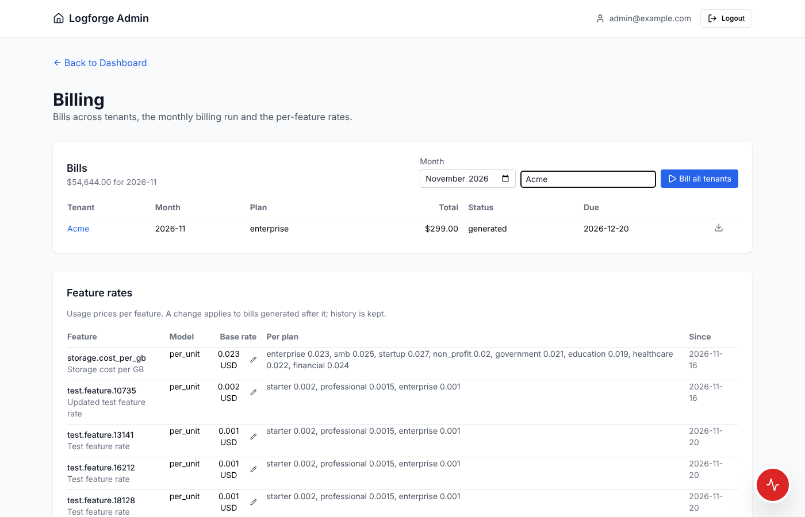
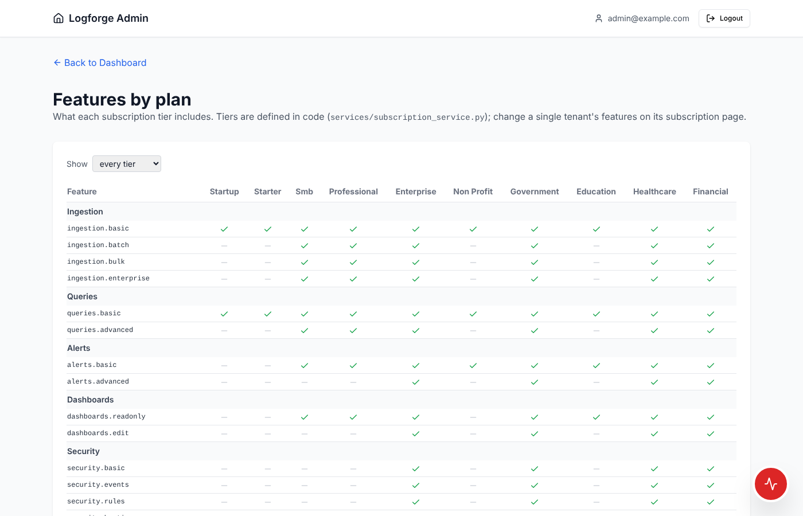
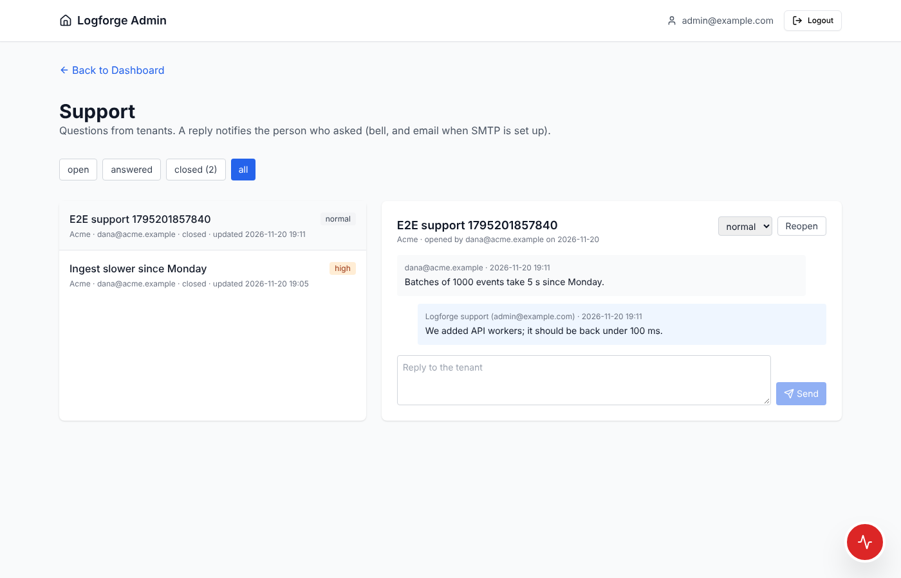
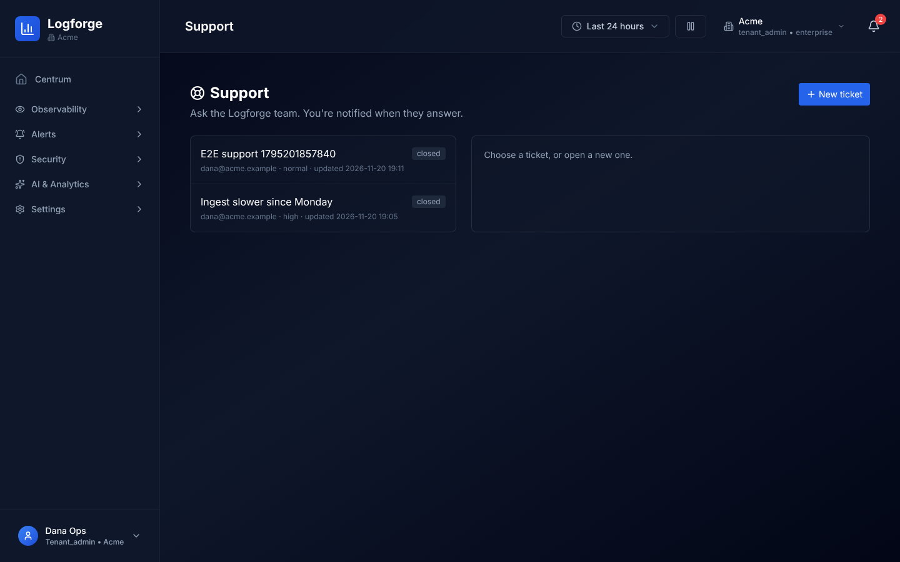

# Platform administration

The admin UI (`apps/admin-ui`, port 3002 in the compose stack) is for the
people who run a Logforge installation: platform admins, not tenant users.
Everything it calls is under `/v1/admin`, which needs the platform admin
role.

Its pages: tenants and their subscriptions, usage, admin users, and the
three below.

## Billing

- **Bills** for a month across every tenant, with each tenant's plan, total,
  status and due date, and the month's totals per currency. Each bill
  downloads as a PDF. `GET /v1/admin/billing/bills?period=YYYY-MM`,
  `GET /v1/admin/billing/bills/{id}/pdf`.
- **Bill all tenants** runs the month's billing on the server for every
  active tenant (`POST /v1/admin/billing/generate` with `billing_period`).
  It's idempotent: a tenant already billed for that month keeps its bill,
  so a run can be repeated after a failure. The result says how many bills
  were generated, how many already existed, and which tenants weren't
  billed and why (typically: no subscription). The Usage page's "Generate
  all bills" uses the same run; it used to bill only the tenants on its
  first page, from the browser.
- **Feature rates**: usage prices per feature, overall and per plan. Click
  a base rate to change it (`PUT /v1/admin/rates/{feature}`). A change
  applies to bills generated afterwards; the history is kept
  (`GET /v1/admin/rates/{feature}/history`).

A single tenant's bills are on its subscription page
(`/v1/tenants/{id}/billing/history`, `POST /v1/tenants/{id}/billing/generate`).

## Features by plan

Which features each subscription tier includes, with wildcards (`queries.*`,
`*`) resolved: `GET /v1/admin/features/matrix`. The tiers are defined in
code (`apps/api/services/subscription_service.py`), so this page shows them
rather than edits them; a single tenant's features are changed on its
subscription page.

## Support

Tenant members ask from **Contact support** in their profile menu (the
tenant UI's `/support` page): a subject, a description and a priority. Here,
platform admins see every tenant's tickets by status, reply, change the
priority, and close or reopen them.

- A reply from support marks the ticket *answered* and notifies the person
  who asked: under their bell and, with SMTP configured, by email.
- A reply from the tenant reopens it (*open*); either side can close it.
  A closed ticket takes no more replies from the tenant (they open a new
  one); support can still reply.
- Tickets are kept in `support_tickets_mt` (migration 042), the whole
  conversation on the ticket.

| | |
|---|---|
| `GET /v1/support/tickets` · `POST` | the tenant's tickets; open one (`subject`, `text`, `priority`) |
| `POST /v1/support/tickets/{id}/messages` · `/close` | reply, close (tenant members) |
| `GET /v1/admin/support/tickets?status=` | every tenant's tickets, with counts by status |
| `POST /v1/admin/support/tickets/{id}/messages` · `PUT /v1/admin/support/tickets/{id}` | reply; change `status` or `priority` |

Any member of a tenant can open and answer its tickets; other tenants'
tickets aren't visible to them.
