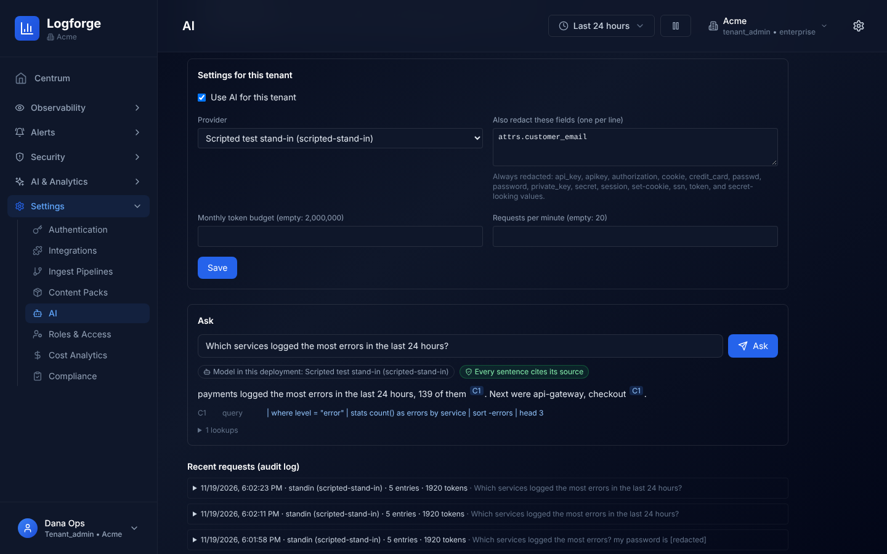

# AI

Logforge can answer questions about a tenant's own logs, alerts, cases and
threat intelligence with a language model, and **cites every source**.
AI is **off by default**: a deployment has to enable it and offer a
provider, and each tenant has to opt in. With AI off, questions get the
existing rule-based answer, as before.



<sub>The screenshot shows an answer from a scripted test stand-in running
in the deployment, not from a real model.</sub>

## Turning it on

1. **The deployment** lists the providers tenants may choose from in
   `apps/api/config/ai.yml` and sets `enabled: true`. API keys are never in
   the file; each provider names the environment variable that holds its
   key.

    ```yaml
    enabled: true
    providers:
      claude:
        kind: anthropic            # Claude, through the official SDK
        model: claude-opus-5-5
        api_key_env: ANTHROPIC_API_KEY
        label: Claude (Anthropic)
      gateway:
        kind: openai_compatible    # vLLM, LM Studio, LiteLLM, hosted gateways
        base_url: https://llm-gateway.internal/v1
        model: my-model
        api_key_env: LLM_GATEWAY_KEY
        external: false            # runs inside your network
      local:
        kind: ollama
        base_url: http://ollama:11434
        model: llama3.1
    ```

    `LOGFORGE_AI_ENABLED=false` switches AI off whatever the file says (the
    environment can't switch it on). `external` (true by default for hosted
    kinds) is shown to users with every answer. The Anthropic adapter turns
    on server-side refusal fallbacks by default (`fallbacks: false` turns
    them off) and takes an optional `effort`.

2. **A tenant admin** opens **Settings → AI**, ticks *Use AI for this
   tenant* and chooses a provider. The page warns when the provider is
   external.

Removing a provider from `ai.yml` turns AI off for the tenants that chose it.

## What happens when someone asks

```
question ──redact──▶ provider ──▶ "run_query(...)"         (tool call)
                                     │  runs as the person asking:
                                     │  their roles, their tenant
                                     ▼
            provider ◀──redact── result, each item tagged C1, C2 ...
                │
                ▼
answer "... [C1] ... [C2]"  ──▶ citations checked ──▶ shown with links and flags
every step ──▶ audit log (what was actually sent, after redaction)
```

* **Models see data only through read-only tools:** `run_query`
  (LogforgeQL, at most 50 rows), `get_alert`, `get_case` and
  `lookup_indicator`. Bulk logs are never handed to a model.
* **Each tool call is authorised like the HTTP request it stands for**
  (`run_query` as `POST /v1/query/logql`, the others as security reads),
  with the asking person's roles, in their tenant, using the middleware's
  own permission functions. A model can't read anything the person couldn't.
  A denied call goes back to the model as an error.
* **Citations:** every item a tool returns gets an id. The model has to put
  the ids after the sentences that use them; each id links to the event,
  alert, case, indicator or query it names. Answers with uncited sentences,
  citations no tool issued, or no citations at all are **flagged** and not
  marked as grounded.
* **Prompt injection:** log lines can contain text written by an attacker.
  The system prompt tells the model to treat tool results as data, and the
  tools can only read, as the person asking. An injected instruction can
  still distort an answer, which is why answers carry their sources.

## Data controls

* **Redaction** happens before anything leaves for a provider: the question
  and every tool result.
  * **Field names:** `password`, `token`, `authorization`, `cookie`,
    `api_key`, `ssn` and others from `ai.yml`, plus fields a tenant adds.
    Matches are case-insensitive, also as a suffix (`db_password`), or as a
    dotted path (`attrs.customer_email`).
  * **Secret-looking values anywhere in text:** `password=...` and
    "password is ..." pairs, bearer tokens, private keys, JWTs, and AWS,
    GitHub, Slack and `sk-` keys.
* **Opt-in per tenant** and a **global switch**, both checked on every
  request.
* **Visible indicator:** every answer says *External model: ...*,
  *Model in this deployment: ...* or *No model: rule-based answer*.

## Audit and cost

* **Audit log:** every prompt, response, tool call, tool result and error
  is written to `ai_audit_mt`, exactly as sent to the provider (after
  redaction), with the user, provider, model and token counts. Rows are
  kept for `audit_retention_days` (90 by default). Tenant admins read it
  under **Settings → AI** or at `GET /v1/ai/audit`.
* **Budgets:**
  * **Monthly token budget:** checked before a request and before every
    model call within it.
  * **Requests-per-minute limit:** a tenant admin can lower both, never
    raise them.
  * **Over a limit:** the request gets HTTP 429.
  * **Per request:** at most `max_tool_calls` lookups and `max_tokens`
    tokens per reply; tool results are capped at 50 rows and 30,000
    characters.

## Evaluation

Each AI feature is scored against a dataset by the harness in
`tests/eval/ai` ([README](https://github.com/miteshpant/Logforge/blob/main/tests/eval/ai/README.md)).
In CI the features run from recordings of a real model, so there is no
network access and no cost; a feature that scores below its baseline fails
the build. **No recordings are committed yet** (recording needs a model API
key), so the gate currently reports both features as skipped.

## API

| Call | Permission | Does |
|---|---|---|
| `GET /v1/ai/status` | `ai:read` | whether AI is on for the tenant, why not, the provider, `external` |
| `POST /v1/ai/ask` | `ai:read` | a grounded answer (`mode: ai`) or the rule-based one (`mode: rule_based`) |
| `GET /v1/ai/usage` | `ai:read` | tokens and requests this month, the limits |
| `GET /v1/ai/settings` / `PUT` | `settings:read` / `settings:write` (tenant admin) | opt in or out, provider, redacted fields, lower limits |
| `GET /v1/ai/audit` | `settings:read` (tenant admin) | the audit log, optionally for one `request_id` |

Tenant admins, security analysts and DevOps engineers have `ai:read`.

## Security review

The review of data flow and tenant isolation is recorded in the
[platform roadmap](PLATFORM_ROADMAP.md) (Phase 8).
