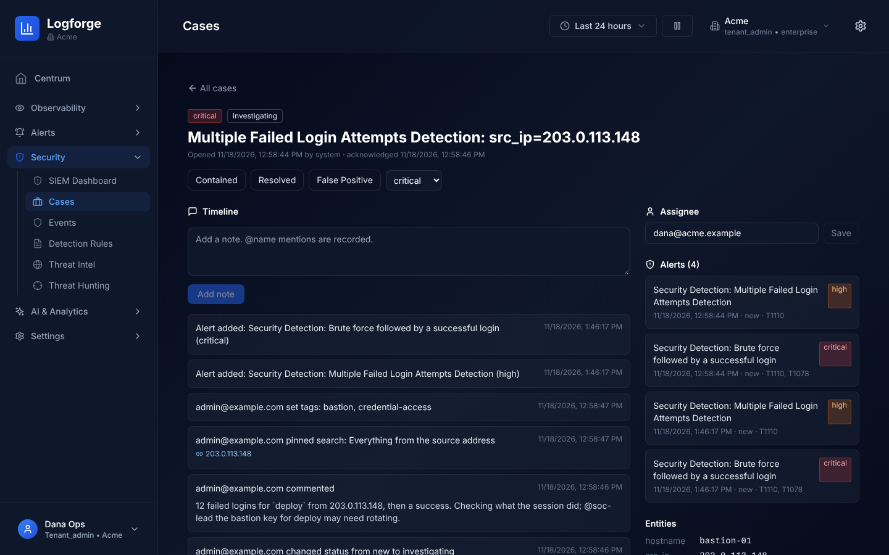

# Cases

A case is an investigation: the alerts about one attacker or one machine,
the analyst working them, what they found, and how it ended. Cases live
under **Security → Cases** in the UI and `/v1/security/cases` in the API,
with the same permissions as the rest of the security API.



## Alerts open cases on their own

Every detection is routed into a case as it is stored:

* it joins the **open case for the same entity** that had an alert in the
  last 24 hours, or opens a new one;
* the entity is the **source IP**, else the **host**, else the **user**,
  taken from the correlation group when the alert comes from a
  correlation rule, otherwise from the event;
* a **low**-severity alert joins an existing case but doesn't open one.

On the evaluation corpus (24 attack scenarios replayed together), grouping
turns 64 alerts into 14 cases, **78% fewer items to triage** and 4.6 alerts
per case. Every scenario lands in one case except lateral movement, which
spans two hosts (entity grouping doesn't link a source host to a
destination host).

| Setting | Default | |
|---|---|---|
| `CASE_GROUPING` | `on` | `off` disables automatic cases |
| `CASE_GROUPING_WINDOW_HOURS` | `24` | how recent the open case's last alert must be |
| `CASE_AUTO_MIN_SEVERITY` | `medium` | alerts below this don't open cases |

## Workflow

```
new → investigating → contained → resolved | false positive
          ↑___________________________________|  (reopen)
```

* **Closing needs a reason.** It is set on the case's alerts as their
  verdict: closing as *false positive* marks them false positive, which is
  what the [tuning suggestion](detection-as-code.md#related) learns from;
  *resolved* resolves them.
* **Acknowledged** is the first move out of *new* or the first assignment.
* Analysts can **assign**, add **notes** (`@name` mentions are recorded on the
  note; they are not delivered as notifications yet), **tag**, change
  **severity**, **pin evidence** (a log search, an event, a trace, a log
  line, a link), **attach alerts**, **merge** cases (the others close as
  merged) and **split** alerts into a new case. The case list has bulk
  assign and status.
* A case can be opened by hand from an alert (**Events → Create case from
  this alert**) or from a search (**Log Explorer → Create case**, which pins
  the search as evidence).

## Timeline and audit

Every change is an event on the case's timeline: who, what, when. The
timeline is append-only and doubles as the audit trail:

```
GET /v1/security/cases/audit/export?start=2026-11-01T00:00:00Z&end=2026-12-01T00:00:00Z&format=csv
```

## SLA and SOC overview

`GET /v1/security/cases/metrics?days=30` (the strip at the top of the Cases
page) reports, per severity, mean and median time to acknowledge and to
resolve, SLA breaches, open cases by status and age, open cases per
analyst, and alerts per case. Targets:

| Severity | Acknowledge | Resolve |
|---|---|---|
| critical | 15 min | 4 h |
| high | 1 h | 24 h |
| medium | 4 h | 3 days |
| low | 24 h | 7 days |

## API

| | |
|---|---|
| `GET /v1/security/cases` | list: `status` (repeatable), `assignee`, `severity`, `q`, `limit`, `offset` |
| `POST /v1/security/cases` | create: `title`, `severity`, `alert_ids`, `evidence`, `tags`, `assignee` |
| `GET /v1/security/cases/{id}` | case, alerts and timeline |
| `PATCH /v1/security/cases/{id}` | title, description, severity |
| `POST /v1/security/cases/{id}/assign` · `/comments` · `/status` · `/tags` · `/evidence` · `/alerts` · `/merge` · `/split` | analyst actions |
| `POST /v1/security/cases/bulk` | assign, status or tags for many cases |
| `GET /v1/security/cases/metrics` | SLA and overview |
| `GET /v1/security/cases/audit/export` | audit trail, JSON or CSV |

Full schemas are in the [API reference](https://miteshpant.github.io/Logforge/api/).
