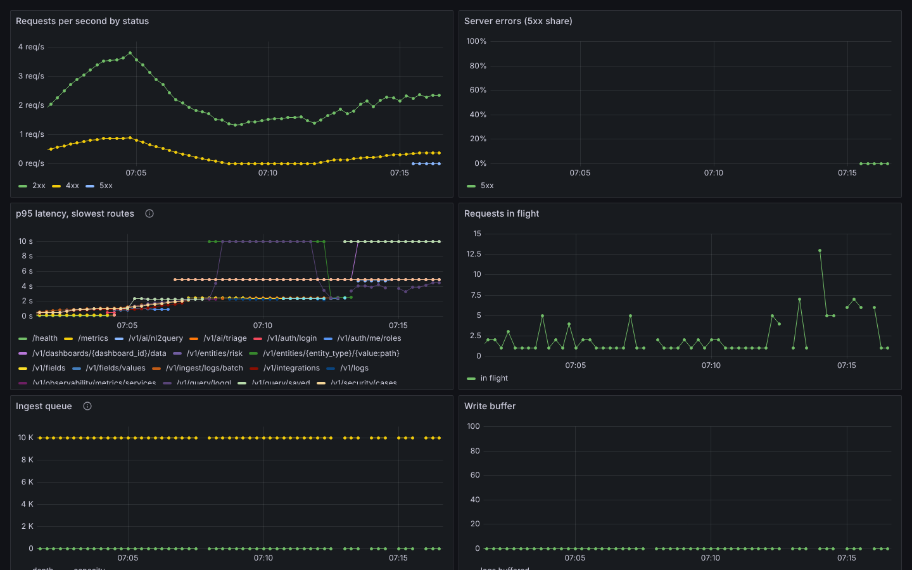

# Deployment, scale-out and backups

Three ways to run Logforge:

| | For | How |
|---|---|---|
| Single node | development, small installs | `infra/docker/compose.yml` |
| Highly available, on one host | trying failover, the chaos test | `infra/docker/ha/compose.ha.yml` |
| Kubernetes | production | the Helm chart in `deploy/helm/logforge`, with ClickHouse, Keeper, Redpanda and object storage from their own operators or charts |

## What survives what

| Component | Replicated how | Losing one |
|---|---|---|
| API | stateless replicas behind a load balancer | in-flight requests fail and are retried; nothing acknowledged is lost |
| ClickHouse | `Replicated*MergeTree` tables in a `Replicated` database, coordinated by Keeper | queries and writes go to another replica; it catches up when back |
| Keeper | three nodes (Raft) | the other two keep a quorum |
| Redpanda | topics with replication factor 3 on three brokers | the partition leaders move |
| Object storage | the provider's (S3: across zones) | |

**Nothing acknowledged is lost when an API replica dies:**

1. `POST /v1/ingest/logs/batch` answers only after Redpanda has
   acknowledged the batch (`acks=all`). If it can't, it returns 503 and
   the shipper retries.
2. The ingest consumer commits a batch's offset only once the batch is
   written to ClickHouse. It retries a failing write for up to two minutes
   (a ClickHouse replica failing over takes seconds).
3. Batches a dead replica had read but not written are delivered again to
   another replica.

Delivery is at least once, so a batch can be stored twice after a
failure. The chaos test counts these duplicates.

## The HA compose

```bash
docker compose -f infra/docker/ha/compose.ha.yml -p logforge-ha up -d --build
```

```bash
LOGFORGE_API_URL=http://localhost:7180 python scripts/bootstrap_demo.py
```

```bash
python scripts/chaos_test.py
```

What it runs:

- **Keeper:** one node; production runs three.
- **ClickHouse:** two replicas, ch1 and ch2.
- **Redpanda, Redis.**
- **API:** two replicas.
- **HAProxy:** the API on :7180 and ClickHouse on :8180.

HAProxy sends every ClickHouse query to ch1 while it is up, and to ch2
only when ch1 is down. Replication is asynchronous, so round-robin reads
could miss a write made a moment earlier on the other replica. That
happened in testing: platform setup failed when the setup token written
through one replica was read through the other.

The init container creates the `Replicated` database on both replicas,
then applies the schema and migrations once
(`infra/docker/clickhouse/apply_schema.sh` with `REPLICATED_ENGINES=true`).

ClickHouse 23.8 needs one setting for this (`ha/profile.xml`):
`allow_experimental_database_replicated`. The `Replicated` database engine
is marked experimental in 23.8, and production-ready in later releases.
(API mutations bind their timestamps as parameters rather than calling
`now()`, so replicas apply identical values and
`allow_nondeterministic_mutations` isn't needed; a unit test keeps it so.)

23.8 also doesn't turn `MergeTree` into replicated tables by itself, so
`REPLICATED_ENGINES=true` creates every MergeTree-family table as its
`Replicated*` engine. Without that, DDL replicates but data doesn't (the
first try showed exactly that).

### Chaos test

`scripts/chaos_test.py`:

- **Load:** a loader sends numbered batches through HAProxy, retrying a
  failed batch the way a shipper does; a reader runs a query every second.
- **Faults:** the test kills ClickHouse replica ch1 (SIGKILL) and starts it
  again, then does the same to API replica api1.
- **Checks:** every acknowledged event is stored on both replicas, and
  there is no stretch over 10 s without a successful write and a
  successful read.

Results are in [Phase 12 results](#phase-12-results).

## Kubernetes (Helm)

```bash
helm install logforge deploy/helm/logforge \
  --set secrets.jwtSecret=$(openssl rand -hex 32) \
  --set secrets.clickhousePassword=... --set secrets.s3AccessKey=... --set secrets.s3SecretKey=... \
  --set clickhouse.host=clickhouse-logforge --set redpanda.brokers=redpanda:9092 \
  --set objectStorage.endpoint=https://s3.us-east-1.amazonaws.com
```

The chart deploys:

- the API: two replicas spread across nodes, a disruption budget keeping
  at least one, rolling updates that never go below the replica count,
  and an optional autoscaler;
- the UI;
- the schema migrations: a pre-install/pre-upgrade hook, using the image
  from `infra/docker/clickhouse/Dockerfile.migrations`;
- the hourly retention CronJob: one runner per cluster, so the API
  replicas don't run it;
- the daily backup CronJob.

It doesn't deploy ClickHouse, Keeper, Redpanda, Redis or object storage;
it takes their addresses. ClickHouse needs:

- the storage policy and the `logforge_archive` and `logforge_backups`
  named collections from
  `infra/docker/clickhouse/config.d/s3_storage.xml`, with credentials from
  the server's environment;
- `named_collection_control` for the Logforge user
  (`infra/docker/clickhouse/users.d/archive_access.xml`);
- a cluster named `logforge` (`remote_servers`), the `{shard}` and
  `{replica}` macros, and Keeper (`infra/docker/ha/clickhouse-node.xml`
  shows all three);
- the two settings in `infra/docker/ha/profile.xml`.

`helm lint` and the rendered manifests are checked in CI
(`tests/test_helm_chart.py`).

## Backups

`python -m backup create` backs up the whole ClickHouse database with
ClickHouse's own `BACKUP`, to `<bucket>/<name>/` in object storage, through
the `logforge_backups` named collection. That covers data and every piece
of tenant configuration: users, roles, rules, pipelines, searches,
dashboards, packs, retention, cases and AI settings.

```bash
python -m backup create
```

```bash
python -m backup create --base logforge-20261120-024100
```

```bash
python -m backup list
```

```bash
python -m backup restore logforge-20261120-024100 --as logforge_check
```

```bash
python -m backup verify logforge-20261120-024100 --database logforge_check
```

- `--base` makes an incremental backup on top of an earlier one.
- Restoring into a new database first lets you inspect it.
- `verify` compares each table's rows with the manifest taken at backup
  time. Replacing, Summing and Aggregating tables are counted with
  `FINAL`: their raw rows shrink after a restore with nothing lost.

A restored database's materialized views still read from the database
they were defined on, so drop an inspection copy when done.

CI backs up the whole database, restores it into a new database and
verifies every table. Locally, the 105 M-row database (3.1 GiB, mostly on
the warm tier) backed up in 20 s and restored in 51 s, with every table
verified.

An `s3_plain` backup disk was tried first. Its restores failed on the
tiered logs table (ATTEMPT_TO_READ_AFTER_EOF on 23.8), and a regular `s3`
disk keeps the backup's file names on the server's local disk, so a lost
server's backups couldn't be restored.

## Phase 12 results

### Chaos test

13 runs after the first durability fix (`docs/benchmarks/2026-11-20-chaos-runs.json`):

- **Before the fixes:** two runs lost 40 and 20 acknowledged events when
  the API replica was killed.
- **What fixed it:** each loss was traced and fixed in turn: the
  consumer's offset commits, the endpoint answering before Kafka had the
  batch, and the producer's batch buffer (which lost 100 events in run 2).
- **With all three fixes (runs 4–13):** no acknowledged event lost.
- **Latest run (13):**
  - 4,780 events acknowledged, all stored on both replicas, plus 60
    duplicates;
  - longest gap without a successful write 4.4 s, without a successful
    read 5.0 s.

The gaps stayed under the 10 s target in every run but two:

- run 4 had a 52 s outage, while another heavy test shared the 4-vCPU
  host;
- run 9 went to 10.6 s with slower health checks, which were reverted.

### Ingest throughput

`tests/bench/ingest_bench.py`: 8 shippers sending 500-event batches for
60 s, through HAProxy, to two API replicas.

| | Events/s | Failed requests |
|---|---|---|
| Accepted | 731 | 0 |
| Stored in both ClickHouse replicas | 686 | |

That is about 343 events/s per API replica, on one 4-vCPU host that also
runs both ClickHouse replicas, Keeper and Redpanda. Dedicated nodes should
do better; this is the number measured.

The first run returned 503s for 11,092 requests. Under load an API
replica answered `/health` in over a second, the check's timeout, so
HAProxy marked both replicas down. Checks may now take 5 s.

### Reference architecture: 50 GB/day, a year of retention

`python scripts/reference_architecture.py`
(`docs/benchmarks/2026-11-20-reference-architecture.json`) uses the
measured sizes (297 B raw, 29 B in ClickHouse, 33 B in Parquet per
event), 30 days searchable (7 hot, 23 warm) and 365 days archived, two
ClickHouse replicas, and peak = 3 × average.

| | Size | Monthly |
|---|---|---|
| Events | 168 M a day (1,948/s average, 5,845/s peak) | |
| Hot, both replicas | 64 GiB on gp3 (100 GiB per node) | $16 |
| Warm, both replicas | 209 GiB on S3 | $5 |
| Cold Parquet | 1,733 GiB on S3-IA | $22 |
| Redpanda disks, S3 requests | | $23 |
| ClickHouse, 2 × 16 vCPU / 64 GiB | | $1,121 |
| Keeper, 3 × 2 vCPU | | $91 |
| Redpanda, 3 × 4 vCPU | | $420 |
| API, 18 replicas at 343 events/s each | | $1,261 |
| UI and jobs | | $70 |
| **Total** | | **$3,030 (≈ $36,400 a year)** |

**The target, $2,000 a month, set before measuring, is not met.**

- **Storage is cheap:** a year of retention costs $65 a month in storage.
- **Compute is the cost,** and ingest throughput per API replica most of
  all.
- **Prices:** on-demand AWS list prices (late 2026), assumptions rather
  than quotes; change `PRICES` in the script for yours.

## Self-monitoring

The API serves Prometheus metrics at `/metrics`. Set
`LOGFORGE_METRICS_TOKEN` and scrapers must send it as a bearer token. In
Prometheus that's `authorization: {credentials_file: /etc/prometheus/metrics-token}`
on the job. Without a token the endpoint is open: keep it on the internal
network. The compose stack has a `monitoring` profile with
Prometheus and Grafana:

```bash
docker compose -f infra/docker/compose.yml --profile monitoring up -d prometheus grafana
```

Grafana (port 3030, `admin` / `GRAFANA_ADMIN_PASSWORD`) has the "Logforge:
API and ingest" dashboard:

- request rate by status and the share of 5xx;
- p95 latency of the slowest routes, and requests in flight;
- the ingest queue against its capacity, and the write buffer;
- log loss: events the broker refused, logs dead-lettered or dropped at
  ingest. These should stay at 0.

Prometheus is on port 9091. Its scrape config is
`infra/docker/monitoring/prometheus.yml`.



OpenTelemetry tracing of Logforge itself isn't there yet.

