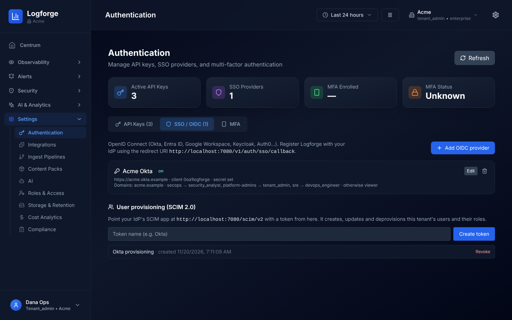
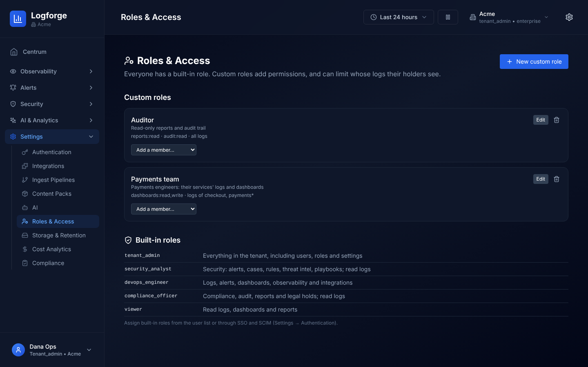

# Enterprise access

Single sign-on, user provisioning, custom roles that limit whose logs
someone sees, and the account emails (password reset, invitations, email
verification). Phase 14 of the [platform roadmap](PLATFORM_ROADMAP.md).

## Single sign-on (OpenID Connect)

Settings → Authentication → SSO, or `/v1/sso/providers` (`settings:write`).
Each tenant adds its IdP (Okta, Entra ID, Google Workspace, Keycloak,
Auth0…):

- **Registering Logforge with the IdP:** use the redirect URI
  `<API URL>/v1/auth/sso/callback`. Set `LOGFORGE_API_PUBLIC_URL` when the API
  is behind a proxy, and `LOGFORGE_PUBLIC_URL` to the UI's address.
- **What a provider stores:**
  - its issuer (https only);
  - its client ID and client secret (sealed, write-only);
  - its email domains (at least one);
  - a groups claim and a mapping from groups to tenant roles;
  - a role for anyone no group matches (or none: refuse them).

On the sign-in page, "Sign in with single sign-on" finds the provider from
the address's domain.

How a sign-in works:

1. **To the IdP.** The authorization code flow with PKCE. State, nonce and
   code verifier travel in a signed, ten-minute, HttpOnly cookie.
2. **Back from the IdP.** The code is exchanged for an ID token, which must:
   - be signed by a key in the IdP's JWKS, with a public-key algorithm
     (HS256 and `none` are refused);
   - name the IdP as issuer and Logforge as audience;
   - be unexpired and carry the nonce.
3. **The address.** It must be verified by the IdP (`email_verified`) and in
   one of the provider's domains.
4. **The account.** A new address gets one, active, with a password nobody
   knows. An existing account may only sign in through a tenant's IdP if all
   its roles are in that tenant. Otherwise one tenant's IdP could sign in as
   another tenant's user by asserting their address.
5. **The role.** The highest tenant role its groups map to, else the
   default. Platform roles can't be granted this way. The IdP stays the
   source of the role, so moving someone between groups changes their role
   at their next sign-in, both up and down.
6. **To the UI.** The session reaches the UI in the URL fragment
   (`/login/sso#…`), which browsers never send to a server, so it isn't in
   any access log.

If a sign-in is refused, the sign-in page says why.

SAML isn't supported yet.

## User provisioning (SCIM 2.0)

Settings → Authentication → User provisioning, or `/v1/scim/tokens`
(`settings:write`). Create a token for the IdP's SCIM app and point it at
`<API URL>/scim/v2`. The token is shown once and stored as a SHA-256 hash.

- **Endpoints:**
  - `/Users`: list (filters `userName`, `emails.value` or `externalId eq
    "…"`; `startIndex`, `count`), get, create, replace (`PUT`), `PATCH`,
    delete;
  - `/ServiceProviderConfig`, `/ResourceTypes` and `/Schemas`.
- **Tenant boundary:** a token sees and changes only users with a role in its
  tenant, and only their roles there. Creating an address that already exists
  is a `uniqueness` error, so a tenant can't take over another tenant's user.
- **Roles:** the SCIM `roles` attribute, tenant roles only; `viewer` when none
  is given.
- **`active: false`:** deactivates the account if this is its only tenant,
  else removes its roles here. Its sessions end either way.
- **Delete:** removes the roles here, deactivating the account if none are
  left anywhere, and ends its sessions.
- **`externalId`:** kept per tenant.

## Custom roles and data scopes

Settings → Roles & Access, or `/v1/roles/custom` (`roles:write`).

Everyone keeps a built-in role (`tenant_admin`, `security_analyst`,
`devops_engineer`, `compliance_officer`, `viewer`); sign-in needs one. A
custom role adds to it:

- **Permissions:** in the built-in roles' vocabulary, `resource:actions:tenant`
  (for example `dashboards:read,write:tenant`). A request is allowed if the
  built-in role or any custom role grants it.
- **A data scope:** the services whose logs its holders read, by name or by
  a prefix ending in `*` (`payments-*`).
  - A user with scoped roles reads only the union of those roles' services.
  - Roles without a scope don't widen it.
  - An empty scope reads no logs.

`/v1/auth/access` shows a user their custom roles, permissions and scope,
and their built-in role's grants (`role_permissions`). The UI uses it to
leave out what a role can't read: Centrum, the landing page, shows a viewer
the logs summary but not usage, alerts or security, instead of failing
requests.

How the scope is enforced:

- **In ClickHouse.** The middleware puts the scope on the request. Every
  ClickHouse query the request makes carries the `additional_table_filters`
  setting, so ClickHouse adds the filter to every read of these tables, in
  subqueries and joins too:
  - logs (`logs_raw_mt`, `logs_normalized_mt`, the hourly rollup), so search,
    LogforgeQL, dashboards, the field catalogue, entities and the AI tools;
  - traces and metrics (`traces_mt`, `metrics_mt`, the service topology), on
    their service name;
  - security events, on the service of the log that matched;
  - alert instances: none are shown, because an alert can summarise several
    services and doesn't record which.
- **Archive search** reads Parquet with the `s3()` table function, which
  table filters don't reach, so the read is wrapped in a subquery with the
  same service filter.
- **Escaping.** Service names are escaped literals; this is tested against
  ClickHouse with injection attempts.
- **Caches.** Cached query results are keyed by scope.
- **Failing closed.** If custom roles can't be read, the request fails (503)
  rather than run unscoped.

### Masked fields

A custom role can also mask fields (`email`, `password`, `attrs.card_number`).
For its holders:

- **Values read `[masked]`** in every JSON answer, at any depth: a log's
  `attrs` (also when stored as a JSON string), tabular query results (by column
  name), entities, cases, the field catalogue's examples.
- **AI answers** can't repeat them: the AI tools redact the masked fields
  before the model sees any data.
- **Requests that name a masked field are refused (403)**: a query could
  otherwise copy the value to another name (`| eval e = attrs.email`).
- **Streams and file downloads are refused (403)** (live tail, CSV and PDF
  exports, archive downloads): they can't be masked.

Names match on their last segment, case-insensitively: `attrs.email` masks
every `email` key. Values inside free text, such as a message that contains an
address, aren't masked; mask at ingest with a pipeline's `mask` processor for
that. `/v1/auth/access` lists the caller's masked fields.

What a scope doesn't cover yet:

- **Alerts** are hidden rather than filtered: alert rules would need to
  record the services behind each alert.
- **Security events** whose matched log has no service are hidden too.
- **Plain-English answers without AI** are refused under a scope (the
  rule-based fallback reads tables a scope can't fully cover).

## Two-step sign-in (TOTP)

Any user can turn it on from **Your account** (the profile menu → Profile
Settings, `/account`): scan or type the key into an authenticator app, confirm
with a code, and keep the eight one-time backup codes shown once. From then on
`POST /v1/auth/login` with the right password returns
`{"mfa_required": true, "mfa_token": "..."}` instead of a session, and
`POST /v1/auth/login/mfa` with that token (valid 5 minutes) and a code or a
backup code finishes the sign-in.

- Codes follow RFC 6238 (SHA-1, 6 digits, 30 s), accepted one step either side.
  A step can't be used twice, and each backup code works once.
- Wrong codes count toward the same sign-in throttle as wrong passwords.
- The secret is sealed with `LOGFORGE_SECRETS_KEY` like other stored secrets;
  backup codes are stored as SHA-256 hashes.
- Turning it off (`DELETE /v1/auth/mfa`) needs a current code or a backup code.
- `GET /v1/auth/mfa` reports whether it's on and how many backup codes remain.

Not yet: a tenant setting that requires it for everyone. OIDC sign-ins rely on
the identity provider's MFA.

## Account emails

Links point at `LOGFORGE_PUBLIC_URL` and are sent through the same SMTP
settings as the email integration (`LOGFORGE_SMTP_HOST`, `_PORT`, `_FROM`).
Without SMTP configured, the email isn't sent and a warning is logged. The API
answers the same either way, so a failure doesn't reveal whether an account
exists.

- **Password reset** (`/forgot-password`, then `/reset-password`):
  - the link works for an hour;
  - setting a new password ends every session of the account.
- **Invitations** (`/accept-invite`):
  - the link works for seven days;
  - accepting creates the account and grants the invited role, recorded as
    granted by the inviter.
- **Email verification** (`/verify-email`):
  - the token is signed and bound to the user, the address and an expiry of
    24 hours;
  - changing the address invalidates it;
  - the page needs the account's session, and the link survives signing in.
