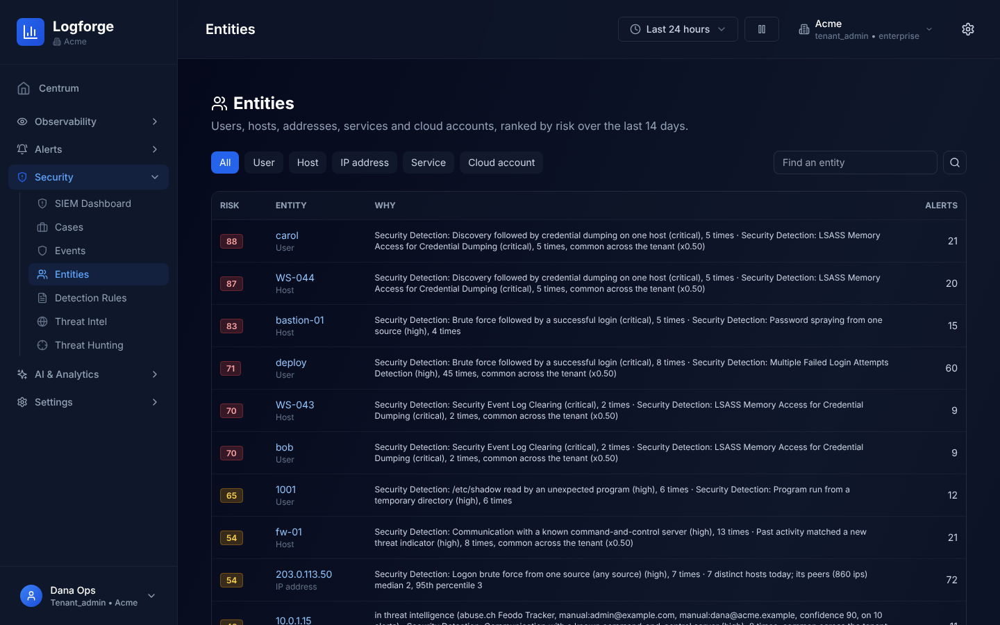
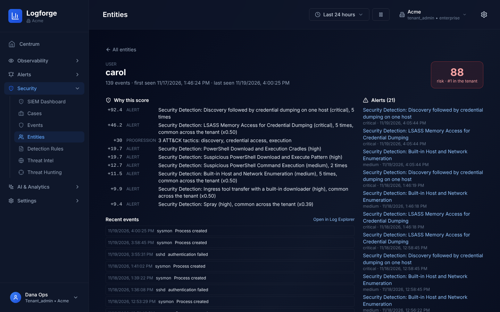
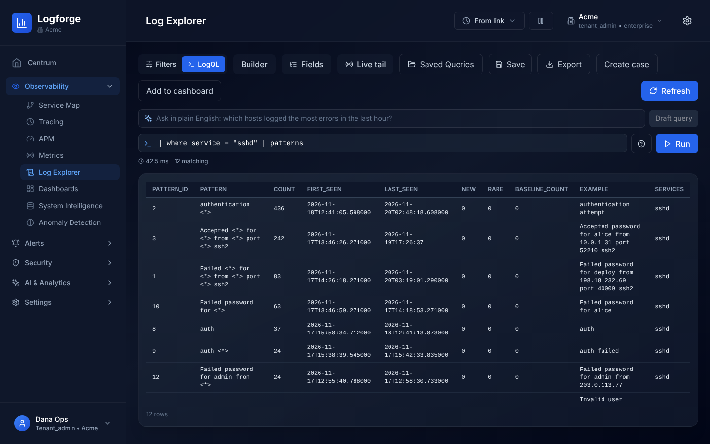

# Entities and behaviour analytics

Logforge keeps track of the **users, hosts, IP addresses, services and cloud
accounts** in your events, scores how risky each one is, learns what is
normal for it, and groups log lines into patterns. Security → **Entities**
shows them.



## Entities

Every event's user (`user_id`, or `attrs.user`), host (`host`, or
`attrs.hostname`), addresses (`src_ip`, `attrs.src_ip`, `attrs.dst_ip`),
service, and cloud account (CloudTrail `recipientAccountId`, or OCSF
`cloud.account.uid`) is an entity. ClickHouse keeps, as events arrive
(migration 026, materialized views over `logs_raw_mt`):

- each entity's **first and last seen** and its **event count**;
- which entities appear **together** in an event: a user on a host, an
  address reaching a host or signing in as a user, a service on a host.

The migration also fills them from the last 30 days of events already
stored.

## Risk

An entity's risk, 0 to 100, comes from the last 14 days:

| Factor | Points |
|---|---|
| Each alert naming it | low 5, medium 15, high 35, critical 60, halved every 3 days |
| Repeats of one rule | the k-th most recent counts 1/2^k, so a rule firing 300 times weighs at most twice its first alert |
| Rules common across the tenant | scaled by 1 / (1 + log2(n)), n = entities of that type the rule fired on: daily churn and a scanner sweeping hosts say little about any one of them |
| ATT&CK progression | among its rare alerts within 24 hours, 15 per tactic beyond the first, 20 more from an early stage (initial access, execution, credential access) to a late one (lateral movement, collection, command and control, exfiltration, impact) |
| Linked entities | entities named together in a rare alert (an attacker's address, the account it signed in as, the host) share the larger progression |
| Threat intelligence | up to 30, by the indicator's confidence (one hit per address) |
| Behaviour anomalies | low 5, medium 10, high 20 (below) |

The raw sum maps to 0–100 as `100 · (1 − e^(−raw/120))`. Every score lists
the factors behind it, with their points.



### Evaluation

`tests/eval/ueba` holds 10 scenarios of 14 days and about 930 alerts each.
The alerts include:

- daily churn of low and medium alerts over 150 users, 80 hosts and 200
  addresses;
- an admin host with true but benign daily alerts;
- an internal scanner tripping two high-severity rules hundreds of times;
- failed-login bursts and low-confidence intel hits;
- an intrusion of three to five steps in the last hours.

The target is that the compromised entities (attacker address, user, host)
rank in the top 5. **Met in 10 of 10 scenarios**, all within the top 4
(`tests/test_entity_risk_eval.py`, run on every change).

The first scoring, without the rarity weights and with progression over the
whole window, met it in 0 of 10. The scenarios were written by the same
author as the scoring, so they show the method works on these noise
patterns, not on every environment.

## Behaviour baselines

For a user, host or address, its last 24 hours against its last 30 days:

| Anomaly | When |
|---|---|
| Unusual hours | activity at hours holding under 2% of its usual activity (needs 20+ events over 5+ days) |
| New country | activity from a country it has never been seen in (GeoIP enrichment, `attrs.geo.country`) |
| Volume | today's events above 3 standard deviations of its daily counts (the 3-sigma rule and severity scale of `services/anomaly_detector.py`) |
| Peer group | its spread today (hosts a user or address touches, users on a host) above 3× its peers' median and their 95th percentile, and at least 5 |

The entity page lists them, and the risk ranking adds the anomalies of the
top 30 users, hosts and addresses. If the baselines can't be read in time,
the ranking falls back to alerts and intel only, with a flag.

## Log patterns

`| patterns`, the last stage of a LogforgeQL query, groups the lines the
query selects into templates. Variable parts become `<*>`:

```text
| where service = "sshd" | patterns
  436  authentication <*>
  242  Accepted <*> for <*> from <*> port <*> ssh2
   83  Failed <*> for <*> from <*> port <*> ssh2
```



It needs no language model. Lines are masked (addresses, UUIDs, hex ids,
versions, numbers), bucketed by length and first token, and joined to the
template they differ from least. At most 30% of a template's positions (at
least one) can become wildcards by merging. A fixed similarity ratio,
tried first, merged 64 distinct messages into one.

- `| patterns new` keeps the templates the same query never produced in the
  7 days before the window. `| patterns rare` keeps the new ones plus those
  seen at most twice.
- **Alerting on a sudden new pattern** is a saved search on
  `| where level = "error" | patterns new` with the condition "rows > 0".
  It uses the usual schedule, throttle and notification channels.
- **Speed:** 1 M lines (with a 200 k-line baseline) reduce to 20 templates
  in 8.5 s on 4 vCPUs. The target is under 30 s
  (`tests/bench/patterns_bench.py`, `docs/benchmarks/2026-11-20-patterns.json`).

## API

All need `security:read` (tenant admins, security analysts):

| Call | Returns |
|---|---|
| `GET /v1/entities?type=&q=` | entities, most recently seen first |
| `GET /v1/entities/risk?type=&limit=` | entities ranked by risk, each with its top factors |
| `GET /v1/entities/{type}/{value}` | summary, risk and rank, factors, anomalies, alerts, cases, related entities, and the query for its events |

`| patterns` runs through `POST /v1/query/logql` like any query.
