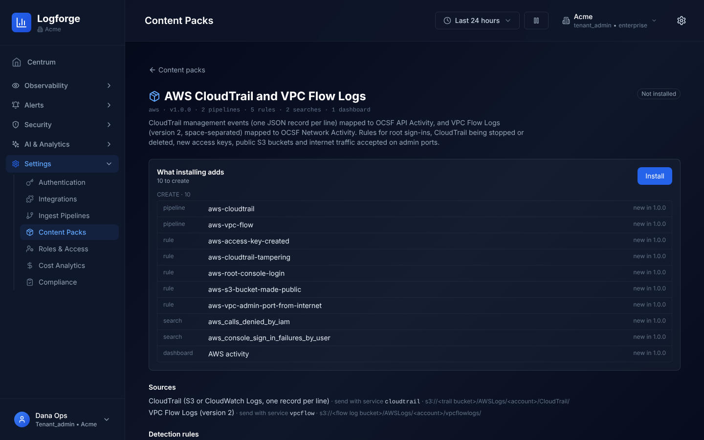

# Content packs

A content pack is everything a log source needs, installed in one step:
pipelines that parse it into the [common schema](schema.md), detection rules
with tests, saved searches and alert templates, a dashboard, and sample data
that proves it all works. Packs live in `packages/packs/<id>/` and are
checked in CI on every change.

## The catalogue

| Pack | Covers | Send logs with service | Pipelines | Rules | Searches | Dashboards |
|---|---|---|---|---|---|---|
| `linux` | Linux auth.log/secure, auditd, syslog | `auth`, `auditd`, `syslog` | 3 | 4 | 2 | 1 |
| `web` | nginx and Apache access logs, nginx error log | `nginx`, `nginx-error`, `apache` | 2 | 3 | 2 | 1 |
| `aws` | AWS CloudTrail and VPC Flow Logs (v2) | `cloudtrail`, `vpcflow` | 2 | 5 | 2 | 1 |
| `identity` | Okta System Log and Google Workspace audit | `okta`, `gworkspace` | 2 | 5 | 2 | 1 |
| `windows` | Windows Security log and Sysmon (NXLog or Winlogbeat JSON) | `windows` | 1 | 5 | 2 | 1 |
| `kubernetes` | Kubernetes audit log and CRI container logs | `k8s-audit`, `k8s-containers` | 2 | 5 | 2 | 1 |

Every rule carries an ATT&CK technique and passes its fixtures. Alert
templates (scheduled searches with an alert) are installed **disabled**:
enable them and add a notification channel once you know the thresholds suit
you.

## Installing, upgrading and removing

**Settings → Content Packs** lists the catalogue with each pack's state for
your tenant. A pack's page shows what installing would change *before*
anything does, then installs it. Installing needs the tenant-admin permission
(`settings:write`); anyone who can read logs can browse the catalogue.



The same operations are in the API:

| Call | Does |
|---|---|
| `GET /v1/packs` | the catalogue, with the installed version and `update_available` |
| `GET /v1/packs/{id}` | a pack's contents and the tenant's install |
| `POST /v1/packs/{id}/plan` | what installing or upgrading would change (changes nothing) |
| `POST /v1/packs/{id}/install` | install or upgrade; `?force=true` overwrites local changes |
| `DELETE /v1/packs/{id}` | remove what the pack installed, keeping local changes |

### What a plan shows

The pack manager records, for every object it installs, a hash of the pack's
definition and a hash of what was stored. Comparing them later tells it what
you changed.

| Action | Meaning |
|---|---|
| create | new in this version |
| update | the pack changed it and you have not |
| unchanged | nothing to do |
| keep_local | you changed it since the install: kept as it is (unless *Overwrite my local changes*) |
| deleted | you deleted it since the install: not recreated (unless overwriting) |
| conflict | something with that name exists that this pack did not install: left alone |
| remove | a newer version dropped it, and you have not changed it |

Removing a pack deletes only the objects you have not changed and lists the
ones it kept. A kept object is yours from then on: installing the pack again
shows it as a conflict rather than overwriting it.

## Walkthrough: a source in 15 minutes

The acceptance test for packs is that installing one and pointing a shipper
at the source gives parsed events, a working dashboard and enabled rules
within 15 minutes. This is the Linux pack with [Vector](https://vector.dev).

1. **Install the pack.** Settings → Content Packs → *Linux* → check the plan
   (10 objects to create) → **Install**.
2. **Create an ingest key.** Settings → API keys → new key with `logs:write`.
   The key selects the tenant, so Vector needs nothing else.
3. **Run Vector** with
   [`vector-linux-pack.toml`](https://github.com/miteshpant/Logforge/blob/main/packages/shipper-recipes/vector/vector-linux-pack.toml),
   which tails `/var/log/auth.log` (or `secure`), the auditd log and syslog
   and sends them with the service names the pack routes on:

    ```bash
    export LOGFORGE_URL=https://logforge.example.com LOGFORGE_API_KEY=lf_...
    vector --config vector-linux-pack.toml
    ```

4. **Check the result.** In the Log Explorer, `| where service = "sshd"`
   shows sign-ins with `attrs.ocsf.class_uid = 3002` and the source address
   in `src_ip`; the *Linux overview* dashboard fills in; the four `linux-`
   rules are enabled under Detection Rules, and failed SSH logins for unknown
   users or a root shell through sudo raise alerts.

`scripts/pack_walkthrough.py` runs these steps against a live stack, with
Vector in Docker tailing a scratch directory, and times them. The run on
2026-11-19 ([raw](https://github.com/miteshpant/Logforge/blob/main/docs/benchmarks/2026-11-19-pack-walkthrough.json)):

| Step | Seconds from install |
|---|---|
| plan shown, 10 objects to create | 0.1 |
| pack installed | 0.2 |
| API key created | 0.3 |
| Vector running and watching the files | 0.5 |
| 11 auth.log and 5 audit.log lines written | 0.5 |
| all 16 events searchable and parsed (sshd 9, sudo 2, auditd 5) | 4.8 |
| *Linux overview* dashboard: 7 of 7 panels show data | 5.0 |
| all 4 rules enabled, each raised alerts for the new lines | 10.6 |

The system's part takes seconds; the rest of the 15 minutes is a person
reading the plan, creating the key and installing Vector. That human time is
an estimate, not a measurement: installing Vector from its package
repository and copying the recipe takes most of it.

## Writing a pack

Copy the template and rename it:

```bash
cp -r packages/packs/_template packages/packs/myapp
```

Then replace `example` with your id everywhere: the directory name, `id` in
`pack.yml`, and the prefix of the pipeline and rule ids. A pack looks like
this:

```
packages/packs/myapp/
  pack.yml              id, name, version, description, sources, samples
  pipelines/*.yml       one pipeline per log format
  rules/*.yml           Sigma rules with fixtures (several per file, separated by ---)
  searches/*.yml        saved searches and alert templates
  dashboards/*.yml      dashboards of LogforgeQL panels
  lookups/*.csv         optional lookup tables (first column is the key)
  samples/*             real log lines, one event per line
```

### pack.yml

```yaml
id: myapp                  # must equal the directory name
name: My App
version: 1.0.0             # semver; bump it whenever anything in the pack changes
description: >
  What the pack covers and what it detects.
sources:
  - name: My App audit log
    service: myapp         # the service name shippers send these logs with
    paths: [/var/log/myapp/audit.log]
samples:
  - file: samples/audit.jsonl
    service: myapp
    pipeline: myapp-audit  # each line must be routed to this pipeline
    expect:
      - contains: login failure        # optional: text in the parsed message
        fields: {user_id: mallory, attrs.outcome: failure}
        min: 2                         # at least this many events (default 1)
    rules: [myapp-bulk-export]         # each must match at least one event of the sample
```

`contains` matches the message *after* the pipeline has run, so if the
pipeline rewrites `msg`, match the rewritten text.

### Pipelines

A pack pipeline is an [ingest pipeline](pipelines.md) with `routing`, so it
runs on the logs it is meant for (`routing: {services: [myapp]}`). Map events
to the [common schema](schema.md) by setting `attrs.ocsf.class_uid` and the
OCSF fields under `attrs.ocsf`, and also write **flat fields under `attrs`**
(`attrs.action`, `attrs.outcome`) for the rules, searches and dashboards:
Sigma rules match flat names (a rule field `action` reads `attrs.action`).

Things that help with real formats:

- `json` parses a JSON line into a subtree; `regex`, `grok`, `kv`, `csv`,
  `syslog`, `cef` and `leef` cover text formats.
- In `script`, a number in a path picks a list element:
  `field('attrs.raw.target.0.id')`. Keys that contain dots (such as
  `authorization.k8s.io/decision`) can't be reached by a path; take them
  from the raw line with a `regex` step before the `json` step.
- Scripts can call only these functions: `contains`, `startswith`,
  `endswith`, `matches`, `exists`, `field`, `lower`, `upper`, `len`, `int`,
  `float`, `str` and `cidr`. There are no methods (`.split()`) and no dict
  literals; use conditional expressions.
- `drop` with an `if` discards records you don't want stored (the Kubernetes
  pack drops the non-final audit stages; the AWS pack drops `NODATA` flow
  records).
- Remove the raw subtree at the end (`remove: {field: attrs.raw}`) and
  `compact` empty values, so only the mapped fields are stored.

### Rules

Rules are Sigma YAML with the Logforge additions described in
[detection-as-code](detection-as-code.md):

- ids start with the pack id (`myapp-...`);
- each rule needs an ATT&CK technique tag (`attack.t1530`);
- each needs `fixtures`, an event it must match (`true_positive`) and one it
  must not (`true_negative`), written with the flat field names;
- supported modifiers: `contains`, `startswith`, `endswith`, `re`, `gt`,
  `gte`, `lt`, `lte` and `all`; matching ignores case.

Pack rules are installed enabled, as `created_by: pack:<id>`.

### Searches and dashboards

A search is a [LogforgeQL](query-language.md) query with an optional
schedule and alert. Ship alert templates with `enabled: false`. A dashboard
has variables (`custom` with `values`, or `query`) and panels of type
`metric`, `line_chart`, `bar_chart` or `table`; a panel's query can use
`$variable`. See the template for both.

### Checking a pack

Pack CI runs on every change. It loads each pack with the code that installs
it (so every rule passes the fixture gate and every query compiles), sends
the samples through the pack's pipelines and checks the expectations and
rules, and runs every search and dashboard query against the parsed samples
in ClickHouse. A dashboard that shows no data fails. Run it locally:

```bash
cd tests
python -m pytest test_pack_ci.py -v
```

```bash
cd tests
LOGFORGE_TEST_CLICKHOUSE=localhost:8124 python -m pytest test_pack_ci_live.py -v
```

To try a pack on a running stack, the API reads the catalogue from
`packages/packs` (in Docker, mounted at `/packages/packs`; or set
`SOURCE_PACKS_DIR`) and notices changes without a restart.

### Review checklist

- Samples are real lines (anonymised: documentation addresses such as
  `203.0.113.0/24`, `example` domains), covering each format the pipeline
  handles, including one that should *not* trigger the rules.
- Every rule is listed under some sample, so CI shows it firing on real
  data, not only on its fixture.
- Alert templates are disabled and their thresholds are explained in the
  description.
- `version` is bumped, so installed tenants see the upgrade.
