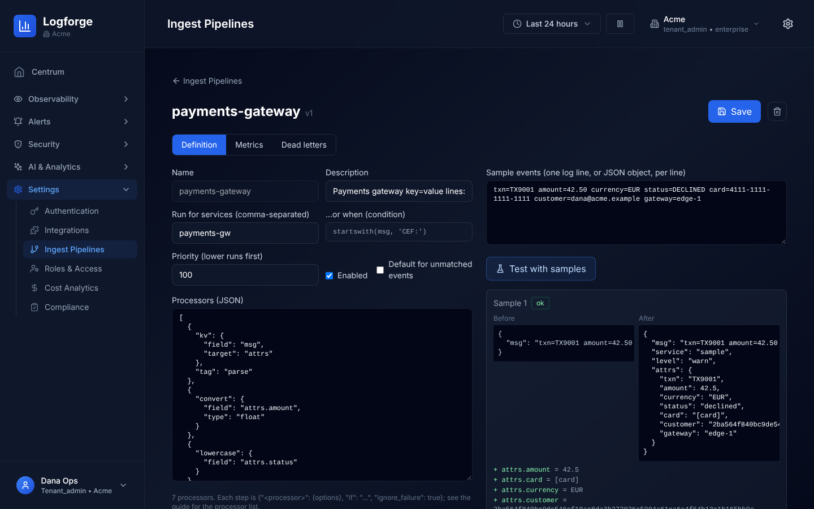

# Ingest pipelines

An ingest pipeline shapes logs on the way in: it parses raw lines into
fields, renames and converts them, masks personal data, enriches events,
and drops noise, all before the log is stored, searched and checked by
detection rules. Nothing needs a code change or a restart.



## Where pipelines run

Pipelines run in the ingest worker, after an event is accepted and before
field mapping, threat-intel matching, storage and detection. Each event
goes through at most one pipeline, chosen in this order:

1. **The one the shipper names.** Send `X-Logforge-Pipeline: <id>` on
   `POST /v1/ingest/logs` or `/v1/ingest/logs/batch`, or put a
   `logforge_pipeline` field on the event. An unknown or disabled pipeline
   is refused with `400`.
2. **Routing.** Otherwise the tenant's enabled pipelines are checked in
   priority order (lowest first). A pipeline runs if the event's `service`
   is in its `services` list, or its `if` condition is true.
3. **The default.** A pipeline marked `default` runs for events that
   nothing else matched.

Events that no pipeline matches are stored unchanged, at no extra cost.

Each kept event is stamped `attrs.pipeline = {id, version}`, so you can
see, and search for, which version shaped it.

## Building one in the UI

1. Go to **Settings → Ingest Pipelines → New pipeline**, or **Copy** a
   built-in.
2. Paste a few sample lines and write the processors.
3. Click **Test with samples**. Each sample shows the event before and
   after, side by side, with every field added, changed or removed, and
   the step trail.
4. Set the routing (services, condition, priority, default) and **Save**.
   Every save is a new version; ingest uses it within 30 seconds.
5. Search the new fields in the Log Explorer, for example
   `| where attrs.order_id = 4242 | last 1h`. Numeric fields compare as
   numbers.

The same can be done with the API: `POST /v1/pipelines` creates a
pipeline, `POST /v1/pipelines/simulate` tests one, `PUT /v1/pipelines/{id}`
saves a new version, and `GET /v1/pipelines/{id}/versions` lists the
history.

## Definition

```json
{
  "name": "orders",
  "routing": {"services": ["orders"], "if": "", "priority": 100, "default": false},
  "processors": [
    {"grok": {"field": "msg", "patterns": ["^order %{INT:order_id:int} %{WORD:action} by %{USERNAME:customer}$"]},
     "tag": "parse"},
    {"lowercase": {"field": "attrs.action"}},
    {"drop": {}, "if": "attrs.action == 'heartbeat'"},
    {"mask": {"field": "msg", "kinds": ["email", "card"]}}
  ],
  "on_failure": [{"set": {"field": "attrs.parse_error", "value": "{{_error.message}}"}}]
}
```

Fields are dotted paths into the log: `msg`, `service`, `level`, `host`,
`src_ip`, `user_id`, `status`, `ts`, and anything under `attrs`. Each step
has exactly one processor, plus these optional keys:

- `if`: a condition (see below);
- `tag`: a name shown in metrics and errors;
- `ignore_failure: true`: carry on if this step fails;
- `on_failure`: steps to run when this step fails.

### Processors

| Kind | Processors |
|---|---|
| Parse | `json`, `kv`, `csv`, `grok`, `regex`, `syslog`, `cef`, `leef`, `date`, `user_agent`, `urldecode` |
| Transform | `rename`, `set`, `remove`, `convert`, `lowercase`, `uppercase`, `trim`, `split`, `compact`, `script` |
| Enrich | `geoip`, `lookup`, `threat_intel` |
| Privacy | `mask` (emails, Luhn-checked card numbers, API tokens, or your own pattern), `hash` (salted SHA-256 by default) |
| Flow | `drop`, `route` (sets `attrs.route.retention` / `attrs.route.stream`), `fail` |

Details for the common ones:

- **grok:** takes `patterns`, tried in order, from the bundled library in
  `apps/api/config/grok_patterns.txt`. That covers IP, HOSTNAME,
  TIMESTAMP_ISO8601, HTTPDATE, COMBINEDAPACHELOG, SYSLOGLINE, NGINXACCESS
  and others. `%{NUMBER:bytes:int}` converts the capture to a number, and
  `pattern_definitions` adds your own patterns.
- **date:** `formats` can be ISO8601, UNIX, UNIX_MS, HTTPDATE or strptime
  formats, plus an optional `timezone`. It writes `ts` unless you give a
  `target`.
- **set:** `value` accepts `{{field}}` templates; `copy_from` copies
  another field instead.
- **lookup:** reads `values` given inline, or the operator's `assets` and
  `users` tables.

### Conditions and scripts

`if` conditions and `script` steps use a small expression language. It is
sandboxed: no `eval`, no attribute access on values, no imports, and size
limits apply. It supports:

- field paths, comparisons and `in` / `not in`;
- `and`, `or`, `not`, arithmetic, and `x if cond else y`;
- these functions: `contains`, `startswith`, `endswith`, `matches`
  (regex), `exists("path")`, `field("attrs.x-y")`, `lower`, `upper`,
  `len`, `int`, `float`, `str`, `cidr(ip, "10.0.0.0/8")`.

A script is assignments and `del` statements:

```text
attrs.kb = attrs.bytes / 1024; level = 'error' if status >= 500 else level
del attrs.debug
```

## When a processor fails

The first of these that applies decides what happens:

1. `ignore_failure: true` on the step: carry on with the next step.
2. The step's own `on_failure` runs, then processing carries on.
3. The pipeline's `on_failure` runs, processing stops, and the event is
   stored.
4. Otherwise the event goes to the **dead-letter queue**.

While handlers run, `_error` holds the failing processor, index, tag and
message.

## Dead-letter queue

The queue keeps:
- an event exactly as it arrived when the pipeline failed on it, or when
  the shipper named a pipeline that does not exist;
- the pipeline version, the failing processor and the error.

The **Dead letters** tab lists them. Fix the pipeline, then **Replay all**:
the originals go through ingest again with the current version, and any
that fail again come back with the new reason. Entries are kept for 30
days (`pipeline_dlq_mt`) and are also announced as `logs.parsing.failed`
on the event bus.

No event is silently lost:
- if the dead-letter queue cannot be written, the original event is
  stored anyway, marked with `attrs.pipeline_error`;
- if pipelines cannot be loaded, the last loaded set keeps routing (or,
  with nothing loaded, events are stored unprocessed).

## Built-in pipelines

`nginx-access`, `syslog`, `cef` and `text` ship with Logforge
(`apps/api/config/builtin_pipelines/`). They parse the formats behind
`/v1/ingest/nginx`, `/syslog`, `/cef` and `/text`, which now go through
these pipelines instead of hard-coded parsers. A test checks that their
output matches the old parsers, and records five bugs in the old parsers
that they fix. You can name a built-in in `X-Logforge-Pipeline`, copy it,
or shadow it with your own pipeline of the same id.

## Metrics

The **Metrics** tab shows, per pipeline version:
- events in, kept, dropped and failed;
- events per second;
- average time per event;
- per processor: runs, skips, failures, drops and average microseconds.

The counts cover this API process since it started (not yet aggregated
across replicas). The list page shows totals and pending dead letters for
every pipeline.

## Cost

A ten-processor pipeline costs about 22 µs per event in process, and about
44 µs at the ingest stage once routing, stats and the dead-letter snapshot
are counted. That is about 7% of what an event costs end to end on the
reference stack; see [Benchmarks](benchmarks/README.md).

## Limits

- `route` records the destination in `attrs.route`. Storing to separate
  tables or retention tiers is not implemented yet.
- Metrics are per API process and reset on restart.
- The editor takes processors as JSON. There is no form-based builder yet.
- Pipelines run in the ingest worker, so a request can't be rejected
  because a pipeline failed on it. Failures go to the dead-letter queue.
  The format endpoints (`/v1/ingest/nginx` and the rest) still answer 400
  for a line their built-in pipeline can't parse, as they did before.
