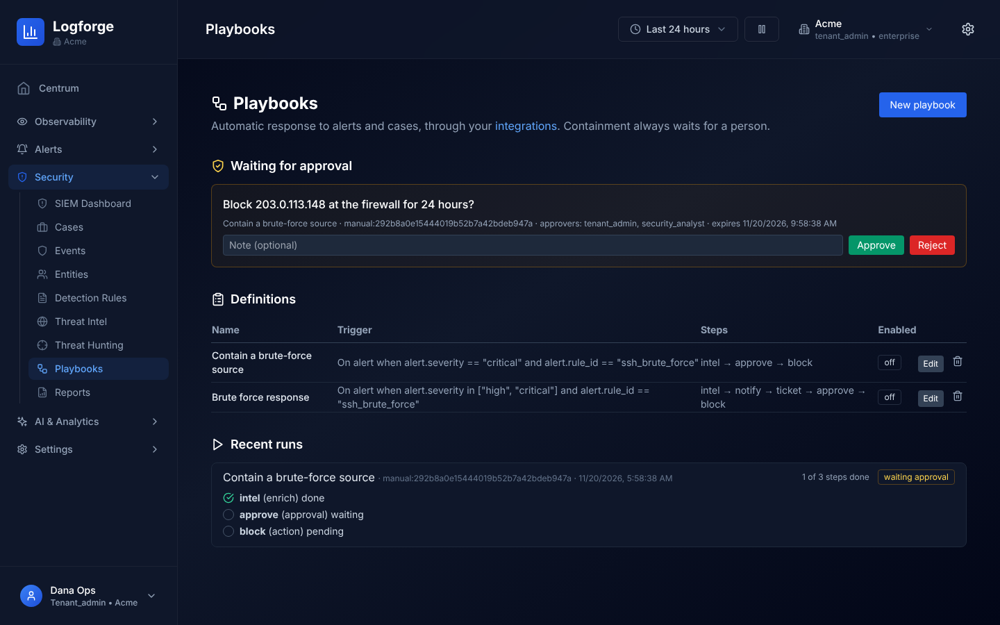
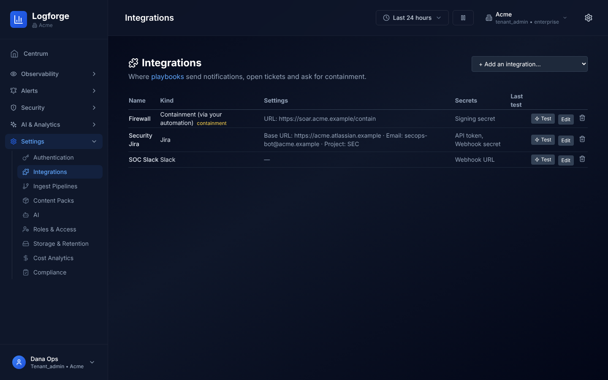
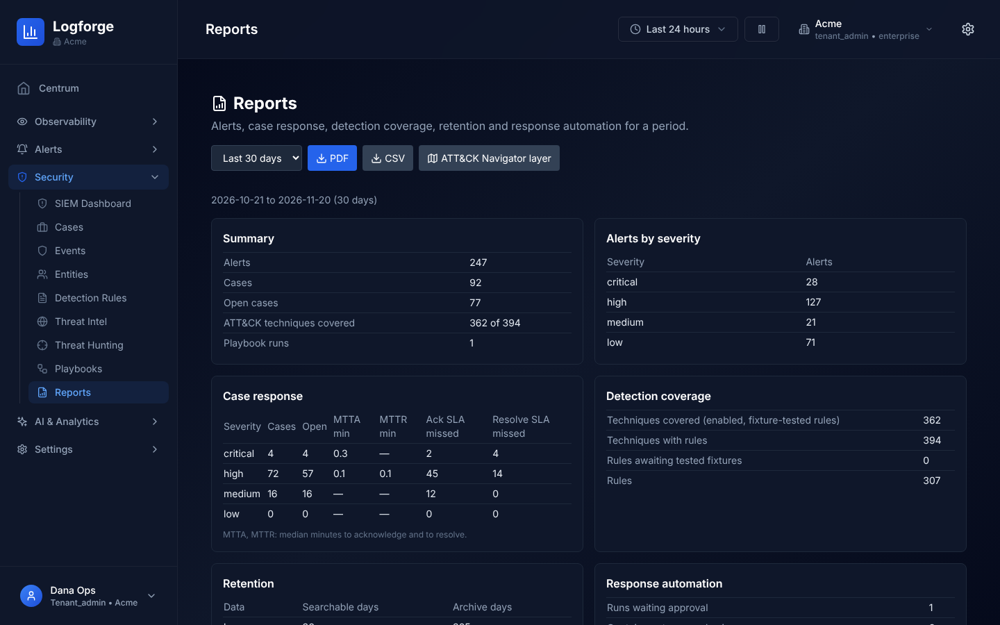

# Response automation

Logforge can act on what it finds: notify, open tickets, and ask your own
automation to contain a threat, through **integrations** that
**playbooks** call when alerts and cases arrive. A ticket a playbook opens
follows its case both ways. **Reports** summarise a period and can be emailed
on a schedule.

Containment is never automatic: a playbook can only reach a containment
integration after a person approves the step.



## Integrations

Settings → Integrations, or `/v1/integrations`. Each integration has a name
(playbooks refer to it by name), settings and secrets.



| Kind | Settings | Secrets | Inputs a step can set |
|---|---|---|---|
| `webhook` | `url` | `signing_secret` (optional) | `body` |
| `slack` | | `webhook_url` | `text`, `blocks` |
| `teams` | | `webhook_url` | `text` |
| `pagerduty` | | `routing_key` | `summary`, `severity`, `dedup_key`, `event_action` |
| `opsgenie` | | `api_key` | `message`, `description`, `priority`, `alias`, `tags` |
| `email` | `smtp_host`, `smtp_port`, `from_address`, `username` (all optional) | `password` (optional) | `to`, `subject`, `body` |
| `jira_issue` | `base_url`, `email`, `project` | `api_token`, `webhook_secret` (optional) | `summary`, `description`, `issue_type`, `labels` |
| `github_issue` | `repo`, `base_url` (optional) | `token`, `webhook_secret` (optional) | `title`, `body`, `labels` |
| `containment_webhook` | `url` | `signing_secret` (optional) | `action` (`block_ip`, `disable_user`, `isolate_host`), `target`, `reason` |

- **Secrets are write-only.** The API and the UI say which are set, never
  their values. They are sealed with Fernet under `LOGFORGE_SECRETS_KEY`
  before they're stored. Outside development the key is required; generate
  one with `python -c "from integrations.secrets import new_key; print(new_key())"`.
  In development, without a key, one is derived from `JWT_SECRET`.
- **Templates:** inputs and settings take `{{ path | filter }}`, with dotted
  paths into the run context (`alert.title`, `alert.entities.src_ip.0`,
  `case.id`, `steps.intel.output.verdict`). Filters: `upper`, `lower`,
  `json`, `default('…')`, `truncate(n)`. Templates read dictionary keys and
  list items only, never attributes, and are rendered once: a value from a
  log can't inject a template.
- **Signed webhooks:** with a `signing_secret`, requests carry
  `X-Logforge-Signature: sha256=<HMAC of the body>`.
- **Containment requests** send `{"action", "target", "reason",
  "requested_by", "dry_run"}`. The integration's **Test** button always sends
  `dry_run: true`; your automation should change nothing then.
- **Private addresses are refused** (loopback, private, link-local), so an
  integration can't be used to reach internal services. Set
  `LOGFORGE_ALLOW_PRIVATE_INTEGRATIONS=true` when your Jira, SOAR or SMTP
  relay is internal.
- **Email** uses the integration's SMTP settings, or `LOGFORGE_SMTP_HOST`,
  `LOGFORGE_SMTP_PORT` (587) and `LOGFORGE_SMTP_FROM`.
- Requests time out after `LOGFORGE_ACTION_TIMEOUT_SECONDS` (15).

Managing integrations needs `settings:write`; reading them `settings:read`.

## Playbooks

Security → Playbooks, or `/v1/playbooks`. A playbook is YAML:

```yaml
name: Brute force response
trigger:
  on: alert                  # alert | case_created | case_updated
  when: alert.severity in ["high", "critical"] and alert.rule_id == "ssh_brute_force"
steps:
  - id: intel
    enrich: {indicator: "{{ alert.entities.src_ip.0 }}"}
  - id: notify
    action: {integration: SOC Slack, inputs: {text: "{{ alert.title }}: {{ steps.intel.output.verdict }}"}}
    on_error: continue       # stop (default) or continue
  - id: ticket
    action: {integration: Jira, inputs: {summary: "{{ alert.title }}"}}
    link_case: true          # the ticket follows the case
  - id: hunt
    search: {query: '| where src_ip = "{{ alert.entities.src_ip.0 }}" | stats count() by host', since: 24h}
  - id: approve
    approval: {prompt: "Block {{ alert.entities.src_ip.0 }} at the firewall?", timeout: 4h}
  - id: block
    action: {integration: Firewall, inputs: {action: block_ip, target: "{{ alert.entities.src_ip.0 }}"}}
```

- **`when`** is the [ingest pipelines' condition language](pipelines.md)
  over the run context: `alert` (id, title, severity, rule_id, status,
  mitre_techniques, entities) and `case` (id, title, severity, status,
  assignee, tags, alert_ids) when the alert is in a case.
- **Steps:**
  - `enrich` looks an indicator up in threat intelligence; its output has a
    `verdict` (malicious, suspicious or unknown) and the matches.
  - `action` calls an integration.
  - `search` runs a LogforgeQL query (read-only, the tenant's data) and keeps
    up to 50 rows.
  - `approval` waits for a person. `approvers` lists the roles that may
    decide (default `tenant_admin`, `security_analyst`); `timeout` is like
    `30m`, `4h` or `2d` (default 24h). Rejected or expired, the run stops.
- **Containment needs an approval.** A step that calls a containment
  integration must have an approval step after the start, or after the
  previous containment step. A playbook breaking this is refused when it's
  saved.
- **Runs start once per alert or case.** The dispatcher checks every
  `LOGFORGE_PLAYBOOK_TICK_SECONDS` (15) for alerts and cases from the last
  `LOGFORGE_PLAYBOOK_LOOKBACK_MINUTES` (15), so a restart doesn't lose any.
  With several API replicas, one dispatches per tick (a Redis lock).
  `LOGFORGE_PLAYBOOKS=off` turns it off.
- **Run one by hand:** `POST /v1/playbooks/{id}/run` with an `alert_id` or a
  `case_id`.
- **Approvals:** waiting runs are at the top of the Playbooks page, or
  `POST /v1/playbooks/runs/{id}/decision` with `{step, decision: approve |
  reject, note}`. Every decision records who made it and when.

Definitions need `settings:write` to change; runs and approvals need
`security:read` and `security:write`.

## Ticket sync

A ticket opened by a step with `link_case: true` is linked to the alert's
case, and the two follow each other:

- **Closing the ticket resolves the case**, and reopening it reopens the
  case.
- **Resolving the case closes the ticket.** In Jira, through a transition
  into the "done" category; in GitHub, by closing the issue. A comment says
  why.
- When both moved since the last sync, the ticket wins: whoever closed it
  there was working the issue.

The case page lists its tickets.

Ticket changes arrive two ways:

- **Webhook.** Point Jira's or GitHub's webhook at
  `https://<logforge>/v1/hooks/<tenant id>/<integration id>`, with the
  integration's `webhook_secret`. GitHub signs with it (`X-Hub-Signature-256`).
  For Jira, add it as `?token=<secret>`. Unsigned or wrongly signed calls get
  401.
- **Polling.** Every `LOGFORGE_TICKET_SYNC_SECONDS` (300) every linked ticket
  is read, which also pushes case changes out. `POST
  /v1/integrations/tickets/sync` runs it now. `LOGFORGE_TICKET_SYNC=off`
  turns it off.

## Reports

Security → Reports, or `/v1/reports`.



- **Security operations report** for the last 7 to 366 days:
  - alerts by severity;
  - case response: cases, open, median minutes to acknowledge and to
    resolve, SLA misses per severity;
  - detection coverage;
  - retention;
  - response automation: runs by outcome, approvals given and refused.

  `GET /v1/reports/soc?days=30&format=json|csv|pdf`.
- **ATT&CK Navigator layer** of detection coverage:
  `GET /v1/reports/attack-navigator`. Each technique is scored by its
  enabled, fixture-tested rules and commented with its last detection. Open
  it in the [ATT&CK Navigator](https://mitre-attack.github.io/attack-navigator/)
  with "Open Existing Layer".
- **Scheduled reports** are emailed through an email integration, as PDF or
  CSV, on one of three schedules:
  - daily at an hour (UTC);
  - weekly on Mondays;
  - monthly on the 1st.

  A new schedule waits for its first slot. The scheduler checks every
  `LOGFORGE_REPORT_TICK_SECONDS` (600); `LOGFORGE_REPORT_SCHEDULER=off` turns
  it off. Send one now with `POST /v1/reports/schedules/{id}/send`. The last
  send time and the last error are kept on the schedule.

Reports need `security:read`; schedules need `settings:read` and
`settings:write`.

## How it was tested

The Phase 13 acceptance criterion is "a playbook can take an alert to a Slack
notification and a Jira ticket, and a resolved ticket closes the case,
covered by an integration test with mocked services". It is covered by
`tests/test_response_acceptance_live.py`, which runs in CI's live job:

1. A high-severity alert is written to ClickHouse and a case opened for it.
2. The real dispatcher starts the playbook. Slack (mocked) receives the
   alert's title. Jira (mocked) receives an issue naming the case, and the
   ticket `SEC-101` is linked to the case.
3. A second dispatcher tick doesn't start the playbook again.
4. A signed Jira webhook says the issue is done. The real webhook route
   resolves the case, the alert gets the resolved verdict, and the link
   records both states.

Only Slack and Jira are mocked; the stores, case service, dispatcher and
webhook route are real. A second test builds a report from real alerts and
round-trips a report schedule. Playwright (`apps/ui/tests/21-response.spec.ts`)
covers the three pages: an integration's failing test is shown, a containment
playbook without an approval is refused, and approving a waiting step runs
the next one.

Running against ClickHouse found five bugs the unit tests' fakes hid, all
fixed:

- the integrations table clashed with an older table of the same name;
- multi-line playbooks couldn't be saved;
- the dispatcher compared naive and aware times;
- ticket sync called a case method that didn't exist;
- the coverage export imported a function that didn't exist.

## Limits

- **Compliance reports** (from the Phase 13 deliverables) aren't done; the
  security operations report isn't one.
- **Ticket systems:** Jira and GitHub only. ServiceNow, Linear and others
  can be reached by a webhook action, without sync.
- **Containment** goes only through your own automation (a webhook to a
  SOAR, a firewall API, an IdP workflow). Logforge has no built-in
  connectors that block or disable anything itself.
- **Playbook steps run in order:** no branches, loops or parallel steps. A
  run waits only at approvals; an approval is decided in Logforge, not from
  Slack.
- **The PDF** uses the standard PDF fonts when all its text is Latin-1 (about
  1 KB a page). A report with other characters (a tenant, rule or case name in
  Greek, Cyrillic and so on) embeds DejaVu Sans and Sans Mono instead, which
  adds about 0.9 MB; text stays searchable and copyable. DejaVu has no CJK
  glyphs, so those characters print as `?`.
