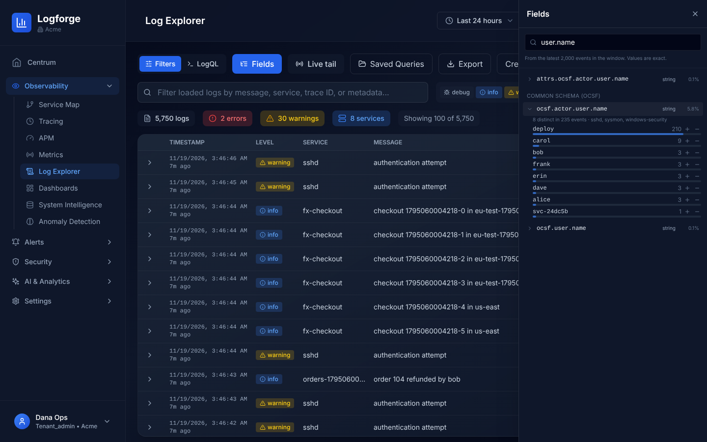

# Common schema

Logforge uses [OCSF](https://schema.ocsf.io/) 1.3.0 (the Open
Cybersecurity Schema Framework, used by AWS Security Lake and others) as its
common vocabulary for security events. Each field also lists its
[OpenTelemetry semantic-convention](https://opentelemetry.io/docs/specs/semconv/)
name, for observability data. A rule, query or dashboard written against
schema fields works for any source once that source is mapped.

## Using schema fields

Write `ocsf.<path>`:

- in detection rules: `ocsf.src_endpoint.ip: 203.0.113.9`;
- in LogforgeQL: `| where ocsf.status_id = 2 | stats count() by ocsf.actor.user.name`.

A schema field resolves when it is read ("schema-on-read"):

1. An explicit `attrs.ocsf.<path>` wins. A source's mapping pipeline sets
   it, for example `class_uid: 3002` for a Windows 4625 event.
2. Otherwise the field takes the first non-empty value among today's fields
   in the table below, converted where noted.

Nothing extra is stored for events that need only the generic mapping. The
mapping lives in `apps/api/config/schema/ocsf_mapping.yml`, and this table
is checked against it in CI.

## Mapping of today's fields

| OCSF field | Type | From today's fields | OpenTelemetry | Meaning |
|---|---|---|---|---|
| `time` | timestamp_t (epoch ms) | `ts` (epoch_ms) | `Timestamp` | When the event occurred. |
| `message` | string_t | `msg` | `Body` | The log message. |
| `severity` | string_t | `level` | `SeverityText` | The event's level as sent (info, warn, error, ...). |
| `severity_id` | integer_t | `level` (severity_id) | `SeverityNumber (different scale)` | OCSF severity: 1 Informational, 3 Medium (warn), 4 High (error), 5 Critical, 6 Fatal. |
| `class_uid` | integer_t | set by the source's pipeline | — | Event class, e.g. 3002 Authentication, 4002 HTTP Activity, 1007 Process Activity. |
| `class_name` | string_t | set by the source's pipeline | — | Event class name, e.g. Authentication. |
| `category_uid` | integer_t | set by the source's pipeline | — | Event category, e.g. 3 Identity & Access Management, 4 Network Activity. |
| `activity_id` | integer_t | set by the source's pipeline | — | Activity within the class; for Authentication 1 Logon, 2 Logoff. |
| `activity_name` | string_t | `attrs.event_type`, `attrs.action` | `event.name` | The activity, e.g. Logon. |
| `status` | string_t | `attrs.result`, `attrs.outcome`, `attrs.status_text` (status_name) | — | Success or Failure. |
| `status_id` | integer_t | `attrs.result`, `attrs.outcome`, `attrs.status_text` (status_id) | — | 1 Success, 2 Failure, 99 Other. |
| `status_detail` | string_t | `attrs.reason`, `attrs.failure_reason` | — | Why it failed (bad password, locked out, ...). |
| `metadata.product.name` | string_t | `service` | `service.name` | The product or service that produced the event. |
| `metadata.correlation_uid` | string_t | `trace_id` | `trace_id` | Correlation (trace) id. |
| `device.hostname` | string_t | `host`, `attrs.hostname` | `host.name` | The host the event came from. |
| `actor.user.name` | string_t | `user_id`, `attrs.user`, `attrs.username`, `attrs.user_name`, `attrs.account` | `user.name` | The user who performed the activity (the account logging in, for Authentication). |
| `user.name` | string_t | `attrs.target_user`, `attrs.TargetUserName` | — | The user acted upon, when different from the actor. |
| `src_endpoint.ip` | ip_t | `src_ip`, `attrs.src_ip`, `attrs.source_ip`, `attrs.client_ip`, `attrs.remote_addr` | `client.address / source.address` | Where the activity came from. |
| `src_endpoint.port` | port_t | `attrs.src_port`, `attrs.source_port` | `client.port / source.port` | Source port. |
| `dst_endpoint.ip` | ip_t | `attrs.dst_ip`, `attrs.dest_ip`, `attrs.destination_ip`, `attrs.server_ip` | `server.address / destination.address` | Where the activity went. |
| `dst_endpoint.port` | port_t | `attrs.dst_port`, `attrs.dest_port`, `attrs.port` | `server.port / destination.port` | Destination port. |
| `dst_endpoint.hostname` | string_t | `attrs.dest_host`, `attrs.dhost` | `server.address` | Destination host name. |
| `connection_info.protocol_name` | string_t | `attrs.protocol`, `attrs.proto` | `network.protocol.name` | Network protocol. |
| `http_request.http_method` | string_t | `attrs.method`, `attrs.http_method` | `http.request.method` | HTTP method. |
| `http_request.url.path` | string_t | `attrs.uri`, `attrs.path`, `attrs.http_path`, `attrs.request_uri` | `url.path` | Request path. |
| `http_request.url.url_string` | url_t | `attrs.url` | `url.full` | Full URL. |
| `http_request.user_agent` | string_t | `attrs.user_agent`, `attrs.http_user_agent` | `user_agent.original` | User agent. |
| `http_response.code` | integer_t | `attrs.status_code`, `attrs.response`, `status` (nonzero_int) | `http.response.status_code` | HTTP status code. |
| `process.name` | string_t | `attrs.process_name`, `attrs.Image` | `process.executable.name` | Process name or image. |
| `process.cmd_line` | string_t | `attrs.command_line`, `attrs.CommandLine` | `process.command_line` | Command line. |
| `process.pid` | integer_t | `attrs.process_id`, `attrs.pid` (int) | `process.pid` | Process id. |
| `process.parent_process.pid` | integer_t | `attrs.parent_process_id`, `attrs.ppid` (int) | `process.parent_pid` | Parent process id. |
| `file.name` | string_t | `attrs.file_name` | `file.name` | File name. |
| `file.path` | string_t | `attrs.file_path` | `file.path` | File path. |
| `query.hostname` | string_t | `attrs.query`, `attrs.dns_query` | `dns.question.name` | DNS query name. |
| `reg_key.path` | string_t | `attrs.registry_key`, `attrs.TargetObject` | — | Windows registry key. |

Conversions:
- **severity_id:** the level name becomes OCSF's 0–6 scale.
- **status_id / status_name:** success, ok, accepted and similar become 1 /
  Success; failed, denied, invalid and similar become 2 / Failure; anything
  else becomes 99 / Other.
- **epoch_ms:** the timestamp in milliseconds.
- **int:** a number. **nonzero_int:** the same, with 0 treated as absent (the `status` column defaults to 0).

## Source mappings

Fields such as `class_uid`, `activity_id` and `status_id` describe *what
happened*, so only a source-specific mapping can set them. Logforge ships
mapping pipelines for the sources below. Each one sets the OCSF
Authentication class (3002) with activity Logon (1) and a status, plus the
user, source address and reason:

| Source | Built-in pipeline | Recognises |
|---|---|---|
| Linux auth (sshd) | `linux-auth` | Accepted / Failed password, Invalid user |
| Windows Security | `windows-security` | Event IDs 4624 (logon), 4625 (failed logon) |
| Okta System Log | `okta` | `user.session.start` with outcome SUCCESS / FAILURE |

For your own application logs, write a pipeline that sets the same fields
(see the [guide](pipelines.md)). The rule `lf-schema-failed-logon` (and
`lf-schema-logon-brute-force`) then detects failed logins from all of them,
unchanged.

## Search-time fields

You don't have to extract a field at ingest to query it. LogforgeQL can
pull fields out of the stored text when the query runs (schema-on-read):

```text
| rex "Failed password for (?<user>\S+) from (?<ip>\S+)" | stats count() by user, ip
| parse "order * by *" as order_id, customer | where order_id > 1000
| json field=attrs.payload "user.name" as who, "action" | stats count() by who, action
```

- **`rex [field=<f>] "<regex>"`:** each named group `(?<name>...)` becomes
  a field. Patterns use RE2 syntax, so lookaround and backreferences are
  refused.
- **`parse [field=<f>] "<text with *>" as a, b`:** each `*` captures up to
  the next literal text. The last `*`, at the end of the pattern, takes the
  rest of the line.
- **`json [field=<f>] "<path>" [as name], ...`:** reads JSON text, a dotted
  path from the root.

The default field is `msg`. Extracted names can be used by later `where`
(numbers compare as numbers), `stats ... by` and `sort`, and each returned
log carries them under `extracted`. Patterns and paths are bound
parameters, never SQL text. Write `\"` for a quote inside a pattern. Names
must be new: `status` or `level` would be refused.

See [Benchmarks](benchmarks/README.md) for what extraction costs against a
field extracted at ingest.

## Field explorer



In the Log Explorer, **Fields** opens the field catalogue:
- every field in the latest events of the time range, with its type and
  how often it appears;
- then the common-schema fields that resolve for those events.

Click a field to see its exact top values and their share. Click **+** or
**−** on a value to add `| where field = value` (or `!=`) to the query.
The query bar also autocompletes these field names.

The same data is available through the API:
- `GET /v1/fields?window=24h`: the catalogue, computed from a sample of the
  most recent events (2,000 by default);
- `GET /v1/fields/values?field=attrs.http.status&window=24h`: exact top
  values, plus total and distinct counts.
