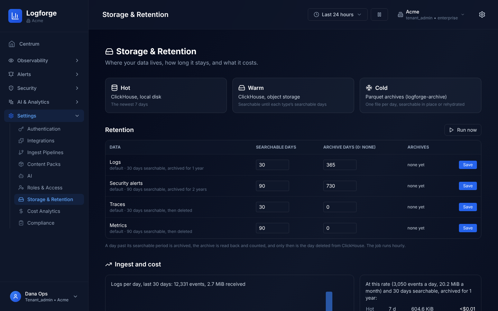
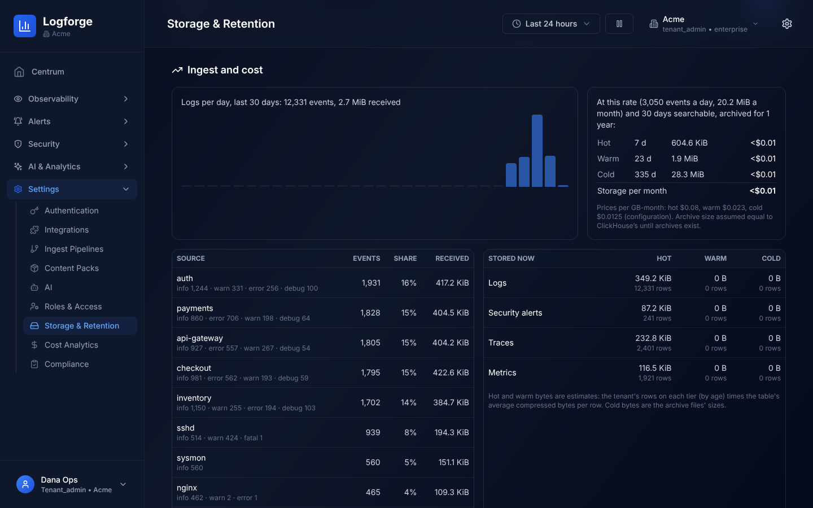

# Storage tiers and retention

Logforge keeps data in three tiers, and each tenant chooses how long each
kind of data stays in them. Settings → **Storage & Retention** shows the
tiers, the retention, what the tenant ingests and stores, and what that
costs.



## Tiers

| Tier | Where | What |
|---|---|---|
| **Hot** | ClickHouse, local disk | The newest `hot_days` (7 by default), for every tenant |
| **Warm** | ClickHouse, an S3-backed volume | Older data still searchable at full query speed, cheaper per GB |
| **Cold** | Parquet files in object storage | One file per tenant, data type and day, after it leaves ClickHouse |

Hot and warm are one ClickHouse storage policy (`tiered`, in
`infra/docker/clickhouse/config.d/s3_storage.xml`): each table's TTL moves
parts to the warm volume after `hot_days`. ClickHouse parts hold rows of
many tenants, so this move is the same for everyone. When the local disk
has less than 10% free, ClickHouse also moves the oldest parts to warm
early (`move_factor`) rather than fill the disk.

At startup the API creates the buckets, switches the tables to the
`tiered` policy and sets their TTL. Existing parts aren't rewritten; they
move as ClickHouse's background merges reach them. A server without the
policy gets only the delete backstop (below).

## Retention

Per tenant and data type (logs, security alerts, traces, metrics):

| Setting | Meaning |
|---|---|
| `searchable_days` | days in ClickHouse (hot and warm), 1 to 400 |
| `archive_days` | days each day's Parquet archive is kept, 0 for none, otherwise from `searchable_days` to 3650 |

Defaults (`apps/api/config/storage_tiers.yml`): logs 30 days searchable
and archived a year; security alerts 90 days and two years; traces 30 days
and metrics 90 days, not archived.

The retention job runs hourly. For each day past a tenant's searchable
period, it:

1. writes the day to Parquet (ClickHouse writes it, through the
   `logforge_archive` named collection; no credentials in queries);
2. reads the file back and counts it;
3. deletes the day from ClickHouse **only if the counts match**. A day
   that gained late events since it was archived is archived again first;
4. deletes archives older than `archive_days`.

The tables also have a TTL that deletes anything older than 400 days, in
case the job stops running.

With more than one API replica, turn the job off in the API
(`LOGFORGE_RETENTION_JOB=off`) and run `python -m tier_manager run` once an
hour (the Helm chart's CronJob does).

## Archive search and rehydration

**Search in place:** the Log Explorer's language runs over the archives
too, for up to a year at a time. Only the archived days in the window
are read, by exact file name:

```json
POST /v1/query/logql
{"query": "| where service = \"auth\" | stats count() by level",
 "source": "archive", "start_time": "2025-12-01T00:00:00Z", "end_time": "2026-03-01T00:00:00Z"}
```

`| patterns` doesn't run on archives.

**Rehydrate:** copy archived days back into ClickHouse for full-speed
search and dashboards, for 1 to 30 days, at most 31 days at a time.

- Days still in ClickHouse are skipped, so nothing is duplicated.
- Days are loaded into a staging copy of the table and attached from it.
  Attaching doesn't fire the materialized views, so entity counts aren't
  inflated.
- The retention job leaves rehydrated days alone until their hold ends,
  then deletes them again; their archives stay.

## Cost

Settings → Storage & Retention shows, for the last 30 days:

- events and bytes received per day and per source, broken down by level;
- what is stored now in each tier;
- the steady-state size and monthly cost of the tenant's log retention
  at the current rate;
- noisy streams, with the Phase 4 pipeline `drop` step that would cut
  them.



How the numbers are made:

- **Hot and warm sizes are estimates:** the tenant's rows on each tier, by
  age, times the table's average compressed bytes per row.
- **Cold sizes are exact:** the archive files' sizes.
- **Prices are configuration**, not quotes (`prices` in
  `storage_tiers.yml`, per GB-month).

Measured on the 100 M-event benchmark data, a day of 14.45 M events:

| Form | Bytes per event | Day |
|---|---|---|
| JSON as sent | 297 | 4.29 GB |
| ClickHouse (compressed) | 29 | 0.42 GB |
| Parquet archive | 33 | 0.48 GB |

## API

| Call | Permission | Does |
|---|---|---|
| `GET /v1/storage/tiers` | `storage:read` | tiers, the tenant's retention per data type, its archives and rehydrated days |
| `PUT /v1/storage/tiers/policies/{data_type}` | `storage:write` | set `searchable_days` and `archive_days` |
| `POST /v1/storage/tiers/run` | `storage:write` | run retention now, for this tenant only |
| `POST /v1/storage/tiers/rehydrate` | `storage:write` | `{data_type, first_day, last_day, keep_days}` |
| `GET /v1/storage/tiers/costs` | `storage:read` | ingest, storage per tier, projection, noise |
| `POST /v1/query/logql` with `"source": "archive"` | as any query | search the archives |

Tenant admins have `storage:*`; analysts don't.

Backups, replication and Kubernetes are in [Deployment](deployment.md).
