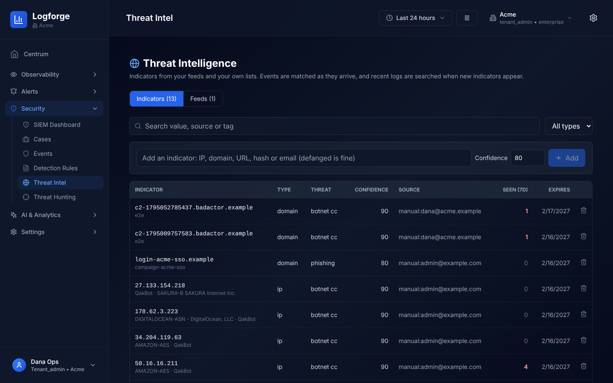

# Threat intelligence and enrichment

Logforge checks every ingested event against your threat-intelligence
indicators, stamps what matches onto the event, raises alerts for known-bad
activity, and searches recent logs again whenever new indicators arrive. The
same ingest step can also add GeoIP/ASN, reverse DNS and asset or user context.



## Feeds

Open **Security → Threat Intel → Feeds** to add a built-in feed or your own.
Each feed has a URL, a format, a fetch interval, a confidence (0–100) and a
TTL. An indicator expires TTL days after the feed last listed it.

| Built-in feed | Format | Account |
|---|---|---|
| abuse.ch Feodo Tracker (botnet C2 IPs) | `feodo_json` | none |
| abuse.ch URLhaus (malware URLs) | `urlhaus` | `ABUSECH_AUTH_KEY` |
| abuse.ch ThreatFox (IOCs) | `threatfox` | `ABUSECH_AUTH_KEY` |
| AlienVault OTX (subscribed pulses) | `otx` | `OTX_API_KEY` |

Custom feeds can use any of these formats:

- `plain`: one indicator per line; `#` starts a comment.
- `csv`: options `value_column`, `type_column` (or a fixed `type`) and `threat_type`.
- `misp`: MISP attribute export.
- `stix`: a STIX 2.1 bundle.
- `urlhaus`, `threatfox`, `otx`, `feodo_json`.

Feeds must use HTTPS.

**API keys are never stored in Logforge.** A feed names an environment
variable (`secret_env`), and its value is sent in the header the feed names
(`auth_header`, e.g. `Auth-Key`). The UI and API only report whether that
variable is set. abuse.ch keys are free: sign in at https://auth.abuse.ch/.

The scheduler checks every minute and fetches the feeds that are due. Set
`THREAT_FEEDS_SCHEDULER=off` to disable it, for example on API replicas
other than one. **Run now** fetches a feed immediately.

Before indicators are stored:

- they are normalised: defanged values such as `hxxp://evil[.]example` are
  restored, and case and trailing dots are normalised;
- they are deduplicated;
- internal addresses are dropped: RFC 1918, loopback, link-local, CGNAT and
  multicast. A feed that lists `10.0.0.5` cannot raise alerts for your own
  network.

## Your own indicators

Add an IP, domain, URL, hash or email on the **Indicators** tab, or with
`POST /v1/security/intel/indicators`:

```json
{"value": "login-acme-sso[.]example", "threat_type": "phishing", "confidence": 80, "tags": ["campaign-7"]}
```

The search box matches value, source and tag. Each indicator shows
**Seen (7d)**, the number of your logs from the last 7 days that mention it.

## Matching at ingest

Each batch is checked against the tenant's active indicators, held in
memory and reloaded every 60 s or when indicators change through the API.
These fields are checked, both at the top level and in `attrs`:

| Type | Fields |
|---|---|
| IP | `src_ip`, `dst_ip`, `dest_ip`, `remote_addr`, `client_ip`, `server_ip`, `ip` |
| Domain | `domain`, `query`, `dns_query`, `server_name`, `sni`, `dest_domain`, and the host of every URL field |
| URL | `url`, `http_uri`, `request_url`, `referrer` |
| Hash | `md5`, `sha1`, `sha256`, `hash`, `file_hash` |
| Email | `email`, `sender`, `recipient`, `from_address` |

A domain indicator also matches its subdomains: `c2.badactor.example`
matches `api.c2.badactor.example`, but not `badactor.example`.

A match is stamped on the event:

```json
"attrs": {"threat": {"matched": true, "max_confidence": 90, "threat_types": ["botnet_cc"],
  "indicators": [{"field": "dst_ip", "value": "50.16.16.211", "type": "ip", "threat_type": "botnet_cc",
                  "confidence": 90, "source": "abuse.ch Feodo Tracker", "tags": ["QakBot"]}]}}
```

Two shipped rules alert on stamped events, and any rule can use
`threat.*` fields:

- `lf-ti-known-c2` (T1071, high): `threat_types` contains `botnet_cc`;
- `lf-ti-malware-delivery` (T1105): a malware-download URL.

Intel alerts go through case grouping like any other alert. Case pages and
the Events list show an intel badge, for example "Known botnet C2 ·
abuse.ch Feodo Tracker · 90%".

## Retro-hunting

When a feed run or a manual add brings in new indicators, Logforge searches
the tenant's logs from the last 7 days for them. The search covers the same
fields as ingest matching, including subdomains and URL hosts. Each past
match is raised as `lf-ti-retro-match`, stamped with `"retro": true`, and
routed into a case. A run raises at most 1,000 alerts.

## Enrichment processors

These are configured with files you download or export yourself and mount
into the API container:

| Variable | Contents |
|---|---|
| `GEOIP_CITY_CSV` | DB-IP Lite city or country CSV (https://db-ip.com/db/lite.php, CC BY 4.0) |
| `GEOIP_ASN_CSV` | DB-IP Lite ASN CSV |
| `ASSETS_CSV` | Your assets, keyed by a `host` column; other columns become attributes |
| `USERS_CSV` | Your users, keyed by a `user` column |
| `REVERSE_DNS=on` | Reverse DNS for external addresses, cached. Off by default because a lookup can hold up ingest for up to 0.5 s |

The results are written to `attrs.geo` (per IP field: country, city, ASN,
AS organisation), `attrs.rdns`, `attrs.asset` and `attrs.identity`.
Internal addresses get no GeoIP lookup.

## Cost

Matching against 100,000 indicators adds about 11–14 µs per event in
process. Live ingest throughput with and without indicators is in
[Benchmarks](benchmarks/README.md).

## Limits

- Fetching needs outbound HTTPS from the API container to the feed hosts.
  In the reference compose setup the containers have no outbound DNS, so
  **Run now** records a `ConnectError`. Allow egress, or run the scheduler
  where it has network access.
- URLhaus and ThreatFox anonymous downloads now return `410 Gone`. Their
  APIs need an Auth-Key, so those two parsers are tested against fixtures in
  the documented API format. Only Feodo was fetched live.
- GeoIP has been tested against DB-IP-format fixtures, not the full
  download.
- Matching is in memory, per API process. There is no ClickHouse
  dictionary yet, so very large indicator sets (tens of millions) need
  memory sizing.
- MISP and TAXII are read as exported documents (MISP attribute JSON, a STIX
  bundle URL). There is no live MISP API or TAXII collection paging yet.
