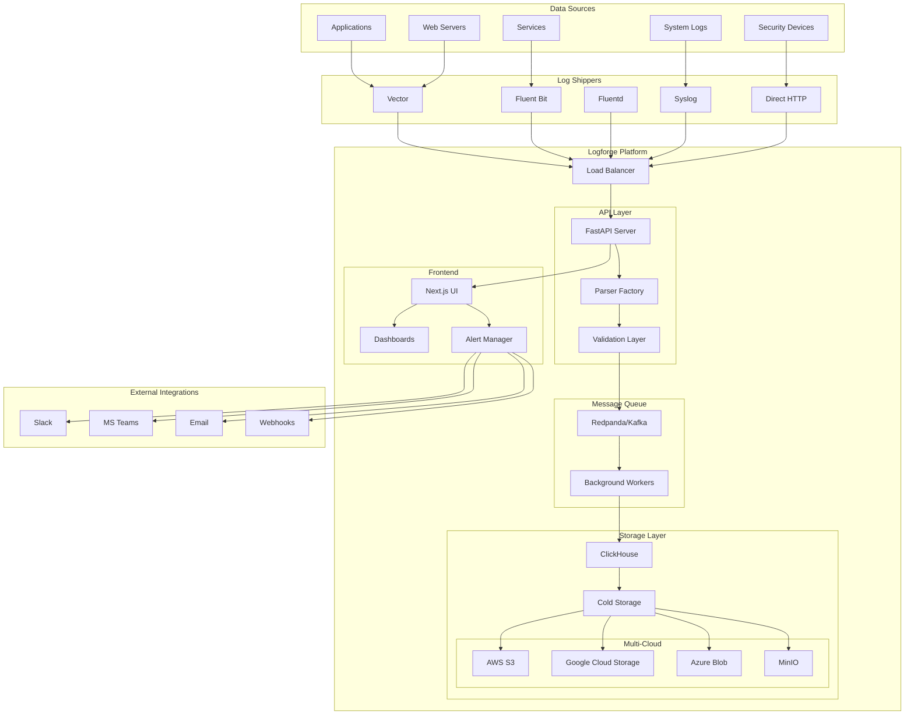
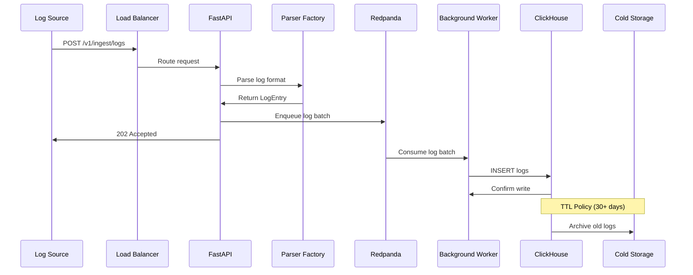
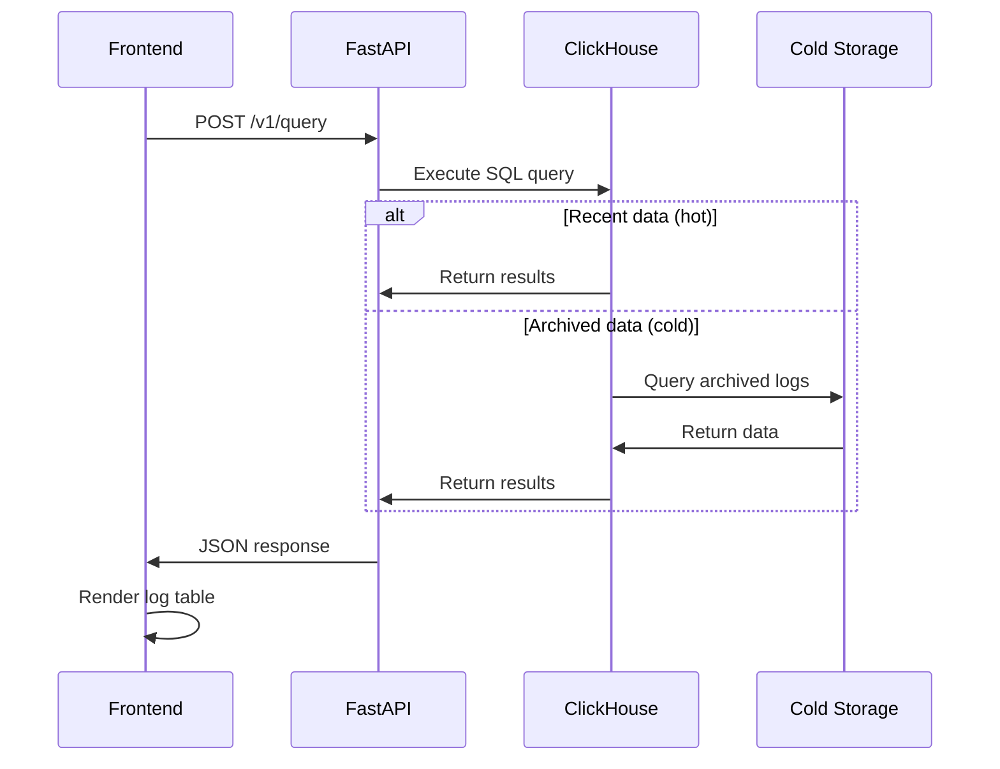
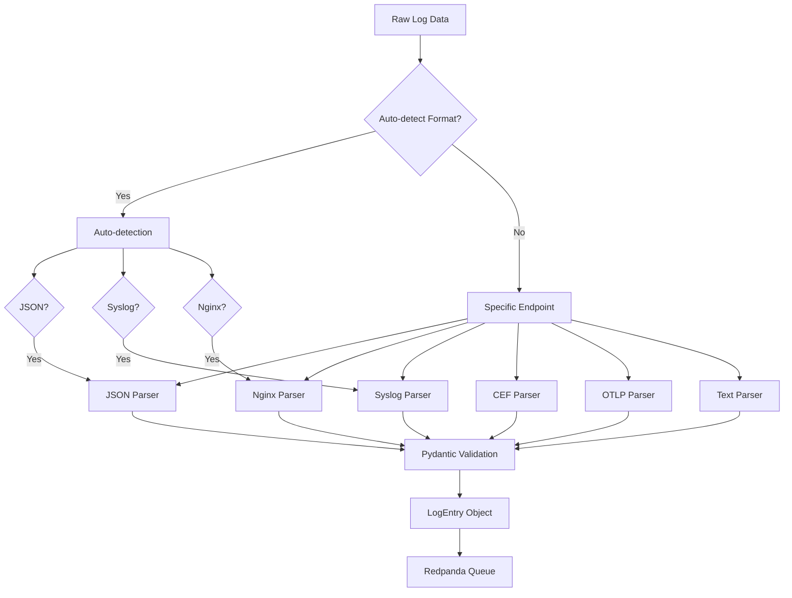
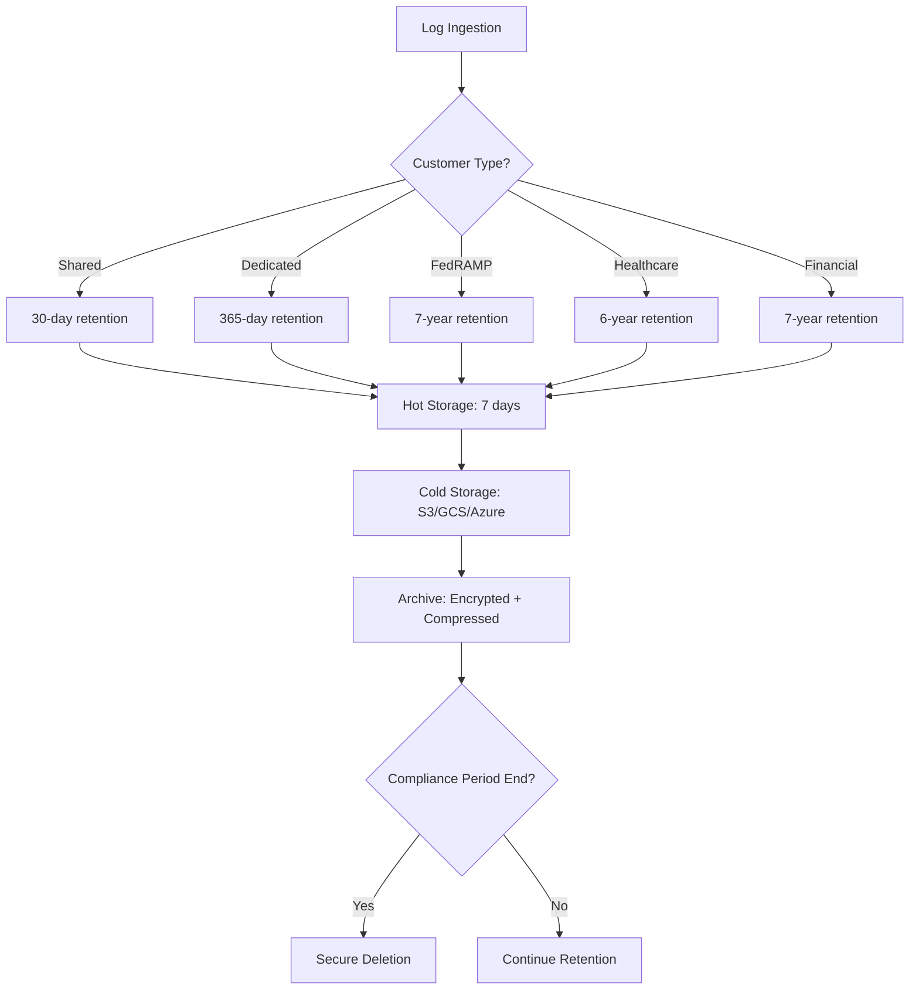
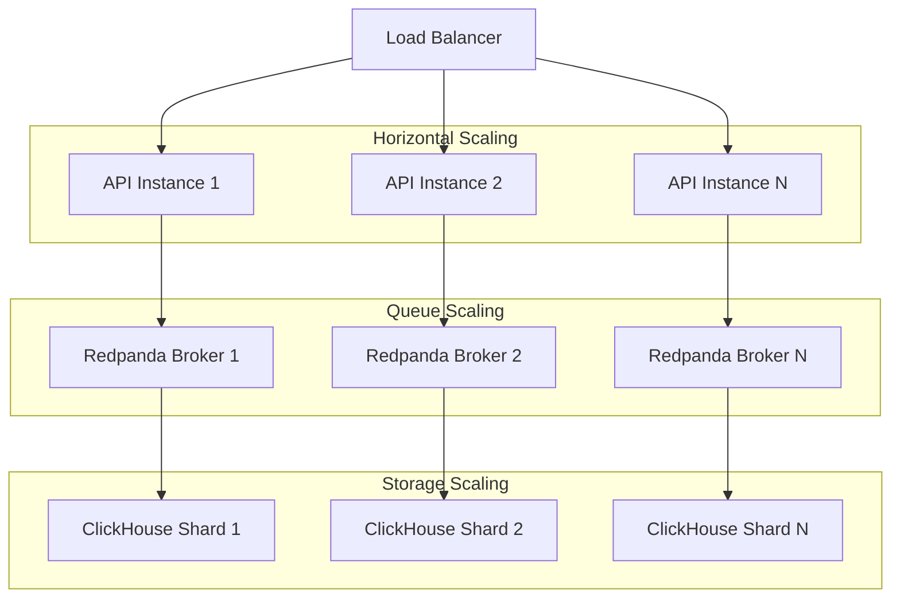
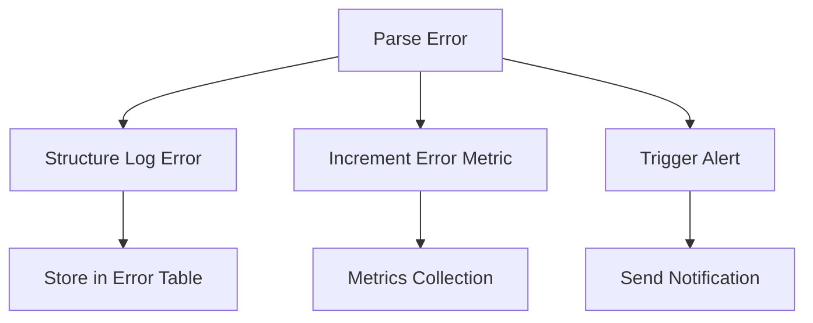

# Logforge Architecture & API Flow Documentation

## Overview

Logforge is an advanced, cost-effective observability and SIEM platform designed for enterprise security and operations teams. This document provides a comprehensive view of the system architecture, component interactions, and data flow through the platform.

## System Architecture



## Component Details

### 1. API Layer (FastAPI)

**Location**: `/apps/api/`
**Port**: 7080 (internal), 8080 (container)
**Language**: Python with FastAPI

#### Core Components:

- **`main.py`** - FastAPI application with all endpoints
- **`models.py`** - Pydantic data models for validation
- **`parsers.py`** - Log format parsers (JSON, Nginx, Syslog, etc.)
- **`storage_config.py`** - Multi-cloud storage configuration
- **`ttl_manager.py`** - Data lifecycle and retention management

#### API Endpoints:

```
Health & Status:
├── GET /health                    # System health check
├── GET /openapi.json             # OpenAPI schema
└── GET /docs                     # Swagger UI

Log Ingestion:
├── POST /v1/ingest/logs          # Generic JSON log ingestion
├── POST /v1/ingest/logs/batch    # High-performance batch ingestion
├── POST /v1/ingest/otlp          # OpenTelemetry Protocol logs
├── POST /v1/ingest/syslog        # RFC 3164/5424 syslog messages
├── POST /v1/ingest/nginx         # Nginx access log parsing
├── POST /v1/ingest/cef           # Common Event Format (security logs)
├── POST /v1/ingest/text          # Plain text with regex matching
├── POST /v1/ingest/structured    # Application JSON logs
└── POST /v1/ingest               # Auto-detect format and parse

Query & Search:
├── POST /v1/query                # Query logs with filters
├── GET /v1/logs                  # Simple log retrieval
└── POST /v1/search               # Advanced search (future)

Analytics & Alerts:
├── POST /v1/alerts/test          # Test alert rules
├── GET /v1/metrics               # System metrics (future)
└── GET /v1/dashboards            # Dashboard data (future)

Storage Management:
├── GET /v1/storage/health        # Storage system health check
├── POST /v1/storage/policies     # Apply retention policies
├── GET /v1/storage/usage         # Storage usage statistics
└── POST /v1/storage/archive      # Manual data archival
```

### 2. Frontend (Next.js)

**Location**: `/apps/ui/`
**Port**: 3001 (external), 3000 (container)
**Technology**: Next.js 14, React, TypeScript, Tailwind CSS

#### Pages & Components:

```
Frontend Structure:
├── app/
│   ├── page.tsx                  # Landing page
│   ├── logs/page.tsx            # Log viewer with filtering
│   ├── health/page.tsx          # System health dashboard
│   └── layout.tsx               # Root layout
├── components/                   # Reusable UI components
└── lib/                         # Utility functions
```

#### Key Features:
- **Real-time Log Viewer** - Live log streaming and filtering
- **Health Dashboard** - System component status monitoring
- **Search Interface** - Query builder for log search
- **Responsive Design** - Mobile-friendly interface

### 3. Storage Layer

#### ClickHouse (Hot Data)
**Port**: 8124 (external), 8123 (container)
**Purpose**: High-performance analytics database for recent logs

**Schema**: `/infra/docker/clickhouse/init_enhanced.sql`
```sql
-- Enhanced log table with advanced TTL policies
CREATE TABLE logs_raw (
    ts DateTime64(3, 'UTC'),
    host LowCardinality(String),
    service LowCardinality(String),
    level LowCardinality(String),
    msg String,
    trace_id String,
    span_id String,
    attrs String,
    status UInt16,
    src_ip String,
    user_id String,
    ingested_at DateTime64(3, 'UTC'),
    severity_num UInt8,
    facility UInt8,
    parser_version String
) ENGINE = MergeTree()
PARTITION BY toYYYYMM(ts)
ORDER BY (service, level, ts, host)
TTL ts + INTERVAL customer_retention_days DAY TO VOLUME 'cold',
    ts + INTERVAL compliance_retention_days DAY DELETE
```

**Performance Features**:
- Monthly partitioning for efficient querying
- Advanced compression with CODEC optimization
- Multi-tier storage (hot/cold/archive)
- Customer-specific TTL policies
- Materialized views for real-time analytics
- Automated data lifecycle management

#### Cold Storage (Multi-Cloud)
**Purpose**: Long-term archival of older logs

**Supported Backends**:
- **AWS S3** - Production workloads
- **Google Cloud Storage** - GCP deployments  
- **Azure Blob Storage** - Microsoft environments
- **MinIO** - On-premises/private cloud

**Configuration**: `/config/storage-config.yaml`
```yaml
deployment_types:
  shared:        # Multi-tenant shared infrastructure
  dedicated:     # Customer-specific resources
  fedramp:       # Government compliance requirements
  private:       # On-premises deployments
```

### 4. Message Queue (Redpanda)

**Port**: 19092 (Kafka protocol), 18081 (Schema Registry)
**Purpose**: Asynchronous log processing and buffering

#### Features:
- **Kafka-compatible** - Standard Kafka producers/consumers
- **Schema Registry** - Message format validation
- **High Throughput** - Built for streaming workloads
- **Fault Tolerance** - Replication and durability

#### Topics:
```
log-ingestion     # Raw log messages from API
log-processed     # Parsed and validated logs
log-alerts        # Alert notifications
system-metrics    # Internal monitoring data
```

### 5. Background Workers

**Location**: `/apps/workers/` (planned)
**Purpose**: Asynchronous processing of log batches

#### Worker Types:
- **Ingestion Worker** - Process raw logs from queue
- **Enrichment Worker** - Add metadata and context
- **Alert Worker** - Evaluate alert rules
- **Archive Worker** - Move old data to cold storage

## Data Flow Diagrams

### 1. Log Ingestion Flow



### 2. Query Flow



### 3. Multi-Format Parsing Flow



## TTL Architecture & Data Lifecycle Management

### TTL Management System

**Location**: `/apps/api/ttl_manager.py`
**Purpose**: Automated data lifecycle management with compliance-driven retention policies

#### Core Components:

- **RetentionPolicy** - Dataclass defining customer-specific retention rules
- **TTLManager** - Main class for policy application and data archival
- **TTLScheduler** - Background scheduler for automated cleanup tasks

#### TTL Flow Diagram



#### Retention Policies by Customer Type

```python
@dataclass
class RetentionPolicy:
    deployment_type: str
    hot_days: int          # Days in ClickHouse hot storage
    cold_days: int         # Days in object storage
    total_days: int        # Total retention period
    compliance_standard: str
    encryption_required: bool
    geographic_restriction: Optional[str]
    
# Pre-defined policies
RETENTION_POLICIES = {
    "shared": RetentionPolicy(
        deployment_type="shared",
        hot_days=7,
        cold_days=23, 
        total_days=30,
        compliance_standard="SOC2",
        encryption_required=True
    ),
    "fedramp": RetentionPolicy(
        deployment_type="fedramp", 
        hot_days=30,
        cold_days=2525,
        total_days=2555,  # 7 years
        compliance_standard="FedRAMP",
        encryption_required=True,
        geographic_restriction="us-gov"
    ),
    "healthcare": RetentionPolicy(
        deployment_type="healthcare",
        hot_days=30,
        cold_days=2160,
        total_days=2190,  # 6 years
        compliance_standard="HIPAA", 
        encryption_required=True
    )
}
```

#### Multi-Cloud Storage Integration

**Supported Storage Backends**:
- **AWS S3** - Production workloads with lifecycle policies
- **Google Cloud Storage** - GCP deployments with Coldline/Archive tiers
- **Azure Blob Storage** - Microsoft environments with Cool/Archive tiers  
- **MinIO** - On-premises with custom lifecycle management

#### TTL API Endpoints

```
Storage Management:
├── GET /v1/storage/health        # Storage system health & capacity
├── POST /v1/storage/policies     # Apply/update retention policies
├── GET /v1/storage/usage         # Detailed usage by customer/time
├── POST /v1/storage/archive      # Manual data archival trigger
└── GET /v1/storage/compliance    # Compliance status reporting
```

#### Automated TTL Processing

The TTL system runs scheduled tasks for:

1. **Daily Archive Check** - Move data from hot to cold storage
2. **Weekly Cleanup** - Delete expired data per compliance rules
3. **Monthly Audit** - Generate retention compliance reports
4. **Quarterly Review** - Optimize storage costs and performance

## Parser Architecture

### Supported Log Formats

| Format | Parser | Description | Example |
|--------|---------|-------------|---------|
| **JSON** | `JSONParser` | Structured application logs | `{"level": "info", "message": "User login"}` |
| **Nginx** | `NginxParser` | Web server access logs | `192.168.1.1 - - [25/Dec/2023:10:00:00 +0000] "GET / HTTP/1.1" 200 1234` |
| **Syslog** | `SyslogParser` | System logs (RFC 3164/5424) | `<34>Dec 25 10:00:00 host service: message` |
| **CEF** | `CEFParser` | Security event format | `CEF:0\|Vendor\|Product\|1.0\|100\|Event\|5\|msg=Security event` |
| **OTLP** | `OTLPParser` | OpenTelemetry logs | OpenTelemetry Protocol JSON structure |
| **Text** | `TextParser` | Plain text with regex | `2023-12-25 10:00:00 INFO Application started` |

### Parser Factory Pattern

```python
class ParserFactory:
    def __init__(self):
        self.parsers = {
            'json': JSONParser(),
            'nginx': NginxParser(),
            'syslog': SyslogParser(),
            'cef': CEFParser(),
            'otlp': OTLPParser(),
            'text': TextParser()
        }
    
    def get_parser(self, format_type: str):
        return self.parsers.get(format_type)
    
    def auto_detect(self, data: str) -> str:
        # Auto-detection logic for format identification
        pass
```

## Storage Configuration Architecture

### Multi-Cloud Support

The platform supports flexible deployment models with different storage backends:

```yaml
# Shared deployment (multi-tenant)
customer_configs:
  startup-company:
    deployment_type: "shared"
    retention_days: 30
    
# Dedicated deployment (single-tenant)
  enterprise-corp:
    deployment_type: "dedicated"
    retention_days: 365
    custom_storage:
      type: "s3"
      bucket: "enterprise-logs-bucket"
      region: "us-east-1"
      
# FedRAMP deployment (government)
  gov-agency:
    deployment_type: "fedramp"
    retention_days: 2555  # 7 years
    encryption_at_rest: true
    custom_storage:
      type: "s3"
      bucket: "fedramp-secure-bucket"
      region: "us-gov-east-1"
```

### ClickHouse Storage Policies

Dynamic storage policies are generated based on customer configuration:

```xml
<storage_policy>
    <volumes>
        <hot>
            <disk>default</disk>
        </hot>
        <cold>
            <disk>s3_disk</disk>
        </cold>
    </volumes>
    <move_factor>0.2</move_factor>
</storage_policy>
```

## Performance Characteristics

### Current Performance Targets (M1)

| Component | Metric | Target | Current Status |
|-----------|--------|--------|----------------|
| **Parsers** | Throughput | >10,000 logs/sec per parser | ✅ Achieved |
| **API** | Ingestion latency | P99 <50ms | 🚧 In testing |
| **API** | Query latency | P99 <200ms | 🚧 In testing |
| **API** | Concurrent throughput | >2,000 req/sec | 🚧 In testing |
| **Storage** | ClickHouse ingestion | >50k EPS per node | 📋 Planned |
| **Storage** | Query performance | P50 <1.5s on 200M rows | 📋 Planned |

### Scalability Design



## Security Architecture

### Data Protection

1. **Encryption in Transit**: TLS 1.3 for all API communication
2. **Encryption at Rest**: Customer-configured encryption keys
3. **PII Redaction**: Automatic detection and masking at ingestion
4. **Access Control**: RBAC with OIDC integration

### Compliance Support

| Standard | Support | Implementation |
|----------|---------|----------------|
| **SOC 2** | ✅ Type I/II | Audit logging, access controls |
| **FedRAMP** | ✅ Moderate | Government cloud deployment |
| **HIPAA** | 📋 Planned | PII redaction, encryption |
| **GDPR** | 📋 Planned | Data retention, right to deletion |

## Error Handling & Monitoring

### Error Flow



### Health Checks

Each component provides health endpoints:

- **API**: `GET /health` - FastAPI application status
- **ClickHouse**: Connection and query tests
- **Redpanda**: Producer/consumer connectivity
- **MinIO**: Storage accessibility
- **Frontend**: Build and runtime status

## Development & Testing

### Local Development Setup

```bash
# Start all services
docker compose -f infra/docker/compose.yml up -d

# Services will be available at:
# - API: http://localhost:7080
# - UI: http://localhost:3001  
# - ClickHouse: http://localhost:8124
# - MinIO Console: http://localhost:9004
# - Redpanda Console: http://localhost:19644
```

### Test Suite Architecture

```
tests/
├── unit/                    # Fast unit tests
│   ├── test_parsers.py     # Parser logic
│   ├── test_models.py      # Data validation
│   └── test_storage.py     # Storage config
├── integration/             # Component interaction tests
│   ├── test_api.py         # API endpoints
│   └── test_pipeline.py    # End-to-end flows
└── performance/             # Load and benchmark tests
    ├── test_throughput.py  # Ingestion performance
    └── test_latency.py     # Query performance
```

### Performance Testing

The comprehensive test suite includes:

- **Parser Throughput**: 10k+ logs/sec per format
- **API Latency**: P50/P95/P99 measurements
- **Concurrent Load**: Multi-threaded stress testing  
- **Memory Efficiency**: Resource usage monitoring
- **End-to-End**: Complete pipeline validation

## Future Architecture (M2-M7)

### Planned Enhancements

1. **M2: Search & Dashboards**
   - Elasticsearch-like query DSL
   - Pre-built dashboard templates
   - Real-time streaming dashboards

2. **M3: Alerts & Integrations**
   - Sigma rule engine
   - Multi-channel notifications
   - Webhook integrations

3. **M4: Security Analytics**
   - MITRE ATT&CK mapping
   - Threat intelligence feeds
   - SOAR integrations

4. **M5: Traces & Metrics**
   - OpenTelemetry trace correlation
   - Metrics ingestion and alerting
   - APM-style monitoring

5. **M6: AI Assistant**
   - Natural language queries
   - Automated root cause analysis
   - Intelligent alerting

6. **M7: Enterprise Readiness**
   - Multi-tenancy at scale
   - Advanced RBAC
   - Compliance automation

## API Usage Examples

### Ingesting Logs

```bash
# JSON logs
curl -X POST http://localhost:7080/v1/ingest/logs \
  -H "Content-Type: application/json" \
  -d '{"level": "info", "message": "User login successful", "user_id": "john123"}'

# Nginx logs
curl -X POST http://localhost:7080/v1/ingest/nginx \
  -H "Content-Type: text/plain" \
  -d '192.168.1.100 - - [25/Dec/2023:10:00:00 +0000] "GET /api/users HTTP/1.1" 200 1234'

# Batch ingestion
curl -X POST http://localhost:7080/v1/ingest/logs/batch \
  -H "Content-Type: application/json" \
  -d '{
    "logs": [
      {"level": "info", "message": "Log 1"},
      {"level": "error", "message": "Log 2"}
    ]
  }'
```

### Querying Logs

```bash
# Simple query
curl -X POST http://localhost:7080/v1/query \
  -H "Content-Type: application/json" \
  -d '{
    "query": "level=error",
    "start_time": "2023-12-25T00:00:00Z",
    "end_time": "2023-12-25T23:59:59Z",
    "limit": 100
  }'
```

This architecture provides a solid foundation for the complete Logforge platform, with clear separation of concerns, scalable design patterns, and comprehensive observability features.