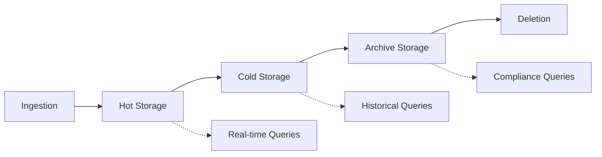

# Cold Storage & Archival Implementation Plan

## Executive Summary

This document outlines the comprehensive implementation plan for tenant-wise cold storage and archival system in Logforge. The system will provide cost-effective data lifecycle management with enterprise-grade compliance features.

## Current State Analysis

### ✅ What's Working
- **Hot Storage**: ClickHouse tables with 7-day retention
- **Multi-tenant Data**: Proper tenant isolation in `logs_raw_mt`, `logs_normalized_mt`
- **Real-time Queries**: Fast queries on hot data
- **Retention API**: Configuration endpoints for retention policies

### ❌ Gaps Identified
- **TTL Policies**: Hardcoded 7-day TTL, policies not applied
- **Cold Storage Queries**: Data archived but not queryable
- **Tenant Isolation**: Cold storage lacks proper tenant separation
- **Data Lifecycle**: Manual archival, no automated transitions

## Architecture Overview

### Data Lifecycle Tiers



### Storage Tier Definitions

| Tier | Storage Backend | Query Performance | Cost | Use Case |
|------|----------------|-------------------|------|----------|
| **Hot** | ClickHouse | Sub-second | High | Real-time analytics, alerts |
| **Cold** | Object Storage + External Tables | 5-30 seconds | Medium | Historical analysis |
| **Archive** | Object Storage (Compressed) | 1-5 minutes | Low | Compliance, audit |

## Implementation Phases

## Phase 1: Dynamic TTL Management

### 1.1 TTL Policy Engine

**File**: `/apps/api/ttl_policy_engine.py`

```python
class TTLPolicyEngine:
    """Manages dynamic TTL policies for multi-tenant tables"""
    
    async def apply_tenant_ttl_policy(self, customer_id: str, policy: RetentionPolicy):
        """Apply TTL policy to specific tenant's data"""
        
        # Update TTL for hot storage (ClickHouse)
        hot_ttl_sql = f"""
        ALTER TABLE logs_raw_mt MODIFY TTL 
            ts + toIntervalDay({policy.hot_retention_days}) 
            TO VOLUME 'cold_storage'
        """
        
        # Update TTL for final deletion
        delete_ttl_sql = f"""
        ALTER TABLE logs_raw_mt MODIFY TTL 
            ts + toIntervalDay({policy.archive_retention_days}) 
            DELETE WHERE customer_id = '{customer_id}'
        """
        
    async def create_tenant_storage_volumes(self, customer_id: str):
        """Create tenant-specific storage volumes"""
        
        # Hot volume (SSD)
        hot_volume_sql = f"""
        CREATE VOLUME IF NOT EXISTS tenant_{customer_id}_hot
        STORAGE POLICY 'default'
        """
        
        # Cold volume (Object Storage)
        cold_volume_sql = f"""
        CREATE VOLUME IF NOT EXISTS tenant_{customer_id}_cold
        STORAGE POLICY 'cold_storage'
        """
```

### 1.2 Database Schema Updates

**File**: `/infra/docker/clickhouse/cold_storage_schema.sql`

```sql
-- Storage policies for different tiers
CREATE STORAGE POLICY IF NOT EXISTS cold_storage
DISKS DEFAULT, 's3_disk'
VOLUMES DEFAULT DISK DEFAULT, 
        cold_storage DISK 's3_disk';

-- External table for querying cold storage
CREATE TABLE IF NOT EXISTS logs_cold_mt (
    ts DateTime64(3, 'UTC'),
    customer_id String,
    host String,
    service String,
    level String,
    msg String,
    -- ... other fields
) ENGINE = S3(
    'http://minio:9000/logforge-cold/{customer_id}/year={year}/month={month}/day={day}/*.parquet',
    'minio',
    'minio123',
    'Parquet'
) PARTITION BY (customer_id, toYYYYMM(ts));

-- Materialized view for seamless querying
CREATE MATERIALIZED VIEW IF NOT EXISTS logs_unified_query_mv
AS SELECT * FROM logs_raw_mt
UNION ALL
SELECT * FROM logs_cold_mt;
```

## Phase 2: Tenant-Isolated Cold Storage

### 2.1 Storage Path Structure

```
logforge-storage/
├── tenants/
│   ├── {tenant_id}/
│   │   ├── hot/                    # ClickHouse data (symlink)
│   │   ├── cold/
│   │   │   ├── year=2024/
│   │   │   │   ├── month=01/
│   │   │   │   │   ├── day=01/
│   │   │   │   │   │   ├── logs_000.parquet
│   │   │   │   │   │   └── logs_001.parquet
│   │   │   │   │   └── day=02/
│   │   │   │   └── month=02/
│   │   │   └── year=2025/
│   │   └── archive/
│   │       ├── compliance/         # Long-term compliance data
│   │       ├── audit/              # Audit trails
│   │       └── backup/             # Full backups
│   └── shared/
│       ├── indexes/                # Shared search indexes
│       └── metadata/               # System metadata
```

### 2.2 Cold Storage Manager

**File**: `/apps/api/services/cold_storage_service.py`

```python
class ColdStorageService:
    """Manages tenant-isolated cold storage operations"""
    
    async def archive_tenant_data(self, customer_id: str, start_date: datetime, end_date: datetime):
        """Archive tenant data to cold storage with proper isolation"""
        
        # 1. Query hot storage data
        query = f"""
        SELECT * FROM logs_raw_mt 
        WHERE customer_id = '{customer_id}'
        AND ts >= '{start_date}' AND ts < '{end_date}'
        ORDER BY ts
        """
        
        # 2. Convert to Parquet with compression
        parquet_path = f"tenants/{customer_id}/cold/year={start_date.year}/month={start_date.month:02d}/day={start_date.day:02d}/"
        
        # 3. Upload to tenant-specific path
        await self._upload_parquet_data(data, parquet_path, customer_id)
        
        # 4. Create metadata record
        await self._create_archive_metadata(customer_id, parquet_path, data_stats)
        
        # 5. Verify upload and delete hot data
        if await self._verify_cold_storage(parquet_path):
            await self._delete_hot_data(customer_id, start_date, end_date)
    
    async def restore_tenant_data(self, customer_id: str, archive_key: str):
        """Restore archived data to hot storage for querying"""
        
        # 1. Download from cold storage
        data = await self._download_parquet_data(archive_key, customer_id)
        
        # 2. Insert back to hot storage with restoration metadata
        await self._insert_restored_data(data, customer_id)
        
        # 3. Mark as temporarily restored (TTL in 24 hours)
        await self._mark_restoration_ttl(customer_id, archive_key)
```

### 2.3 Tenant Security & Isolation

**File**: `/apps/api/middleware/cold_storage_auth.py`

```python
class ColdStorageAuthMiddleware:
    """Ensures tenant isolation for cold storage operations"""
    
    def validate_tenant_access(self, customer_id: str, storage_path: str) -> bool:
        """Validate tenant can only access their own cold storage"""
        
        # Extract tenant from path
        path_tenant = self._extract_tenant_from_path(storage_path)
        
        # Validate access
        if path_tenant != customer_id:
            raise SecurityError(f"Tenant {customer_id} cannot access {path_tenant} data")
        
        return True
    
    def get_tenant_storage_policy(self, customer_id: str) -> Dict[str, Any]:
        """Get tenant-specific storage policy"""
        
        return {
            "encryption_required": True,
            "compression_level": "high",
            "geo_restrictions": self._get_tenant_geo_policy(customer_id),
            "retention_policy": self._get_tenant_retention_policy(customer_id)
        }
```

## Phase 3: Unified Query Engine

### 3.1 Federated Query System

**File**: `/apps/api/query_engines/federated_query_engine.py`

```python
class FederatedQueryEngine:
    """Queries across hot, cold, and archive storage tiers"""
    
    async def execute_federated_query(self, customer_id: str, query: QueryRequest) -> QueryResult:
        """Execute query across all storage tiers"""
        
        # 1. Analyze query time range
        time_range = self._analyze_query_time_range(query)
        
        # 2. Determine required storage tiers
        tiers = self._determine_storage_tiers(time_range, customer_id)
        
        # 3. Execute parallel queries
        results = await asyncio.gather(
            self._query_hot_storage(query, customer_id) if 'hot' in tiers else None,
            self._query_cold_storage(query, customer_id) if 'cold' in tiers else None,
            self._query_archive_storage(query, customer_id) if 'archive' in tiers else None
        )
        
        # 4. Merge and deduplicate results
        return self._merge_tier_results(results)
    
    async def _query_cold_storage(self, query: QueryRequest, customer_id: str) -> List[Dict]:
        """Query cold storage using external tables"""
        
        # Use ClickHouse external table for Parquet files
        cold_query = f"""
        SELECT * FROM s3(
            'http://minio:9000/logforge-cold/tenants/{customer_id}/cold/**/*.parquet',
            'minio', 'minio123', 'Parquet'
        ) WHERE {self._convert_query_filters(query)}
        """
        
        return await self.clickhouse_client.query(cold_query)
```

### 3.2 Query Optimization

**File**: `/apps/api/query_engines/cold_storage_optimizer.py`

```python
class ColdStorageQueryOptimizer:
    """Optimizes queries for cold storage performance"""
    
    def optimize_cold_query(self, query: QueryRequest, customer_id: str) -> OptimizedQuery:
        """Optimize query for cold storage execution"""
        
        # 1. Partition pruning based on time range
        partitions = self._get_relevant_partitions(query.time_range, customer_id)
        
        # 2. Predicate pushdown to Parquet level
        parquet_filters = self._create_parquet_filters(query.filters)
        
        # 3. Column pruning for bandwidth optimization
        required_columns = self._analyze_required_columns(query)
        
        # 4. Generate optimized S3 paths
        s3_paths = self._generate_s3_paths(partitions, customer_id)
        
        return OptimizedQuery(
            s3_paths=s3_paths,
            parquet_filters=parquet_filters,
            columns=required_columns,
            estimated_cost=self._estimate_query_cost(partitions)
        )
```

## Phase 4: Archival & Compliance

### 4.1 Compliance Archival System

**File**: `/apps/api/services/compliance_archival_service.py`

```python
class ComplianceArchivalService:
    """Handles compliance-driven archival and legal hold"""
    
    async def create_compliance_archive(self, customer_id: str, compliance_type: str, date_range: DateRange):
        """Create compliance-specific archives (SOX, HIPAA, GDPR)"""
        
        compliance_policies = {
            'SOX': {'retention_years': 7, 'encryption': 'AES256', 'immutable': True},
            'HIPAA': {'retention_years': 6, 'encryption': 'AES256', 'audit_trail': True},
            'GDPR': {'retention_years': 0, 'right_to_delete': True, 'pseudonymization': True}
        }
        
        policy = compliance_policies.get(compliance_type)
        if not policy:
            raise ValueError(f"Unknown compliance type: {compliance_type}")
        
        # Create immutable archive with compliance metadata
        archive_path = f"tenants/{customer_id}/archive/compliance/{compliance_type}/"
        
        await self._create_immutable_archive(
            customer_id=customer_id,
            archive_path=archive_path,
            policy=policy,
            date_range=date_range
        )
    
    async def apply_legal_hold(self, customer_id: str, case_id: str, data_selector: Dict):
        """Apply legal hold to prevent data deletion"""
        
        # Mark data with legal hold
        hold_metadata = {
            'case_id': case_id,
            'created_at': datetime.utcnow(),
            'expires_at': None,  # Manual release required
            'authority': 'legal_department'
        }
        
        await self._mark_legal_hold(customer_id, data_selector, hold_metadata)
```

### 4.2 Data Lifecycle Automation

**File**: `/apps/api/services/data_lifecycle_service.py`

```python
class DataLifecycleService:
    """Automates data transitions between storage tiers"""
    
    async def run_lifecycle_policies(self):
        """Execute automated data lifecycle policies"""
        
        # Get all active tenants with retention policies
        tenants = await self._get_tenants_with_policies()
        
        for tenant in tenants:
            policy = await self._get_tenant_retention_policy(tenant.customer_id)
            
            # Hot to Cold transition
            await self._transition_hot_to_cold(tenant.customer_id, policy)
            
            # Cold to Archive transition  
            await self._transition_cold_to_archive(tenant.customer_id, policy)
            
            # Archive deletion (if enabled)
            if policy.auto_deletion_enabled:
                await self._delete_expired_archives(tenant.customer_id, policy)
    
    async def _transition_hot_to_cold(self, customer_id: str, policy: RetentionPolicy):
        """Move data from hot to cold storage"""
        
        cutoff_date = datetime.utcnow() - timedelta(days=policy.hot_retention_days)
        
        # Find data older than hot retention
        old_data_query = f"""
        SELECT DISTINCT toDate(ts) as date_partition
        FROM logs_raw_mt 
        WHERE customer_id = '{customer_id}'
        AND ts < '{cutoff_date}'
        ORDER BY date_partition
        """
        
        dates_to_archive = await self.clickhouse_client.query(old_data_query)
        
        for date_partition in dates_to_archive:
            await self.cold_storage_service.archive_tenant_data(
                customer_id=customer_id,
                start_date=date_partition['date_partition'],
                end_date=date_partition['date_partition'] + timedelta(days=1)
            )
```

## Phase 5: Monitoring & Operations

### 5.1 Cold Storage Monitoring

**File**: `/apps/api/monitoring/cold_storage_monitor.py`

```python
class ColdStorageMonitor:
    """Monitors cold storage health and performance"""
    
    async def get_tenant_storage_metrics(self, customer_id: str) -> Dict[str, Any]:
        """Get comprehensive storage metrics for tenant"""
        
        return {
            'hot_storage': {
                'size_gb': await self._get_hot_storage_size(customer_id),
                'record_count': await self._get_hot_record_count(customer_id),
                'oldest_record': await self._get_oldest_hot_record(customer_id)
            },
            'cold_storage': {
                'size_gb': await self._get_cold_storage_size(customer_id),
                'file_count': await self._get_cold_file_count(customer_id),
                'compression_ratio': await self._get_compression_ratio(customer_id)
            },
            'archive_storage': {
                'size_gb': await self._get_archive_storage_size(customer_id),
                'compliance_archives': await self._get_compliance_archive_count(customer_id)
            },
            'cost_breakdown': await self._calculate_storage_costs(customer_id)
        }
```

### 5.2 Performance Optimization

**File**: `/apps/api/optimization/cold_storage_optimizer.py`

```python
class ColdStorageOptimizer:
    """Optimizes cold storage for cost and performance"""
    
    async def optimize_tenant_storage(self, customer_id: str):
        """Run optimization routines for tenant storage"""
        
        # 1. Compact small Parquet files
        await self._compact_small_files(customer_id)
        
        # 2. Optimize partition structure
        await self._optimize_partitions(customer_id)
        
        # 3. Update compression settings
        await self._optimize_compression(customer_id)
        
        # 4. Clean up orphaned metadata
        await self._cleanup_orphaned_metadata(customer_id)
    
    async def _compact_small_files(self, customer_id: str):
        """Combine small Parquet files for better performance"""
        
        # Find partitions with many small files
        small_files = await self._find_small_files(customer_id)
        
        for partition in small_files:
            if partition['file_count'] > 10 and partition['avg_size_mb'] < 100:
                await self._combine_partition_files(customer_id, partition)
```

## API Endpoints

### Storage Management APIs

```python
# Retention Policy Management
POST /v1/storage/retention/{customer_id}      # Create retention policy
GET  /v1/storage/retention/{customer_id}       # Get retention policy  
PUT  /v1/storage/retention/{customer_id}       # Update retention policy

# Cold Storage Operations
POST /v1/storage/archive/{customer_id}         # Trigger archival
GET  /v1/storage/archives/{customer_id}        # List archives
POST /v1/storage/restore/{customer_id}         # Restore from cold storage

# Query APIs
POST /v1/query/federated                       # Federated query (hot + cold)
POST /v1/query/cold-storage                    # Cold storage only query
POST /v1/query/archive                         # Archive query

# Monitoring APIs
GET  /v1/storage/metrics/{customer_id}         # Storage metrics
GET  /v1/storage/health/{customer_id}          # Storage health
POST /v1/storage/optimize/{customer_id}        # Trigger optimization

# Compliance APIs
POST /v1/compliance/legal-hold/{customer_id}   # Apply legal hold
POST /v1/compliance/archive/{customer_id}      # Compliance archive
GET  /v1/compliance/audit/{customer_id}        # Audit trail
```

## Implementation Timeline

### Phase 1: Foundation (4 weeks)
- [ ] Dynamic TTL policy engine
- [ ] Database schema updates  
- [ ] Basic cold storage structure
- [ ] Tenant isolation framework

### Phase 2: Cold Storage (6 weeks)
- [ ] Tenant-isolated storage paths
- [ ] Cold storage manager service
- [ ] Basic archival operations
- [ ] Security & access controls

### Phase 3: Query Engine (8 weeks)  
- [ ] Federated query system
- [ ] External table integration
- [ ] Query optimization engine
- [ ] Performance monitoring

### Phase 4: Compliance (4 weeks)
- [ ] Compliance archival system
- [ ] Legal hold functionality
- [ ] Data lifecycle automation
- [ ] Audit trail system

### Phase 5: Operations (3 weeks)
- [ ] Monitoring dashboards
- [ ] Performance optimization
- [ ] Cost management tools
- [ ] Operational runbooks

## Success Metrics

### Performance Targets
- **Hot Storage Queries**: < 2 seconds (95th percentile)
- **Cold Storage Queries**: < 30 seconds (95th percentile)  
- **Archive Queries**: < 5 minutes (95th percentile)
- **Data Archival Rate**: > 1TB/hour per tenant

### Cost Targets
- **Hot Storage**: $0.10/GB/month (ClickHouse)
- **Cold Storage**: $0.02/GB/month (Object storage)
- **Archive Storage**: $0.005/GB/month (Deep archive)
- **Overall Savings**: 60-80% vs all-hot storage

### Reliability Targets
- **Data Durability**: 99.999999999% (11 9's)
- **Query Availability**: 99.9% uptime
- **Recovery Time**: < 4 hours for any data
- **Backup Verification**: 100% automated verification

## Risk Mitigation

### Data Loss Prevention
- **Multiple Replicas**: 3 copies minimum across regions
- **Checksums**: SHA-256 verification for all transfers
- **Backup Verification**: Automated restore testing
- **Immutable Storage**: Write-once, read-many for compliance

### Performance Risks
- **Query Timeouts**: Automatic fallback to hot storage
- **Bandwidth Limits**: Intelligent query routing
- **Cache Warming**: Predictive cold storage preloading
- **Load Balancing**: Distribute queries across storage tiers

### Security Risks
- **Encryption**: AES-256 for all cold storage
- **Access Controls**: Fine-grained tenant permissions
- **Audit Logging**: Complete access audit trail
- **Key Management**: HSM-backed encryption keys

## Conclusion

This comprehensive plan provides a roadmap for implementing enterprise-grade cold storage and archival capabilities in Logforge. The phased approach ensures minimal disruption to existing operations while building a robust, scalable, and compliant storage system.

The implementation will enable:
- **60-80% cost reduction** through intelligent data tiering
- **Compliance support** for SOX, HIPAA, GDPR, and other regulations
- **Seamless querying** across all storage tiers
- **Automated lifecycle management** with minimal operational overhead

**Next Steps**: Begin Phase 1 implementation with dynamic TTL policies and foundational storage architecture.