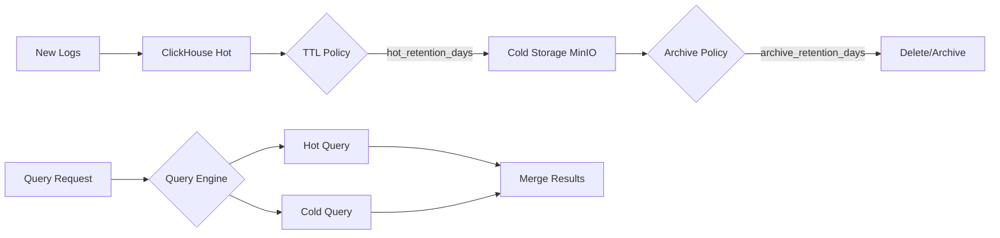

# Cold Storage Quick Reference

## TL;DR - What We Need to Build

### Current Problem
- ❌ Retention policies stored but **not applied** to ClickHouse tables
- ❌ Data archived to MinIO but **cannot be queried**  
- ❌ Hardcoded 7-day TTL ignores tenant retention settings
- ❌ No tenant isolation in cold storage paths

### Solution Summary
1. **Fix TTL Application** - Make retention policies actually work
2. **Tenant-Isolated Cold Storage** - Separate paths per tenant  
3. **Federated Query Engine** - Query hot + cold storage seamlessly
4. **Automated Lifecycle** - Move data automatically between tiers

## Quick Implementation Checklist

### Phase 1: Fix TTL Policies (Week 1)
- [ ] Create `TTLPolicyEngine` to apply dynamic TTL
- [ ] Update `storage_service.py` to call TTL engine after policy creation
- [ ] Test TTL application on multi-tenant tables
- [ ] Verify data moves/deletes based on retention settings

### Phase 2: Cold Storage Structure (Week 2-3) 
- [ ] Create tenant-isolated storage paths (`tenants/{tenant_id}/cold/`)
- [ ] Build `ColdStorageService` for archival operations
- [ ] Add archive metadata tracking in `archive_metadata_mt`
- [ ] Test archival of sample tenant data

### Phase 3: Query Engine (Week 4-5)
- [ ] Create `FederatedQueryEngine` for cross-tier queries
- [ ] Add external table support for Parquet files
- [ ] Build query optimization for cold storage
- [ ] Test querying both hot and cold data

### Phase 4: API Integration (Week 6)
- [ ] Update storage router with new endpoints
- [ ] Add federated query endpoint (`/v1/storage/query/federated`)
- [ ] Build monitoring and health checks  
- [ ] Test end-to-end workflows

## Key Components to Build

### 1. TTL Policy Engine
```python
# File: /apps/api/engines/ttl_policy_engine.py
class TTLPolicyEngine:
    async def apply_retention_policy(self, customer_id: str, policy: Dict):
        # Apply TTL to ClickHouse tables based on retention settings
        hot_days = policy['hot_retention_days'] 
        await self._apply_hot_ttl(hot_days)
```

### 2. Cold Storage Service  
```python
# File: /apps/api/services/cold_storage_service.py
class ColdStorageService:
    async def archive_tenant_partition(self, customer_id: str, partition_date: str):
        # Archive specific date partition to tenant-isolated cold storage
        path = f"tenants/{customer_id}/cold/year={year}/month={month}/day={day}/"
```

### 3. Federated Query Engine
```python
# File: /apps/api/engines/federated_query_engine.py  
class FederatedQueryEngine:
    async def execute_query(self, query: QueryRequest, customer_id: str):
        # Query both hot ClickHouse and cold Parquet files
        hot_results = await self._query_hot_storage(query, customer_id)
        cold_results = await self._query_cold_storage(query, customer_id)
        return self._merge_results([hot_results, cold_results])
```

## Storage Path Structure

```
logforge-storage/
├── tenants/
│   ├── tenant-123/
│   │   ├── cold/
│   │   │   ├── year=2024/month=01/day=01/logs_2024-01-01.parquet
│   │   │   ├── year=2024/month=01/day=02/logs_2024-01-02.parquet
│   │   │   └── year=2024/month=02/day=01/logs_2024-02-01.parquet  
│   │   └── archive/
│   │       ├── compliance/sox/logs_2023.parquet
│   │       └── backup/full_backup_2024-01.parquet
│   └── tenant-456/
│       ├── cold/
│       └── archive/
```

## Data Flow



## Database Changes Needed

### Update TTL to be Dynamic
```sql
-- Current (BROKEN):
TTL toDateTime(ts) + toIntervalDay(7)

-- Should be (DYNAMIC - applied by TTL engine):
TTL toDateTime(ts) + toIntervalDay({tenant_policy.hot_retention_days})
```

### Add Archive Tables (Already Created)
- `archive_metadata_mt` - Track archived files
- `archive_access_log_mt` - Log access for billing

## API Endpoints to Add

```bash
# Apply retention policy (fix existing)
PUT /v1/storage/retention/{customer_id}

# Query across hot and cold storage  
POST /v1/storage/query/federated
{
  "filters": {"level": "ERROR"},
  "start_time": "2024-01-01T00:00:00Z", 
  "end_time": "2024-01-31T23:59:59Z"
}

# List archived data
GET /v1/storage/archives/{customer_id}

# Archive specific date range
POST /v1/storage/archive/{customer_id}
{
  "start_date": "2024-01-01",
  "end_date": "2024-01-31"
}
```

## Testing Strategy

### Unit Tests
- TTL policy application
- Archive metadata creation
- Query result merging
- Tenant isolation validation

### Integration Tests  
- End-to-end archival workflow
- Federated query across tiers
- Retention policy enforcement
- Cost optimization validation

## Success Metrics

### Performance
- **Hot Queries**: < 2 seconds
- **Cold Queries**: < 30 seconds  
- **Federated Queries**: < 45 seconds
- **Archival Rate**: > 1TB/hour

### Cost Savings
- **Hot → Cold**: 60-80% cost reduction
- **Compression**: 50-70% additional savings
- **Overall**: 80-90% storage cost reduction

## Common Pitfalls to Avoid

1. **Tenant Data Leakage** - Always validate paths contain customer_id
2. **TTL Race Conditions** - Apply TTL policies atomically  
3. **Query Timeouts** - Set appropriate timeouts for cold storage
4. **Metadata Consistency** - Keep archive metadata in sync with actual files
5. **Security** - Encrypt cold storage and validate access permissions

## Next Steps

1. **Start with TTL Engine** - Fix the core retention policy application
2. **Build Cold Storage** - Create tenant-isolated archival  
3. **Add Query Engine** - Enable cross-tier queries
4. **Test Thoroughly** - Validate all scenarios work correctly
5. **Monitor Performance** - Ensure acceptable query times

This approach will provide enterprise-grade data lifecycle management while maintaining cost efficiency and compliance requirements.