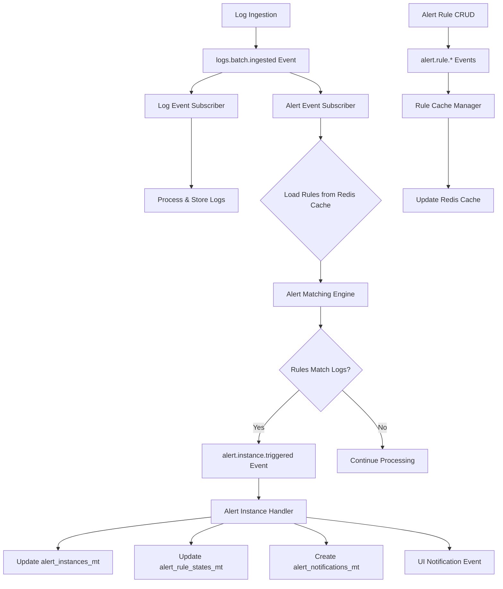

# Alert Matching System Implementation Plan

## Executive Summary

This document outlines the implementation plan for an event-driven alert matching system that processes log ingestion events, matches them against cached alert rules, and generates alert instances with notifications.

## Current State Analysis

### ✅ What We Have
- **Event-driven log ingestion** with `logs.batch.ingested` events
- **Alert rule CRUD operations** with database storage
- **Event system infrastructure** (publishers, subscribers, Kafka/RedPanda)
- **Database tables**: `alert_rules_mt`, `alert_instances_mt`, `alert_rule_states_mt`, `alert_notifications_mt`

### ❌ What's Missing
- **Alert rule caching** for performance (Redis integration needed)
- **Alert matching logic** to evaluate rules against ingested logs
- **Event-driven rule updates** for cache invalidation
- **Alert notification system** for UI and external channels
- **Modular event processing** architecture

## Architecture Overview

### Event Flow Design



### Performance Strategy

**Redis Cache for Alert Rules** ✅
- **Why**: Alert rules are read-heavy (every log ingestion) vs write-light (rare updates)
- **Structure**: `alerts:rules:{customer_id}` → JSON array of rules
- **TTL**: No expiration (event-driven invalidation)
- **Fallback**: Query database if cache miss

## Implementation Plan

### Phase 1: Infrastructure Setup (Week 1)

#### 1.1 Redis Integration

**File**: `/infra/docker/compose.yml`
```yaml
# Add Redis service
redis:
  image: redis:7-alpine
  container_name: logforge-redis
  ports:
    - "6379:6379"
  volumes:
    - redis_data:/data
  command: redis-server --appendonly yes
  networks:
    - logforge_network

volumes:
  redis_data:
```

**File**: `/apps/api/redis_client.py`
```python
import redis.asyncio as redis
from typing import Optional
import json
import structlog

class RedisClient:
    def __init__(self):
        self.redis: Optional[redis.Redis] = None
        self.logger = structlog.get_logger(__name__)
    
    async def connect(self):
        self.redis = redis.from_url("redis://redis:6379", decode_responses=True)
        await self.redis.ping()
        
    async def get_alert_rules(self, customer_id: str) -> List[Dict]:
        # Get cached alert rules for customer
        
    async def set_alert_rules(self, customer_id: str, rules: List[Dict]):
        # Cache alert rules for customer
        
    async def invalidate_customer_rules(self, customer_id: str):
        # Remove customer rules from cache
```

#### 1.2 Modular Event Processing Architecture

**Directory Structure**:
```
/apps/api/event_management/
├── __init__.py
├── processors/
│   ├── __init__.py
│   ├── log_processor.py           # Log ingestion processing
│   ├── alert_processor.py         # Alert matching and processing
│   ├── usage_processor.py         # Usage tracking processing
│   └── base_processor.py          # Base processor class
├── matchers/
│   ├── __init__.py
│   ├── threshold_matcher.py       # Threshold rule matching
│   ├── anomaly_matcher.py         # Anomaly detection matching
│   ├── pattern_matcher.py         # Pattern-based matching
│   └── base_matcher.py            # Base matcher interface
├── handlers/
│   ├── __init__.py
│   ├── alert_instance_handler.py  # Alert instance creation
│   ├── notification_handler.py    # Notification processing
│   └── state_handler.py           # Rule state management
└── utils/
    ├── __init__.py
    ├── cache_manager.py            # Redis cache operations
    ├── rule_evaluator.py           # Rule evaluation utilities
    └── event_utils.py              # Event helper functions
```

### Phase 2: Alert Rule Caching (Week 2)

#### 2.1 Cache Management Service

**File**: `/apps/api/event_management/utils/cache_manager.py`
```python
class AlertRuleCacheManager:
    """Manages Redis cache for alert rules with event-driven updates"""
    
    async def initialize_cache_from_db(self):
        # Load all alert rules from database into Redis
        
    async def get_customer_rules(self, customer_id: str) -> List[Dict]:
        # Get rules from cache, fallback to DB if needed
        
    async def update_rule_cache(self, customer_id: str, rule_data: Dict):
        # Update specific rule in cache
        
    async def invalidate_customer_cache(self, customer_id: str):
        # Remove customer's rules from cache
        
    async def handle_rule_event(self, event_type: str, rule_data: Dict):
        # Handle rule CRUD events for cache updates
```

#### 2.2 Rule Event Handlers

**File**: `/apps/api/event_management/handlers/rule_cache_handler.py`
```python
class RuleCacheEventHandler:
    """Handles alert rule events for cache management"""
    
    async def handle_rule_created(self, event: AlertRuleEvent):
        # Add new rule to cache
        
    async def handle_rule_updated(self, event: AlertRuleEvent):
        # Update rule in cache
        
    async def handle_rule_deleted(self, event: AlertRuleEvent):
        # Remove rule from cache
        
    async def handle_rule_enabled(self, event: AlertRuleEvent):
        # Enable rule in cache
        
    async def handle_rule_disabled(self, event: AlertRuleEvent):
        # Disable rule in cache
```

### Phase 3: Alert Matching Engine (Week 3)

#### 3.1 Base Matcher Interface

**File**: `/apps/api/event_management/matchers/base_matcher.py`
```python
from abc import ABC, abstractmethod
from typing import List, Dict, Any

class BaseAlertMatcher(ABC):
    """Base interface for alert rule matchers"""
    
    @abstractmethod
    async def matches(self, logs: List[Dict], rule: Dict[str, Any]) -> bool:
        """Check if logs match the alert rule"""
        pass
    
    @abstractmethod
    def get_rule_type(self) -> str:
        """Return the rule type this matcher handles"""
        pass
    
    async def extract_match_data(self, logs: List[Dict], rule: Dict) -> Dict:
        """Extract data about the match for alert instance"""
        pass
```

#### 3.2 Specific Matchers

**File**: `/apps/api/event_management/matchers/threshold_matcher.py`
```python
class ThresholdMatcher(BaseAlertMatcher):
    """Matches threshold-based alert rules (e.g., error count > 10)"""
    
    def get_rule_type(self) -> str:
        return "threshold"
    
    async def matches(self, logs: List[Dict], rule: Dict[str, Any]) -> bool:
        # Implement threshold matching logic
        # Example: Count logs matching criteria, compare to threshold
        pass
```

**File**: `/apps/api/event_management/matchers/pattern_matcher.py**
```python
class PatternMatcher(BaseAlertMatcher):
    """Matches pattern-based alert rules (e.g., specific log patterns)"""
    
    def get_rule_type(self) -> str:
        return "pattern"
    
    async def matches(self, logs: List[Dict], rule: Dict[str, Any]) -> bool:
        # Implement pattern matching logic
        # Example: Regex matching, keyword detection
        pass
```

#### 3.3 Alert Matching Orchestrator

**File**: `/apps/api/event_management/processors/alert_processor.py`
```python
class AlertProcessor:
    """Main alert processing engine"""
    
    def __init__(self):
        self.cache_manager = AlertRuleCacheManager()
        self.matchers = {
            'threshold': ThresholdMatcher(),
            'pattern': PatternMatcher(),
            'anomaly': AnomalyMatcher(),
            'frequency': FrequencyMatcher(),
            'absence': AbsenceMatcher(),
            'sequence': SequenceMatcher()
        }
    
    async def process_log_batch(self, event: LogIngestionEvent):
        """Process log batch for alert matching"""
        
        customer_id = event.customer_id
        logs = event.logs
        
        # Get alert rules for customer from cache
        rules = await self.cache_manager.get_customer_rules(customer_id)
        
        # Match each rule against logs
        for rule in rules:
            if not rule.get('is_enabled', False):
                continue
                
            matcher = self.matchers.get(rule['rule_type'])
            if not matcher:
                continue
                
            # Check if rule matches
            if await matcher.matches(logs, rule):
                # Create alert instance
                await self._create_alert_instance(rule, logs, matcher)
    
    async def _create_alert_instance(self, rule: Dict, logs: List[Dict], matcher: BaseAlertMatcher):
        """Create alert instance and trigger notifications"""
        
        # Check cooldown period
        if await self._is_in_cooldown(rule['id']):
            return
            
        # Create alert instance event
        alert_event = AlertInstanceTriggeredEvent(
            rule_id=rule['id'],
            customer_id=rule['customer_id'],
            severity=rule['severity'],
            trigger_data=await matcher.extract_match_data(logs, rule),
            triggered_at=datetime.now(timezone.utc)
        )
        
        # Publish alert instance event
        await self.event_publisher.publish_alert_instance_triggered(alert_event)
```

### Phase 4: Alert Instance Management (Week 4)

#### 4.1 Alert Instance Handler

**File**: `/apps/api/event_management/handlers/alert_instance_handler.py`
```python
class AlertInstanceHandler:
    """Handles alert instance creation and state management"""
    
    async def handle_alert_triggered(self, event: AlertInstanceTriggeredEvent):
        """Handle alert instance triggered event"""
        
        # 1. Create alert instance record
        instance_id = await self._create_alert_instance(event)
        
        # 2. Update rule state
        await self._update_rule_state(event.rule_id)
        
        # 3. Create notifications
        await self._create_notifications(event, instance_id)
        
        # 4. Publish UI notification event
        await self._publish_ui_notification(event, instance_id)
    
    async def _create_alert_instance(self, event: AlertInstanceTriggeredEvent) -> str:
        """Insert record into alert_instances_mt"""
        
    async def _update_rule_state(self, rule_id: str):
        """Update alert_rule_states_mt table"""
        
    async def _create_notifications(self, event: AlertInstanceTriggeredEvent, instance_id: str):
        """Create records in alert_notifications_mt"""
```

#### 4.2 Notification Handler

**File**: `/apps/api/event_management/handlers/notification_handler.py`
```python
class NotificationHandler:
    """Handles alert notifications to various channels"""
    
    async def handle_notification_request(self, event: NotificationRequestEvent):
        """Process notification request"""
        
        notification_type = event.notification_type
        
        if notification_type == 'ui':
            await self._send_ui_notification(event)
        elif notification_type == 'email':
            await self._send_email_notification(event)
        elif notification_type == 'slack':
            await self._send_slack_notification(event)
        elif notification_type == 'webhook':
            await self._send_webhook_notification(event)
    
    async def _send_ui_notification(self, event: NotificationRequestEvent):
        """Send real-time notification to UI via WebSocket"""
        # Integrate with UI WebSocket system
```

### Phase 5: Event System Integration (Week 5)

#### 5.1 Event Definitions

**File**: `/apps/api/events/events.py` (additions)
```python
@dataclass
class AlertInstanceTriggeredEvent(BaseEvent):
    event_type: str = "alert.instance.triggered"
    rule_id: str
    customer_id: str
    severity: str
    trigger_data: Dict[str, Any]
    triggered_at: datetime

@dataclass
class AlertRuleEvent(BaseEvent):
    event_type: str  # alert.rule.created, updated, deleted, enabled, disabled
    rule_id: str
    customer_id: str
    rule_data: Dict[str, Any]
    
@dataclass
class NotificationRequestEvent(BaseEvent):
    event_type: str = "notification.request"
    instance_id: str
    notification_type: str
    channel_config: Dict[str, Any]
    message_data: Dict[str, Any]
```

#### 5.2 Event Subscribers Update

**File**: `/apps/api/events/subscribers.py` (additions)
```python
class AlertEventSubscriber(BaseEventSubscriber):
    """Subscribes to log events for alert processing"""
    
    def __init__(self):
        super().__init__("alert-subscriber")
        self.alert_processor = AlertProcessor()
        
    async def get_subscribed_events(self) -> List[str]:
        return [
            "logs.batch.ingested",
            "alert.rule.created",
            "alert.rule.updated", 
            "alert.rule.deleted",
            "alert.rule.enabled",
            "alert.rule.disabled",
            "alert.instance.triggered"
        ]
    
    async def handle_event(self, event_type: str, event_data: Dict[str, Any]):
        if event_type == "logs.batch.ingested":
            await self.alert_processor.process_log_batch(event_data)
        elif event_type.startswith("alert.rule."):
            await self.alert_processor.handle_rule_event(event_type, event_data)
        elif event_type == "alert.instance.triggered":
            await self.alert_instance_handler.handle_alert_triggered(event_data)
```

#### 5.3 Publishers Update

**File**: `/apps/api/events/publishers.py` (additions)
```python
class AlertEventPublisher:
    """Publisher for alert-related events"""
    
    async def publish_alert_rule_created(self, rule_data: Dict[str, Any]):
        """Publish alert rule created event"""
        
    async def publish_alert_instance_triggered(self, alert_data: Dict[str, Any]):
        """Publish alert instance triggered event"""
        
    async def publish_notification_request(self, notification_data: Dict[str, Any]):
        """Publish notification request event"""
```

### Phase 6: Alert Rule CRUD Integration (Week 6)

#### 6.1 Alert Router Updates

**File**: `/apps/api/routers/alerts.py` (modifications)
```python
# Add event publishing to existing CRUD operations

@router.post("/rules")
async def create_alert_rule(rule_request: AlertRuleRequest, customer_id: str = MiddlewareTenant):
    """Create alert rule and publish event"""
    
    # Existing creation logic...
    rule_id = await alert_service.create_rule(rule_data)
    
    # NEW: Publish rule created event
    await alert_event_publisher.publish_alert_rule_created({
        "rule_id": rule_id,
        "customer_id": customer_id,
        "rule_data": rule_data,
        "event_type": "alert.rule.created"
    })
    
    return {"rule_id": rule_id, "status": "created"}

@router.put("/rules/{rule_id}")
async def update_alert_rule(rule_id: str, rule_request: AlertRuleRequest, customer_id: str = MiddlewareTenant):
    """Update alert rule and publish event"""
    
    # Existing update logic...
    await alert_service.update_rule(rule_id, rule_data)
    
    # NEW: Publish rule updated event
    await alert_event_publisher.publish_alert_rule_updated({
        "rule_id": rule_id,
        "customer_id": customer_id,
        "rule_data": rule_data,
        "event_type": "alert.rule.updated"
    })

# Similar for delete, enable, disable operations...
```

## Database Schema Updates

### Table Modifications

#### alert_instances_mt (already exists)
```sql
-- No changes needed, current schema is sufficient
CREATE TABLE IF NOT EXISTS alert_instances_mt (
    id String,
    rule_id String,
    status Enum8('triggered' = 1, 'acknowledged' = 2, 'resolved' = 3, 'suppressed' = 4),
    triggered_at DateTime64(3),
    resolved_at Nullable(DateTime64(3)),
    acknowledged_by Nullable(String),
    acknowledged_at Nullable(DateTime64(3)),
    trigger_data String, -- JSON blob with trigger details
    resolution_data Nullable(String), -- JSON blob with resolution details
    escalation_level UInt8 DEFAULT 0,
    next_escalation Nullable(DateTime64(3)),
    customer_id String
) ENGINE = MergeTree()
PARTITION BY toYYYYMM(triggered_at)
ORDER BY (customer_id, rule_id, triggered_at)
SETTINGS index_granularity = 8192;
```

#### alert_rule_states_mt (already exists)
```sql
-- No changes needed, current schema is sufficient
CREATE TABLE IF NOT EXISTS alert_rule_states_mt (
    rule_id String,
    last_evaluation DateTime64(3),
    last_trigger Nullable(DateTime64(3)),
    evaluation_count UInt64 DEFAULT 0,
    trigger_count UInt64 DEFAULT 0,
    consecutive_failures UInt32 DEFAULT 0,
    state_data String, -- JSON blob for rule-specific state
    created_at DateTime64(3) DEFAULT now64(3),
    updated_at DateTime64(3) DEFAULT now64(3),
    customer_id String
) ENGINE = ReplacingMergeTree(updated_at)
PARTITION BY toYYYYMM(created_at)
ORDER BY (customer_id, rule_id)
SETTINGS index_granularity = 8192;
```

#### alert_notifications_mt (already exists)
```sql
-- No changes needed, current schema is sufficient
CREATE TABLE IF NOT EXISTS alert_notifications_mt (
    id String,
    alert_event_id String,
    channel_id String,
    notification_type Enum8('email' = 1, 'slack' = 2, 'webhook' = 3, 'pagerduty' = 4),
    status Enum8('pending' = 1, 'sent' = 2, 'failed' = 3, 'delivered' = 4),
    sent_at Nullable(DateTime64(3)),
    delivery_attempts UInt8 DEFAULT 0,
    error_message Nullable(String),
    customer_id String,
    created_at DateTime64(3) DEFAULT now64(3)
) ENGINE = MergeTree()
PARTITION BY (customer_id, toYYYYMM(created_at))
ORDER BY (customer_id, alert_event_id, created_at)
SETTINGS index_granularity = 8192;
```

### Remove Unused Table

#### alert_events_mt ❌ **REMOVE**
```sql
-- This table is redundant with alert_instances_mt
-- Can be safely removed as suggested
DROP TABLE IF EXISTS alert_events_mt;
```

## Redis Cache Structure

### Cache Keys and Data Structure

```redis
# Alert rules for a customer
alerts:rules:{customer_id} → JSON array of rule objects

# Example:
alerts:rules:tenant-123 → [
  {
    "id": "rule-456",
    "name": "High Error Rate",
    "rule_type": "threshold", 
    "condition_config": {"threshold": 10, "field": "level", "value": "error"},
    "severity": "high",
    "is_enabled": true,
    "cooldown_minutes": 5,
    "notification_channels": ["slack-123", "email-456"]
  },
  // ... more rules
]

# Rule cooldown tracking
alerts:cooldown:{rule_id} → timestamp (TTL-based)

# Cache metadata
alerts:cache:metadata → {
  "last_updated": "2024-01-01T12:00:00Z",
  "total_customers": 150,
  "total_rules": 1247
}
```

## Performance Considerations

### Caching Strategy
- **Cache Hit Rate Target**: >95%
- **Cache Invalidation**: Event-driven (immediate consistency)
- **Fallback Strategy**: Database query on cache miss
- **Memory Usage**: ~1MB per 1000 rules (estimated)

### Alert Processing Performance
- **Target Latency**: <100ms from log ingestion to alert evaluation
- **Throughput**: Support 10,000+ logs/second with alert evaluation
- **Batching**: Process logs in batches to reduce Redis queries

## Testing Strategy

### Unit Tests
- Alert matcher logic for each rule type
- Cache manager operations  
- Event handler functionality
- Rule evaluation performance

### Integration Tests
- End-to-end alert flow (log → match → notification)
- Redis cache invalidation scenarios
- Event system integration
- Database consistency checks

### Performance Tests
- Alert matching throughput under load
- Redis cache performance
- Memory usage validation
- Latency measurements

## Deployment Considerations

### Redis Setup
- **Persistence**: Enable AOF for durability
- **Memory**: Allocate 512MB-1GB for alert rules cache
- **Clustering**: Single instance initially, cluster for scale
- **Monitoring**: Redis metrics and cache hit rates

### Monitoring & Alerting
- Cache hit/miss rates
- Alert processing latency
- Event queue depth
- Rule evaluation errors

## Success Metrics

### Performance Targets
- **Alert Latency**: <5 seconds from log ingestion to UI notification
- **Cache Hit Rate**: >95%
- **Alert Accuracy**: <1% false positives
- **System Throughput**: 10,000+ events/second

### Business Metrics
- **Alert Response Time**: Faster incident detection
- **Resource Usage**: <10% CPU overhead for alert processing
- **User Experience**: Real-time alert notifications

## Migration Strategy

### Phase 1: Infrastructure (Week 1)
1. Deploy Redis container
2. Implement basic cache manager
3. Test Redis connectivity

### Phase 2: Core Matching (Weeks 2-3)
1. Implement base matcher interfaces
2. Build threshold and pattern matchers
3. Add cache integration

### Phase 3: Event Integration (Weeks 4-5)  
1. Update event subscribers and publishers
2. Integrate with existing alert CRUD
3. Test end-to-end flow

### Phase 4: Production Ready (Week 6)
1. Add monitoring and metrics
2. Performance testing and optimization
3. Documentation and runbooks

This plan provides a scalable, event-driven alert matching system that leverages Redis caching for high performance while maintaining clean separation of concerns through modular architecture.