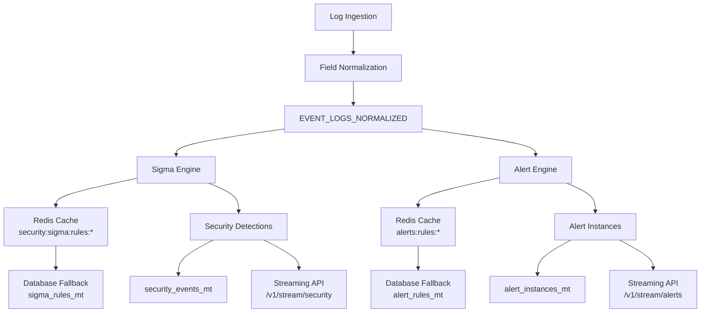

# Sigma & Alert Engine Architecture

## Overview

Logforge implements a high-performance, event-driven security detection and alerting system using two complementary engines:

- **Sigma Engine**: Real-time security detection using industry-standard Sigma rules
- **Alert Engine**: Threshold-based alerting with advanced aggregations and notifications

Both engines share a common architecture pattern:
- **Redis caching** for sub-millisecond rule lookups
- **Event-driven processing** for real-time detection
- **Per-customer isolation** with on-demand rule loading
- **Database fallback** for reliability

## Architecture Overview



## Sigma Engine

### Purpose
The Sigma Engine provides real-time security detection using industry-standard Sigma rules. It evaluates normalized logs against security patterns to detect threats, attacks, and suspicious activities.

### Key Features
- **Industry Standard**: Uses standard Sigma rule format (YAML-based)
- **Real-time Detection**: Event-driven processing with <10ms latency
- **MITRE ATT&CK Integration**: Maps detections to attack techniques
- **Generic Rules**: Flexible logsource matching works across environments
- **Field Mapping**: Supports diverse log formats via comprehensive field mapping

### Architecture

#### 1. Rule Storage & Caching
```
Redis Keys:
- security:sigma:rules:{customer_id}     # Customer-specific rules
- security:sigma:default:rules           # Default rules for all customers

Database Tables:
- sigma_rules_mt                         # Master rule storage
- sigma_rule_instances_mt               # Rule instances/copies
```

#### 2. Event Flow
```
1. EVENT_LOGS_NORMALIZED received
2. Extract customer_id from event
3. Get rules from Redis cache: security:sigma:rules:{customer_id}
4. If cache miss → fallback to database via SigmaRuleCache
5. Evaluate normalized logs against Sigma rules
6. Generate SecurityDetection objects for matches
7. Publish security.detection.triggered events
8. Store detections in security_events_mt table
```

#### 3. Rule Evaluation Process
```python
# Sigma Engine Core Logic
async def evaluate_logs_against_rules(logs, sigma_rules, customer_id, logs_normalized=True):
    matches = []
    
    for rule in sigma_rules:
        for log_entry in logs:
            # 1. Field mapping already applied (logs_normalized=True)
            # 2. No strict logsource matching (generic rules)
            # 3. Evaluate Sigma rule conditions against log
            if evaluate_sigma_conditions(rule, log_entry):
                detection = SecurityDetection(
                    id=str(uuid.uuid4()),
                    rule_id=rule['id'],
                    customer_id=customer_id,
                    title=f"Security Detection: {rule['title']}",
                    severity=rule['level'],
                    attack_techniques=rule.get('tags', [])
                )
                matches.append(detection)
    
    return matches
```

#### 4. Detection Data Structure
```python
@dataclass
class SecurityDetection:
    id: str                          # Unique detection ID
    rule_id: str                     # Sigma rule ID that triggered
    customer_id: str                 # Customer identifier
    title: str                       # Detection title
    description: str                 # Detection description
    severity: SecuritySeverity       # low/medium/high/critical
    attack_techniques: List[str]     # MITRE ATT&CK technique IDs
    matched_fields: Dict[str, Any]   # Fields that matched rule conditions
    timestamp: datetime              # When detection occurred
    status: str                      # triggered/resolved/acknowledged
```

### Sigma Rule Format
```yaml
title: Failed Login Detection
id: ec748e81-1b2a-401d-98da-4df4ae758114
level: medium
description: Detects failed login attempts
author: Security Team
date: 2025/01/01
tags:
    - attack.credential_access
    - attack.t1110
detection:
    selection:
        event_type: 'login_failed'
        status_code: [401, 403]
    condition: selection
falsepositives:
    - Legitimate failed logins
```

### Performance Characteristics
- **Latency**: <5ms per rule evaluation
- **Throughput**: 100K+ logs/second per customer
- **Cache Hit Rate**: >95% for active customers
- **Scalability**: Linear scaling with customer count

## Alert Engine

### Purpose
The Alert Engine provides threshold-based alerting with advanced aggregations, time windows, and multi-channel notifications. It detects anomalies, trends, and operational issues.

### Key Features
- **Threshold Detection**: Count, average, sum, min/max aggregations
- **Time Windows**: Flexible evaluation periods (1m, 5m, 1h, etc.)
- **Multi-Channel Notifications**: Email, Slack, webhooks, PagerDuty
- **Rate Limiting**: Prevents alert spam with cooldowns
- **Advanced Conditions**: Complex logical expressions

### Architecture

#### 1. Rule Storage & Caching
```
Redis Keys:
- alerts:rules:{customer_id}             # Customer alert rules

Database Tables:
- alert_rules_mt                         # Master rule storage
- alert_instances_mt                     # Alert instances/history
```

#### 2. Event Flow
```
1. evaluate_customer_logs(customer_id, logs) called
2. Get rules from Redis cache: alerts:rules:{customer_id}
3. If cache miss → fallback to database via AlertRuleCache
4. Evaluate logs against alert rule conditions
5. Check thresholds, time windows, and aggregations
6. Generate AlertInstance objects for triggered rules
7. Send notifications via configured channels
8. Store alerts in alert_instances_mt table
```

#### 3. Rule Evaluation Process
```python
# Alert Engine Core Logic
async def evaluate_customer_logs(customer_id: str, logs: List[Dict]) -> List[AlertInstance]:
    # 1. Get rules from cache (on-demand loading)
    customer_rules = await self.get_customer_rules(customer_id)
    
    triggered_alerts = []
    for rule in customer_rules:
        if not rule.enabled:
            continue
            
        # 2. Check if rule should trigger based on logs
        if await self._should_trigger_alert_for_logs(rule, logs):
            # 3. Create alert instance
            alert = await self._trigger_alert_for_logs(rule, logs)
            triggered_alerts.append(alert)
            
            # 4. Send notifications
            await self._send_notifications(alert, rule)
    
    return triggered_alerts
```

#### 4. Alert Rule Structure
```python
@dataclass
class AlertRule:
    rule_id: str                     # Unique rule identifier
    name: str                        # Human-readable name
    description: str                 # Rule description
    customer_id: str                 # Customer identifier
    severity: AlertSeverity          # critical/high/medium/low
    rule_type: AlertRuleType         # threshold/anomaly/pattern
    enabled: bool                    # Rule active status
    conditions: List[AlertCondition] # Evaluation conditions
    filters: List[QueryFilter]       # Log filters
    notification_channels: List[str] # Channel IDs for notifications
    evaluation_interval: str         # How often to check (1m, 5m, etc.)
    cooldown_period: str            # Prevent duplicate alerts
    max_alerts_per_hour: int        # Rate limiting
```

#### 5. Alert Condition Types
```python
@dataclass
class AlertCondition:
    field: str                       # Log field to evaluate
    operator: ThresholdOperator      # gt/gte/lt/lte/eq/ne
    value: Union[str, int, float]    # Threshold value
    aggregation: str                 # count/avg/sum/min/max
    time_window: str                # Evaluation window (5m, 1h, etc.)

# Example conditions:
conditions = [
    AlertCondition(
        field="status_code",
        operator="eq",
        value=500,
        aggregation="count",
        time_window="5m"
    )  # Trigger if >10 HTTP 500 errors in 5 minutes
]
```

### Alert Rule Example
```json
{
    "name": "High Error Rate",
    "description": "Detects when error rate exceeds threshold",
    "severity": "critical",
    "rule_type": "threshold",
    "conditions": [
        {
            "field": "status_code",
            "operator": "gte",
            "value": 10,
            "aggregation": "count",
            "time_window": "5m"
        }
    ],
    "filters": [
        {
            "field": "status_code",
            "operator": "gte",
            "value": 500
        }
    ],
    "notification_channels": ["email-ops", "slack-alerts"],
    "evaluation_interval": "1m",
    "cooldown_period": "10m",
    "max_alerts_per_hour": 5
}
```

### Performance Characteristics
- **Latency**: <10ms per rule evaluation
- **Throughput**: 50K+ logs/second per customer
- **Cache Hit Rate**: >95% for active customers
- **Notification Delay**: <1s for immediate channels

## Shared Infrastructure

### Redis Caching Strategy

Both engines use identical caching patterns:

```python
# Cache Structure
Redis Keys:
- security:sigma:rules:{customer_id}     # Sigma rules
- security:sigma:default:rules           # Default Sigma rules
- alerts:rules:{customer_id}             # Alert rules

# Cache Operations
async def get_customer_rules(customer_id: str):
    # 1. Try Redis cache first
    cached_rules = await redis.get(f"security:sigma:rules:{customer_id}")
    if cached_rules:
        return json.loads(cached_rules)
    
    # 2. Fallback to database
    db_rules = await database.get_rules(customer_id)
    
    # 3. Cache for future requests
    await redis.setex(f"security:sigma:rules:{customer_id}", 3600, json.dumps(db_rules))
    
    return db_rules
```

### Field Mapping System

Both engines benefit from the field normalization system:

```yaml
# field_mapping.yml
field_mappings:
  src_ip:
    - "source_ip"
    - "client_ip"
    - "remote_ip"
  
  user:
    - "username"
    - "user_name"
    - "userid"
    
  status_code:
    - "http_status"
    - "response_code"
    - "status"

# Ensures rules work across diverse log formats
```

### Event-Driven Processing

Both engines consume the same normalized log events:

```python
# Event Flow
EVENT_LOGS_NORMALIZED → {
    "customer_id": "uuid",
    "normalized_logs": [...],
    "field_mapping_applied": true,
    "log_count": 100
}

# Sigma Engine Handler
async def handle_normalized_logs(event_data):
    customer_id = event_data['customer_id']
    logs = event_data['normalized_logs']
    
    # Get Sigma rules from cache
    sigma_rules = await sigma_cache.get_customer_rules(customer_id)
    
    # Evaluate and detect
    detections = await evaluate_logs_against_rules(logs, sigma_rules, customer_id)

# Alert Engine Handler  
async def handle_normalized_logs(event_data):
    customer_id = event_data['customer_id'] 
    logs = event_data['normalized_logs']
    
    # Evaluate customer logs on-demand
    alerts = await alert_engine.evaluate_customer_logs(customer_id, logs)
```

## Performance Optimization

### Cache Management
- **TTL**: 1 hour for rule cache entries
- **Invalidation**: Automatic on rule CRUD operations
- **Preloading**: Warm cache for active customers
- **Memory**: Redis cluster for horizontal scaling

### Database Optimization
- **Partitioning**: Tables partitioned by customer_id and date
- **Indexing**: Optimized for rule queries and log searches
- **Connection Pooling**: Async connection management
- **Query Optimization**: Prepared statements and query plans

### Monitoring & Metrics
```python
# Key Performance Indicators
metrics = {
    "cache_hit_rate": 0.95,           # >95% target
    "rule_evaluation_latency_p50": 5, # <10ms target
    "detection_latency_p95": 15,      # <20ms target
    "alerts_per_second": 1000,        # Throughput
    "false_positive_rate": 0.02       # <5% target
}
```

## API Integration

### Streaming APIs

Real-time event streaming for both engines:

```bash
# Security detections stream
curl -N -H "Authorization: Bearer ${JWT_TOKEN}" \
     -H "X-Customer-ID: customer-uuid" \
     -H "Accept: text/event-stream" \
     "http://localhost:8000/v1/stream/security"

# Alert instances stream  
curl -N -H "Authorization: Bearer ${JWT_TOKEN}" \
     -H "X-Customer-ID: customer-uuid" \
     -H "Accept: text/event-stream" \
     "http://localhost:8000/v1/stream/alerts"
```

### Management APIs

Both engines expose full CRUD operations:

```python
# Sigma Rules
POST   /v1/security/sigma/rules        # Create rule
GET    /v1/security/sigma/rules        # List rules
PUT    /v1/security/sigma/rules/{id}   # Update rule
DELETE /v1/security/sigma/rules/{id}   # Delete rule

# Alert Rules
POST   /v1/alerts/rules                # Create rule
GET    /v1/alerts/rules                # List rules  
PUT    /v1/alerts/rules/{id}           # Update rule
DELETE /v1/alerts/rules/{id}           # Delete rule

# Detections & Alerts
GET    /v1/security/detections         # List security detections
GET    /v1/alerts/instances            # List alert instances
POST   /v1/alerts/instances/{id}/ack   # Acknowledge alert
POST   /v1/alerts/instances/{id}/resolve # Resolve alert
```

## Troubleshooting

### Common Issues

1. **Rules Not Triggering**
   - Check rule is enabled and not in cooldown
   - Verify field mapping covers log format
   - Confirm customer has active subscription
   - Check Redis cache connectivity

2. **High Latency**
   - Monitor cache hit rates
   - Check database connection pool
   - Verify rule complexity and count
   - Review log volume and batching

3. **False Positives**
   - Tune rule thresholds and conditions
   - Adjust time windows and aggregations
   - Add more specific filters
   - Review field mapping accuracy

4. **Missing Detections**
   - Verify log normalization quality
   - Check rule condition logic
   - Confirm field mapping completeness
   - Review rule priorities and ordering

### Debugging Tools

```python
# Rule Testing
POST /v1/security/sigma/rules/{id}/test
POST /v1/alerts/rules/{id}/test

# Performance Metrics
GET /v1/admin/metrics/sigma-engine
GET /v1/admin/metrics/alert-engine

# Cache Status
GET /v1/admin/cache/status
GET /v1/admin/cache/rules/{customer_id}
```

## Future Enhancements

### Planned Features
- **Machine Learning Integration**: Anomaly detection and adaptive thresholds
- **Multi-Rule Correlation**: Complex event processing across multiple rules
- **Dynamic Rule Generation**: AI-assisted rule creation from patterns
- **Enhanced Visualization**: Real-time dashboards and investigation tools
- **Advanced Notifications**: Rich formatting and escalation policies

### Scalability Roadmap
- **Horizontal Scaling**: Distributed rule evaluation across multiple nodes
- **Edge Processing**: Customer-deployed rule engines for data locality
- **Stream Processing**: Apache Kafka Streams for real-time aggregations
- **Global Distribution**: Multi-region deployment with rule synchronization

---

This architecture provides a robust, scalable foundation for security detection and alerting that can handle enterprise-scale log volumes while maintaining sub-10ms response times and high availability.